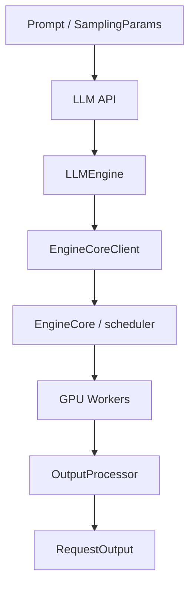
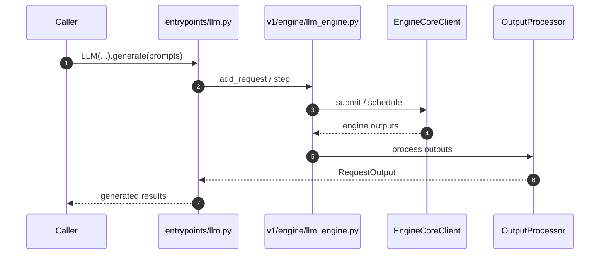

# vLLM｜生产级大模型推理与持续批处理

## 一句话定义

vLLM 面向多模型、多请求的高吞吐 inference serving，早期核心贡献包括 PagedAttention；本项目在该知识库已有 `painode-103-vllm.md` 清单实体，应直接升级为完整项目详情，不能另建重复页。
**索引身份**：本页沿用已有 `painode-103-vllm.md`，保留旧页面 URL 与清单入口，不创建第二个 vLLM 实体。

## 英文缩写速查

| 缩写 | 英文全称 | 简要说明 |
|---|---|---|
| LLM | Large Language Model | 本页服务的自回归语言模型类型 |
| KV | Key-Value Cache | 用于增量推理的历史注意力键值缓存 |
| GPU | Graphics Processing Unit | 计算和 kernel 执行的硬件 |
| CI | Continuous Integration | 贡献审核时运行的自动验证 |
| PR | Pull Request | 提交测试、代码变更、性能证据的上游审查单 |

## 为什么重要

vLLM 面向多模型、多请求的高吞吐 inference serving，早期核心贡献包括 PagedAttention；本项目在该知识库已有 `painode-103-vllm.md` 清单实体，应直接升级为完整项目详情，不能另建重复页。

## 核心原理

离线 Python `vllm/entrypoints/llm.py` 中 `LLM` 通过 `vllm/v1/engine/llm_engine.py` 提交请求，V1 Engine 使用 InputProcessor / OutputProcessor 与 EngineCoreClient 协调引擎，实际调度和 GPU worker 不应简化成单个函数。在线 HTTP 路径与离线 LLM 入口不同。

### 流程总览

## 源码运行时序图

**已核对执行入口：** 官方离线入口 `from vllm import LLM, SamplingParams`；代码 `vllm/entrypoints/llm.py` 使用 V1 LLMEngine（见 import），V1 入口可在 `vllm/v1/engine/llm_engine.py` 找到 EngineCoreClient 与处理器边界。 此图仅覆盖所列实际入口的主干路径，不代表全部异步/多卡细节。

## 工程实践

- **可执行入口：** 官方离线入口 `from vllm import LLM, SamplingParams`；代码 `vllm/entrypoints/llm.py` 使用 V1 LLMEngine（见 import），V1 入口可在 `vllm/v1/engine/llm_engine.py` 找到 EngineCoreClient 与处理器边界。
- **贡献切口：** 阅读官方 `docs/contributing/README.md` 的 good-first-issues、Python 开发环境和 pytest 流程；只修改 Python 代码可用预编译二进制；提交具体回归用例、失败前与修复后结果。
- **回归要求：** 说明 GPU/驱动/依赖、模型版本、输入与输出 token 长度分布、预热次数与 batch/并发；保留正确性对拍，再报告 tokens/s、TTFT 或 TPOT（按服务模式选择）。
- **开源状态：** 官方 [GitHub 仓库](https://github.com/vllm-project/vllm) 与 README/源码可访问；对特殊 GPU kernel、训练与数据等子组件是否完全开放，不能从主页自动推断。

## 局限与风险

生产级栈的模型支持/CI 分支变化快；一个小 PR 可能被分配到 GPU/多平台测试。既有 Physical AI 资源清单编号 103/384 只是历史索引，不是当前版本或技术排名。

- **视频事实界限：** “学生 / 1–2 年 / 资深”是用户提供的视频观点，不是上游官方招聘标准；未验证作者或 Discord 时间。别把开源贡献与 PR 合并结果视为确定承诺。

## 关联页面

- [LLM 推理显存估算](../concepts/llm-inference-vram-estimation.md)
- [Nano-vLLM｜面向学习的极简 LLM 推理引擎](./nano-vllm.md)
- [FlashInfer｜跨框架 GPU 推理 Kernel 库](./flashinfer.md)
- [SGLang｜大规模语言与多模态模型推理服务框架](./sglang.md)
- [TensorRT-LLM｜NVIDIA 大模型推理运行时与 LLM API](./tensorrt-llm.md)

## 参考来源

- [既有 Physical AI 清单资源 #103](../../sources/repos/pai_awesome_resource_103_vllm.md) — 保留本仓此前收录的策展来源与原有 URL 身份。

- [vLLM｜生产级大模型推理与持续批处理：一手文档和代码核验归档](../../sources/repos/vllm-official-contribution.md)
- [六项目对照与原视频证据边界](../../sources/repos/llm-inference-open-source-contribution-primary-docs-2026-11.md)
- [官方 README](https://github.com/vllm-project/vllm/blob/main/README.md)

## 推荐继续阅读

- [官方仓库与最新文档](https://github.com/vllm-project/vllm)
