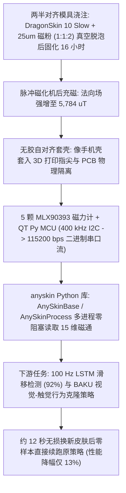
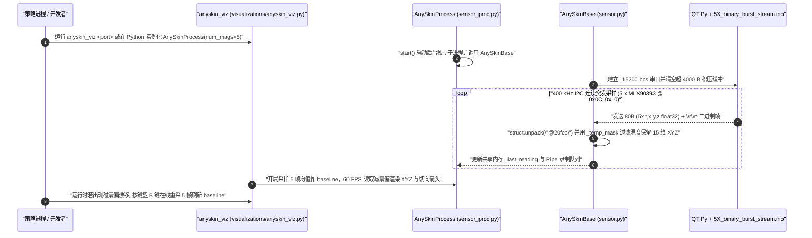

# AnySkin：即插即用磁触觉皮肤（ICRA 2025 · arXiv:2409.08276）

## 一句话定义

**英文全称 / 原始题目**：*AnySkin: Plug-and-play Skin Sensing for Robotic Touch*（`arXiv:2409.08276v3`，ICRA 2025，DOI: `10.1109/ICRA55743.2025.11128638`，NYU / CMU / Columbia University / Meta AI Research）。

**AnySkin** 是一种在 ReSkin 五磁力计电路基础上**物理隔离传感电子与交互表皮**的可更换磁触觉皮肤系统：借助无外场固化、超细 `25 μm` 磁粉、固化后脉冲充磁与无胶自对齐套壳结构，把触觉从“破损即需重新采集和重训的一次性标定资产”改造为**像手机壳一样 12 秒无损换肤、且学习策略可零样本跨皮肤实例迁移**的模块化硬件层。

## 英文缩写速查

| 缩写 | 英文全称 | 简要说明 |
|---|---|---|
| **AnySkin** | Plug-and-play Skin Sensing for Robotic Touch | 本文提出的低成本、自对齐可更换磁触觉传感器系统 |
| **PM** | Pulse Magnetizer | 脉冲磁化机，用于在弹性体固化后产生高强度稳定磁场 |
| **FP** | Finer Particles | 25 um 超细磁粉（MQFP-15-7），抑制固化沉降以保证批间一致性 |
| **SA** | Self-Aligning | 无胶自对齐模具与套壳结构，消除人工粘贴错位引起的信号漂移 |
| **VBTS** | Vision-Based Tactile Sensing | 光学视觉触觉（如 DIGIT / GelSight）；本文作横向替换与迁移对照 |
| **BAKU** | Efficient Transformer for Multi-Task Policy Learning | 本文视觉-触觉行为克隆（BC）验证所采用的多模态动作分块策略网络 |

## 为什么重要

1. **攻克软触觉传感器易磨损与跨实例漂移的双重死结**：柔性弹性体在与环境高频接触交互中极易磨损开裂，而传统光学触觉（VBTS）与早代磁皮肤（ReSkin）即使更换新凝胶或新表皮，因个体工艺波动与装配错位，原有学习策略往往彻底失效。AnySkin 首次在未做额外在线重新标定的前提下，实测**将更换皮肤后的策略性能零样本保持在 13% 降幅以内**（同期 ReSkin 暴跌 43% 退化至盲视水平）。
2. **用制备工艺与几何解耦取代软件端繁重域适应**：证明通过工艺侧控制雷诺数防沉降、后充磁提升磁场强度（Fz 均值从 `283 μT` 提至 `5,784 μT`）并拉开皮肤与 PCB 物理间隙，即可从源头把跨实例归一化标准差压低至 `0.12–0.15`。
3. **打通开源制备、驱动流与学习验证闭环**：不仅开源基于 5 颗 `MLX90393` 磁力计的高频采集 SDK（`pip install anyskin`，MIT License）及两半式模具/CAD 生成工具，还在滑移检测（92%）与精密插拔任务上验证了这套 15 维低维磁信号的工程实用价值。

## 核心原理

### 核心信息

| 维度 | 核心参数与出处（核对自 `arXiv:2409.08276v3` 与 `raunaqbhirangi/anyskin`） |
|---|---|
| **研发机构与作者** | NYU（Lerrel Pinto 组）, CMU, Columbia University, Meta AI Research；一作/通讯：Raunaq Bhirangi |
| **材料配比与工艺** | Smooth-On **DragonSkin 10 Slow** + **Magnequench MQFP-15-7（25 μm）**，配比 `1:1:2`（聚合物 A/B/磁粉）；真空脱泡（29 mmHg/in 10 min）并静置固化 **16 h**，随后脉冲磁化；默认厚度 **2 mm** |
| **硬件传感栈** | 5 颗 **MLX90393** 三轴磁力计（I2C 地址 `0x0C–0x10`，400 kHz）+ Adafruit QT Py MCU（115200 bps 二进制串口流）；输出 **5 × 3 轴 = 15 维**磁通信号 |
| **适配机器人平台** | xArm 7、Kinova Jaco + OnRobot RG-2、Franka、LEAP Hand、Dobb-E stick 等多种末端 |
| **开源状态（2026-11-14）** | **已开源**：驱动与可视化仓库 `raunaqbhirangi/anyskin`（MIT / Arduino Beerware）；2D/3D 模具与 CAD 文件托管于官方 [Google Drive](https://drive.google.com/drive/folders/1JOb_r0cT0t0BLju4XC6zboPppiXv8LDE) 与项目页 |

### 四项关键工艺与结构演进

1. **无外场固化 + 固化后脉冲磁化（+PM）**：ReSkin 在固化期间用永磁阵夹持，液态弹性体中的磁粉会沿磁感线不均匀聚集且受操作手法影响大；AnySkin 先静置 16 小时自然固化，再用脉冲磁化机强充磁，把法向磁场均强 `Bz` 从 `283 μT` 放大 **20 倍**至 `5,784 μT`，由此支持在表皮和脆弱磁力计电路之间保留安全物理隔离空腔，避免剪切载荷压毁 PCB。
2. **百倍细化磁粉粒度（+FP）**：将 ReSkin 使用的 `MQP-15-7 (-80 mesh)` 替换为粒径小约 **100 倍**的 **MQFP-15-7 (`25 μm`)**，颗粒在低雷诺数下不会在 16 小时固化窗口内沉底，既消除底面起粉脱落，又把跨实例归一化标准差从 ReSkin 的 `0.54 / 0.87` 降至 `0.21 / 0.12`。
3. **无胶、免螺丝自对齐套壳（+SA）**：摒弃易在剪切力下开胶的 Silpoxy 胶水与易撕裂的螺丝固定，利用两部件模具对齐导柱浇注出直接包裹 3D 打印三角形指尖的外套式表皮，把 `1 mm` 手工贴装错位导致的信号归一化离散度（ReSkin `1.38 / 1.43`）彻底压缩到 `0.10 / 0.07`。

### 流程总览

## 实验与评测

### 信号强度、一致性与替换便利性（Table I & II）

| 评价对象 / 演进阶段 | 平均信号强 `Bxy / Bz` (uT) | 跨 5 实例归一化标准差 `Bxy / Bz` | 1 mm 错位归一化标准差 `Bxy / Bz` | 非专家换肤耗时 (s) & 可复用 |
|---|---|---|---|---|
| **ReSkin（胶粘 / 螺丝基线）** | `1062 / 283` | `0.54 / 0.87` | `1.38 / 1.43` | 胶粘 `82±64`（否）/ 螺丝 `236±64`（是） |
| **+PM（加脉冲充磁）** | `1818 / 5212` | `0.34 / 0.12` | `0.25 / 0.11` | — |
| **+FP（加 25 um 细颗粒）** | `1602 / 5784` | `0.21 / 0.15` | `0.18 / 0.07` | — |
| **+SA（完整 AnySkin）** | 高强度物理隔离 | `0.12 / —` | **`0.10 / 0.07`** | **`12 ± 5 s`（完全无损复用）** |
| **DIGIT（商业参考指尖）** | 光学 RGB 像素帧 | 实例间静态基图色差大 | — | `58 ± 22 s`（是） |

### 滑移检测与跨皮肤实例策略学习（Table III）

- **纯触觉滑移检测**：在 Kinova Jaco + OnRobot RG-2 夹爪上以 **100 Hz** 采集 **40 个日常物体**（30 训练 / 10 未见测试，各 6 条轨迹），沿时间轴降采样 15 倍并求一阶差分喂入 **LSTM**，在未见物体上达到 **92%** 滑移判定准确率。
- **接触丰富精密操作与换肤零样本迁移**（xArm 7 + 4 相机 + Meta Quest 3 Open-Teach 采集每任务 **96 条**演示，训练 **BAKU** Transformer 策略预测未来 10 步动作，3 种子 × 10 回合 = 30 次评测）：
  - **Plug Insertion（插头插入）**：纯相机 `1.7±0.6`；AnySkin 原皮 **`6.7±1.5`** → 换皮 **`5.3±2.5`**（仅降 **13%**）；ReSkin 原皮 `6.0±1.7` → 换皮暴跌 **43%** 至 **`1.7±1.2`**（退化为瞎蒙）；标准 DIGIT 原皮 `2.3±0.6` → 换皮 `1.3±0.6`（Fig. 7 证实两颗 DIGIT 之间的静态像素差与交互期间最大信号变化相当）。
  - **Card Swiping（刷卡）**：纯相机 `2.0±1.0`；AnySkin 原皮 **`7.0±1.7`** → 换皮 **`6.3±0.6`**。
  - **USB Insertion（USB 接口插拔）**：纯相机 `1.7±1.2`；AnySkin 原皮 **`5.7±1.5`** → 换皮 **`3.0±1.0`**。三项任务换肤后综合平均降幅 **15.6%**，均大幅维持优于纯视觉对照策略。

### 与其他工作对比

| 路线 | 传感机制 | 空间维数与校准负担 | 跨实例策略迁移表现 |
|---|---|---|---|
| **AnySkin（本文）** | 5×3 轴分离磁弹性体 | 15 维磁通；无胶自对齐套壳、免重标定 | 3 项精密任务零样本换肤保留大部分性能（Plug 仅降 13%） |
| **ReSkin（CoRL 2021）** | 5×3 轴耦合磁皮肤 | 15 维磁通；胶粘/螺丝拆换耗时且错位敏感 | 换肤后 Plug Insertion 性能下跌 43% |
| **DIGIT / GelSight（VBTS）** | 内嵌相机拍弹性体形变 | 高分辨率图像（需强纹理/标记点及算法适应） | 未做标定或适配时跨实例色度/胶纹差异大（见 [Sparsh](./paper-sparsh.md) 与 [OmniTacTune](./paper-omnitactune-tactile-residual-adaptation.md)） |

### 核心结论

AnySkin 证实**硬件可替换性可以直接转化为学习策略的跨实例通用性**：通过“后脉冲充磁 + 25 um 微粉防沉降 + 物理隔离自对齐模具”，仅凭低维 15 通道磁信号即可在精密接触任务上显著压低换肤退化并降低长期维护成本。

## 源码运行时序图

[`raunaqbhirangi/anyskin`](https://github.com/raunaqbhirangi/anyskin)（`v1.0.0`）提供底层固件、采集 SDK 与实时可视化入口；注意本仓库聚焦传感数据流，**不包含**论文中的 LSTM 与 BAKU 策略训练脚本：

## 工程实践

1. **安装与权限准备**：推荐在传感器端主机执行 `pip install anyskin`；Linux 下接入 QT Py（通常为 `/dev/ttyACM0`）需授权读写（`sudo chmod a+rw /dev/ttyACM0` 或加入 `dialout` 组），通过 `anyskin_viz /dev/ttyACM0` 快速检验 5 颗芯片 XY 切向箭头和 Z 轴法向圈响应。
2. **实时策略切勿阻塞主控循环**：数据采集与控制闭环中应实例化 `AnySkinProcess(num_mags=5, port=...)` 而非阻塞的 `AnySkinBase`；高频策略读取共享内存 `last_reading` 或 `get_data(num_samples=1)`，离线演示录制则使用 `start_buffering()` 与 `get_buffer(pause_if_buffering=True)` 管道取回，无真实硬件做 CI 测试时可使用 `AnySkinDummy`（或设置 `allow_dummy_sensor=True`）。
3. **上电静止消零与运行中按 `B` 重置**：磁力计对地球磁场与周边工装稳态磁化极为敏感，如 `anyskin_viz.py` 所示，启动后务必在无接触状态下先取 `baseline` 差分；长时间作业或末端移动至新金属桌角后一旦发现零位偏置，可快速重采无接触样本更新零点基准。
4. **旧索引勘误**：部分早期综述文献曾误把本作 arXiv 记为 `2401.17695`，经原文核对**正确编号为 `2409.08276`**（ICRA 2025）。

## 常见误区与局限

- **外界磁场与铁磁性物体干扰**：核心局限之一——磁力计会被机械臂附近强磁铁、电磁制动器或大块铁磁性工件畸变磁场，未来需配合时序滤波去噪学习或在表皮背部集成小型法拉第/导磁屏蔽层。
- **空间纹理分辨率弱于 VBTS**：仅提供 5 个离散感测点共 15 维向量，虽然足够完成滑移时序判定与精密插拔力反馈，但无法提供类似 [GelSight](./painode-151-gelsight.md) / DIGIT 的微米级表面几何图像重建（见 [Vision-Based Tactile Intelligence 综述](./paper-vision-based-tactile-intelligence.md) 硬件谱系对比）。
- **批次与工艺敏感性 + 商业派生差异**：手工作业中的脱泡时间、DragonSkin 批次粘度或脉冲充磁电压偏差仍会影响跨批次一致度；此外市面上已有第三方商业套件（如部分电商渠道售卖的衍生强化版 AnySkin）与原作者开源 Google Drive 图纸并存，复现论文一致性指标前需核清膜厚、微粉型号（`MQFP-15-7 25 μm`）及电路对齐卡槽公差。
- **软件栈定位边界**：`raunaqbhirangi/anyskin` 仓库仅负责串口/微控制器通信及可视化工具链，不包含论文内用 **Open-Teach** 遥操采集、**LSTM** 滑移分类及 **BAKU** 策略微调的代码模块。

## 关联页面

- [tactile-sensing.md](../concepts/tactile-sensing.md) — 磁触觉与光学触觉传感器谱系总览
- [visuo-tactile-fusion.md](../concepts/visuo-tactile-fusion.md) — 视觉与低维磁触觉策略融合路线
- [contact-rich-manipulation.md](../concepts/contact-rich-manipulation.md) — 插拔与接触丰富精密任务场景
- [paper-sparsh.md](./paper-sparsh.md) — 视觉触觉跨传感器自监督表征路线对照
- [paper-sa-2507-09160-tactile-vla-unlocking-vision-language-action-mod.md](./paper-sa-2507-09160-tactile-vla-unlocking-vision-language-action-mod.md) — VLA 融合触觉力反馈对照
- [dataset-rct-robotic-contact-tactile.md](./dataset-rct-robotic-contact-tactile.md) — 光学触觉跨传感器个体留出 drop 问题实证
- [tactile-intelligence-nine-papers-map.md](../overview/tactile-intelligence-nine-papers-map.md) — 同批九篇触觉论文总览
- [sun-awesome-touch-technology-map.md](../overview/sun-awesome-touch-technology-map.md) — 触觉技术策展地图

## 参考来源

- [anyskin_reading_arxiv_2409_08276.md](../../sources/papers/anyskin_reading_arxiv_2409_08276.md) — `arXiv:2409.08276v3` 全文通读与实验数值核对档案
- [anyskin.md](../../sources/repos/anyskin.md) — `raunaqbhirangi/anyskin` 官方仓库源码与固件核对档案
- [anyskin_arxiv_2409_08276.md](../../sources/papers/anyskin_arxiv_2409_08276.md) — 原生论文信息归档
- [any-skin-github-io.md](../../sources/sites/any-skin-github-io.md) — 官方项目页归档
- [AnySkin 官方项目页](https://any-skin.github.io/) · [GitHub: raunaqbhirangi/anyskin](https://github.com/raunaqbhirangi/anyskin) · [arXiv:2409.08276](https://arxiv.org/abs/2409.08276)

## 推荐继续阅读

- 如果你在为自有平台挑触觉传感器，先对照 [dataset-rct-robotic-contact-tactile.md](./dataset-rct-robotic-contact-tactile.md) 了解光学触觉跨传感器换装掉点，再结合本文决定走“硬件一致化（AnySkin）”还是“表征自适应（[Sparsh](./paper-sparsh.md) / [OmniTacTune](./paper-omnitactune-tactile-residual-adaptation.md)）”；
- 需要搭建遥操采集与 BAKU 类策略闭环，结合 [vla.md](../methods/vla.md) 与 [contact-rich-manipulation.md](../concepts/contact-rich-manipulation.md) 落地。
