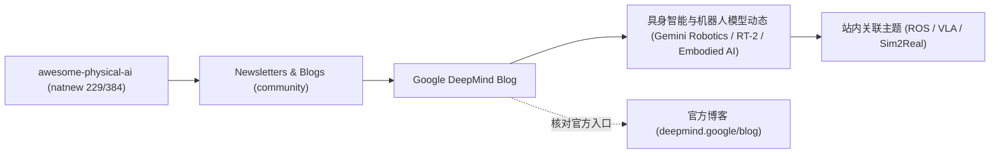

# Google DeepMind Blog

**Google DeepMind Blog** 收录于 awesome-physical-ai（natnew）**第 229/384** 条，分组 **Newsletters & Blogs**。本页是 **清单索引**：给出它在清单中的位置与官方入口，细节以官方文档 / 原文为准。

## 一句话定义

Gemini Robotics, RT-2, and embodied AI updates.

## 英文缩写速查

| 缩写 | 英文全称 | 简要说明 |
|------|----------|----------|
| PAI | Physical AI | 具身/物理智能策展主题 |
| ROS | Robot Operating System | 社区讨论高频中间件 |
| VLA | Vision-Language-Action | 开源具身讨论主线 |

## 为什么重要

- Gemini Robotics, RT-2, and embodied AI updates.
- 想横向对照同一分组的其他工作，可以从 [Physical AI 技术地图](../overview/awesome-physical-ai-technology-map.md) 逐条展开。
- 两份清单合并去重：同一条目只有这一页，出处见下方「参考来源」。

## 核心信息

| 字段 | 内容 |
|------|------|
| 编号 | 229/384 |
| 分组 | Newsletters & Blogs |
| 来源清单 | natnew |
| 主链接 | <https://deepmind.google/blog/> |

## 核心原理

Gemini Robotics, RT-2, and embodied AI updates.

该条目在 Physical AI 清单中的角色是 **community**，分组 **Newsletters & Blogs**。本页只给出清单里的问题设定与入口链接，不转载外部营销页或课程大纲。

这一页的用处是从清单跳到可核对的官方入口；机制细节、API 与版本以官方文档为准。

## 工程实践

| 字段 | 内容 |
|------|------|
| 官方入口 | <https://deepmind.google/blog/> |
| 开源核查 | 以项目页 / GitHub 实际链接为准（清单可能滞后） |
| 源码运行时序图 | **不适用**（非论文可运行训练仓，或未核 README 入口） |

使用前先确认链接指向的是官方仓 / 文档，而不是镜像或过期 fork。

## 局限与风险

- 不要把 Awesome 摘要当成完整方法证明或合规结论。
- 同名 GitHub 仓（natnew vs aichr）条目链接可能不同；以本页主链接与技术地图为准。
- 清单中的实验室 / 硬件 / 人物条目偶发链到错误 org，复现或引用前先打开官方页核对。

## 机制与架构图

## 关联页面

- [awesome-physical-ai（natnew）](../entities/awesome-physical-ai-natnew.md)
- [awesome-physical-ai（aichr）](../entities/awesome-physical-ai-aichr.md)
- [Physical AI 技术地图](../overview/awesome-physical-ai-technology-map.md)
- [Physical AI 策展清单对比](../comparisons/awesome-physical-ai-curated-lists.md)
- [Robotics Transformer（RT-1 / RT-2）](../methods/robotics-transformer-rt-series.md)：Google DeepMind 官方博客持续发布 RT-2 等代表性视觉-语言-动作策略的研究进展与技术解读。
- [VLA（Vision-Language-Action）](../methods/vla.md)：博客涵盖 Gemini Robotics 与通用具身模型动态，是追踪 VLA 路线演进的重要一手发布渠道。

## 参考来源

- [`sources/repos/pai_awesome_community_229_google-deepmind-blog.md`](../../sources/repos/pai_awesome_community_229_google-deepmind-blog.md) — 本条目策展摘录
- [`sources/repos/awesome-physical-ai-union-catalog.md`](../../sources/repos/awesome-physical-ai-union-catalog.md) — 双清单并集目录
- [sources/repos/awesome-physical-ai-natnew.md](../../sources/repos/awesome-physical-ai-natnew.md)
- [sources/repos/awesome-physical-ai-aichr.md](../../sources/repos/awesome-physical-ai-aichr.md)
- 主链接：<https://deepmind.google/blog/>

## 推荐继续阅读

- [natnew/awesome-physical-ai](https://github.com/natnew/awesome-physical-ai)
- [aichr/awesome-physical-ai](https://github.com/aichr/awesome-physical-ai)
- [原文 / 官方入口](https://deepmind.google/blog/)
