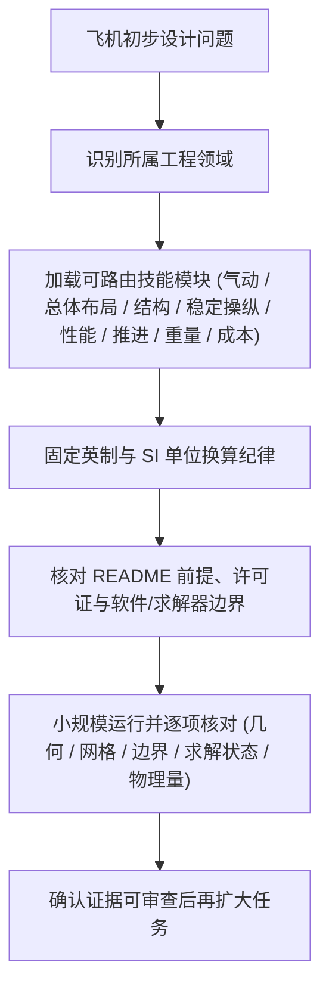

# AeroDesign Skill（Pan-Chenliang/AeroDesign_skill）

## 一句话定义

AeroDesign Skill（Pan-Chenliang/AeroDesign_skill）是将 Raymer《Aircraft Design: A Conceptual Approach》第六版知识组织为可路由技能文件，覆盖气动、总体布局、结构、稳定操纵、性能、推进、重量和成本。

## 英文缩写速查

| 缩写 | 英文全称 | 简要说明 |
|------|----------|----------|
| CFD | Computational Fluid Dynamics | 计算流体力学证据或流程 |
| CAD | Computer-Aided Design | 参数化工程几何设计 |
| AI | Artificial Intelligence | 辅助设计或研究的人工智能能力 |

## 为什么重要

对 CAE 自动化而言，代理能否稳定完成任务，取决于工程步骤是否清楚、工具边界是否明确、结果是否保留可审查证据。将 Raymer《Aircraft Design: A Conceptual Approach》第六版知识组织为可路由技能文件，覆盖气动、总体布局、结构、稳定操纵、性能、推进、重量和成本。

## 核心原理

**项目自身范围：** Aircraft conceptual design knowledge skill organized by engineering discipline.

**工作流：** 先识别飞机初步设计问题所属领域，再加载对应知识模块；固定英制/SI 换算纪律，减少跨模块单位错配。

## 工程实践

1. 从目标问题识别所需的 Skill、MCP、CLI 或软件接口，不把指导文件当成求解器。
2. 依照仓库 README 检查安装前提、软件/许可证、输入文件和输出证据。
3. 小规模运行并逐项核对几何、网格、边界、求解状态和物理量，再决定是否扩大任务。

文章所述的项目特征：将 Raymer《Aircraft Design: A Conceptual Approach》第六版知识组织为可路由技能文件，覆盖气动、总体布局、结构、稳定操纵、性能、推进、重量和成本。

## 机制与架构图

## 局限与风险

知识库辅助概念设计，不替代适航认证或高保真分析；教材内容及经验公式适用范围需要显式核对。

源码状态核验：该 GitHub 仓库于 2026-10-07 可公开访问。仓库 API 报告许可证为 MIT。 

## 关联页面

- [CAE / CFD 代理工具项目总览](../overview/cae-cfd-agent-skills-landscape.md)
- [Claude Engineering Skills](./soljourner-claude-engineering-skills.md)
- [Agent Skill Packaging · 智能体技能封装](../methods/agent-skill-packaging.md)：AeroDesign Skill 将飞机概念设计学科知识封装为按工程领域路由、可按需加载的智能体技能文件。
- [Engineering Simulation and Verification Workflow · 工程仿真建模与验证流程](../methods/engineering-simulation-workflow.md)：AeroDesign Skill 在概念设计阶段串联气动、结构与推进等参数约束，与工程仿真建模和物理量核对流程衔接。

## 参考来源

- [公众号文章原始资料归档](../../sources/blogs/wechat_cae_cfd_agent_skills_2026-10-07.md)
- [GitHub 仓库资料归档](../../sources/repos/pan-chenliang-aerodesign-skill.md)
- [Pan-Chenliang/AeroDesign_skill 官方仓库](<https://github.com/Pan-Chenliang/AeroDesign_skill>)

## 推荐继续阅读

- [项目 README](<https://github.com/Pan-Chenliang/AeroDesign_skill/blob/main/README.md>)