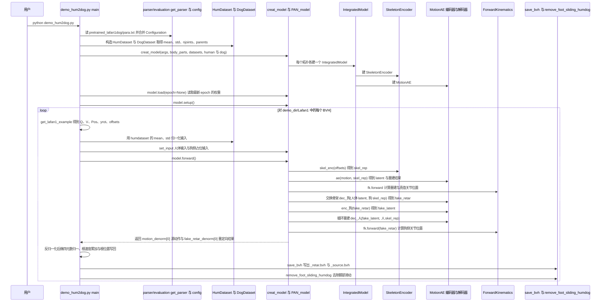

---

type: entity
tags: [repo, motion-retargeting, cross-embodiment, quadruped, humanoid, learning-based, nvidia]
status: complete
updated: 2026-06-08
summary: "hlcdyy/pan-motion-retargeting 实现按身体部位注意力的学习式重定向，支持双足↔四足及 Mixamo 跨结构映射（TVCG 2023）。"
related:
  - ../concepts/motion-retargeting.md
  - ../methods/neural-motion-retargeting-nmr.md
  - ./lafan1-dataset.md
  - ../concepts/character-animation-vs-robotics.md
sources:
  - ../../sources/repos/pan_motion_retargeting.md
---

# PAN Motion Retargeting

**pan-motion-retargeting**（<https://github.com/hlcdyy/pan-motion-retargeting>）是 TVCG 2023 论文 [*Pose-aware Attention Network for Flexible Motion Retargeting by Body Part*](https://arxiv.org/abs/2306.08006) 的官方实现，用 **按身体部位的注意力网络** 做 **灵活骨架重定向**，支持 **双足↔四足**（LaFAN1 dog set）与 **Mixamo 跨结构** 演示。

## 英文缩写速查

| 缩写 | 英文全称 | 简要说明 |
|------|----------|----------|
| PAN | Pose-aware Attention Network | 按部位加权的重定向网络 |
| BVH | Biovision Hierarchy | 输入动作格式 |
| Retargeting | Motion Retargeting | 跨骨架运动映射 |
| IL | Imitation Learning | 与机器人跟踪可衔接但本仓偏离线生成 |

## 为什么重要

- **跨形态重定向研究基线**：显式处理人–狗等不同拓扑，比纯 IK 更偏 **学习式分布映射**。
- **与机器人栈的关系**：输出多为动画骨架 BVH，进机器人前仍需物理筛选；可与 [NMR](../methods/neural-motion-retargeting-nmr.md) 等「学习式 + 物理修补」路线对照。

## 演示入口

- 人→狗：`python demo_hum2dog.py`（需 LaFAN1 dog BVH 与预训练权重）
- 狗→人：`python demo_dog2hum.py`
- Mixamo 互转：见 `pretrained_mixamo/demo`

## 源码运行时序图

入口：`python demo_hum2dog.py`（人体 → 狗骨架重定向，读取 `demo_dir/Lafan1`；反向入口为 `demo_dog2hum.py`，Mixamo 入口为 `demo_mixamo.py`，二者未画）

图依据：hlcdyy/pan-motion-retargeting@5a51d92，读过 README.md、demo_hum2dog.py、demo_dog2hum.py、demo_mixamo.py、models/__init__.py、models/architecture_humdog.py、models/Intergrated.py、models/networks.py、models/functions.py、models/base_model.py。

## 关联页面

- [Motion Retargeting](../concepts/motion-retargeting.md)
- [NMR](../methods/neural-motion-retargeting-nmr.md)
- [LaFAN1](./lafan1-dataset.md)
- [Character Animation vs Robotics](../concepts/character-animation-vs-robotics.md)

## 参考来源

- [pan-motion-retargeting 仓库归档](../../sources/repos/pan_motion_retargeting.md)
- 源码核对（2026-11-02）：hlcdyy/pan-motion-retargeting@5a51d92，读过 README.md、demo_hum2dog.py、demo_dog2hum.py、demo_mixamo.py、models/__init__.py、models/architecture_humdog.py、models/Intergrated.py、models/networks.py、models/functions.py、models/base_model.py；时序图依据以上文件，未运行代码。

## 推荐继续阅读

- 项目页：<https://hlcdyy.github.io/pan-motion-retargeting/>
