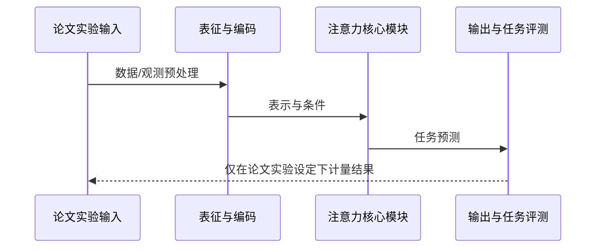

# Attention is not Explanation（注意力权重不等于解释）

## 一句话定义

在文本分类、问答和自然语言推理中的基于注意力的编码器上，检验注意力权重与特征重要性的一致性，以及改变注意力权重是否会相应改变模型输出。

## 英文缩写速查

| 缩写 | 英文全称 | 简要说明 |
|---|---|---|
| NLP | Natural Language Processing | 论文主要评测领域 |
| NLI | Natural Language Inference | 自然语言推理任务 |
| QA | Question Answering | 问答任务 |

## 为什么重要

- **解决的问题：** 在文本分类、问答和自然语言推理中的基于注意力的编码器上，检验注意力权重与特征重要性的一致性，以及改变注意力权重是否会相应改变模型输出。
- **机器人关联（跨论文迁移判断，非本文直接验证）：** 解释机器人策略时不能只看热图，应结合输入遮挡、反事实干预和动作成功率验证。

## 核心原理

作者先在 BiLSTM、CNN 等带加性注意力的文本分类、NLI 与问答模型上训练基线，再比较注意力分布与梯度/leave-one-out 特征重要性。使用随机置换和对抗优化构造与原注意力差异很大、但模型预测几乎不变的分布；分别测输出 TVD 和注意力 JSD，而不是仅用注意力热图主观判断解释质量。

**实验设计的关键取舍：** 比较 BiLSTM、CNN、平均编码器等不同编码器与任务；平均编码器的一些设置更符合归因相关性，说明结论受网络结构影响。

## 流程总览

**图示范围：** 基于论文摘要和已公开方法主线的高层数据流；具体模块实现细节及源码调用关系待全文和代码核验，不应当作复现级结构图。

## 实验与评测

实验在文本分类、NLI、问答等数据集进行；注意力与梯度、leave-one-out 的 Kendall τ 经常很低；在不少样本上可找到 JSD 相差很大、预测 TVD 仍小的对抗分布。作者同时报告与模型、任务有关的例外，不能把结论读成任何注意力机制都无法解释。

**阅读约束：** 不把跨数据集、不同硬件和不同任务的指标直接合并排名。

## 结论

1. **方法贡献：** 作者先在 BiLSTM、CNN 等带加性注意力的文本分类、NLI 与问答模型上训练基线，再比较注意力分布与梯度/leave-one-out 特征重要性。
2. **实证价值：** 实验在文本分类、NLI、问答等数据集进行；注意力与梯度、leave-one-out 的 Kendall τ 经常很低；在不少样本上可找到 JSD 相差很大、预测 TVD 仍小的对抗分布。
3. **应用边界：** 仅研究被选取的 NLP 模型、任务与注意力归因口径；注意力权重与反事实因果解释不等价，亦不自动否定所有经过专门监督的解释机制。

## 与其他工作对比

- [Transformer 基础](./paper-attention-is-all-you-need.md) 提供全局注意力基线，本文体现其在特定任务或计算约束下的变体/评估。
- [20 篇注意力架构与机器人策略对照](../comparisons/attention-architectures-robotics-20-papers.md) 按视频、三维、机器人策略与计算优化归类。

## 工程实践

- **工程建议：** 机器人策略解释应至少配合输入遮挡、梯度或干预实验，并记录机器人动作变化与任务成功率；不能将可视化热图直接称为因果依据。
- **公开实现/项目：** https://github.com/successar/AttentionExplanation。正文与附录已对照，训练/推理代码尚未在本环境执行。

## 源码运行时序图

**源码核对边界：** 已定位公开实现入口 https://github.com/successar/AttentionExplanation，本轮没有实际执行该仓库。以下图为论文方法层的前向/评测时序，非冒充已验证的函数调用栈。

## 局限与风险

- 仅研究被选取的 NLP 模型、任务与注意力归因口径；注意力权重与反事实因果解释不等价，亦不自动否定所有经过专门监督的解释机制。
- **原文状态：** 正文与附录已核对，归档见 [原文精读笔记](../../sources/papers/attention20_1902_10186.md)；不以论文已读等同于上机复现。

## 相关方法与任务

以下链接是**应用关联**，不是本文已在机器人场景验证这些工程收益：

- [bc-with-transformer](../methods/bc-with-transformer.md) — Transformer 行为克隆的注意力归因需结合输入干预评估
- [robotics-transformer-rt-series](../methods/robotics-transformer-rt-series.md) — 机器人 Transformer 的注意力可视化不能直接当作动作因果解释

## 关联页面

- [Attention Is All You Need](./paper-attention-is-all-you-need.md)
- [ACT 机器人动作分块](./paper-act.md)
- [20 篇注意力相关论文对照](../comparisons/attention-architectures-robotics-20-papers.md)

## 参考来源

- [本论文原始来源归档](../../sources/papers/attention20_1902_10186.md)
- [一手论文](https://aclanthology.org/N19-1357/)

## 推荐继续阅读

- [原始论文/会议出版页](https://aclanthology.org/N19-1357/)
- [Transformer 基础](./paper-attention-is-all-you-need.md)
