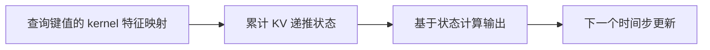
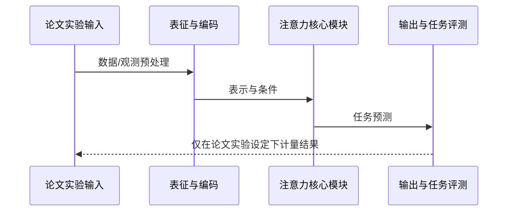

# Transformers are RNNs: Fast Autoregressive Transformers with Linear Attention（Transformer 也是 RNN：用于快速自回归建模的线性注意力）

## 一句话定义

通过 kernel feature map 重写注意力，并利用矩阵乘法结合律把特征键值积累为可递推状态，从而将序列长度方向的计算规模由二次降至线性。

## 英文缩写速查

| 缩写 | 英文全称 | 简要说明 |
|---|---|---|
| RNN | Recurrent Neural Network | 序列递推的状态更新 |
| KV | Key Value | 递推状态中键值组合 |
| QKV | Query Key Value | 注意力的三类投影 |

## 为什么重要

- **解决的问题：** 通过 kernel feature map 重写注意力，并利用矩阵乘法结合律把特征键值积累为可递推状态，从而将序列长度方向的计算规模由二次降至线性。
- **机器人关联（跨论文迁移判断，非本文直接验证）：** 对持续感知、长上下文和在线动作控制可作为架构候选，必须评测与 softmax 基线的精度差别。

## 核心原理

把注意力相似度写作非负特征映射的内积，使用 phi(x)=ELU(x)+1，再利用矩阵结合律先累积 key/value 充分统计量，而不是显式生成 N×N 注意力矩阵。因果自回归时 S_t=S_(t-1)+phi(k_t)v_t^T，Z_t=Z_(t-1)+phi(k_t)，输出为 phi(q_t)^T S_t / (phi(q_t)^T Z_t)，使单步解码成为有限状态递推。

**实验设计的关键取舍：** 论文分别分析训练时的序列规模、测试时递推推理和不同任务；结果明确显示线性化核映射并不精确等价于 softmax。

## 流程总览

**图示范围：** 基于论文摘要和已公开方法主线的高层数据流；具体模块实现细节及源码调用关系待全文和代码核验，不应当作复现级结构图。

## 实验与评测

CIFAR-10 自回归图像建模 bpd：Linear Transformer 3.40、标准 Transformer 3.47；论文所述递推生成吞吐示例 17.85 images/s，对照非递推标准实现 0.004 images/s，但不能忽略 stateful softmax 版本同样可缓存。WSJ 语音识别 PER：线性注意力 8.08，而标准 softmax 5.12，说明速度收益不代表所有任务的质量提升。

**阅读约束：** 不把跨数据集、不同硬件和不同任务的指标直接合并排名。

## 结论

1. **方法贡献：** 把注意力相似度写作非负特征映射的内积，使用 phi(x)=ELU(x)+1，再利用矩阵结合律先累积 key/value 充分统计量，而不是显式生成 N×N 注意力矩阵。
2. **实证价值：** CIFAR-10 自回归图像建模 bpd：Linear Transformer 3.40、标准 Transformer 3.47；论文所述递推生成吞吐示例 17.85 images/s，对照非递推标准实现 0.004 images/s，但不能忽略 stateful softmax 版本同样可缓存。
3. **应用边界：** phi 特征空间容量和因果累积状态的数值稳定性会限制表达能力；复杂度改善以固定特征维度为前提，模型质量可下降。

## 与其他工作对比

- [Transformer 基础](./paper-attention-is-all-you-need.md) 提供全局注意力基线，本文体现其在特定任务或计算约束下的变体/评估。
- [20 篇注意力架构与机器人策略对照](../comparisons/attention-architectures-robotics-20-papers.md) 按视频、三维、机器人策略与计算优化归类。

## 工程实践

- **工程建议：** 适合长历史/自回归状态更新；机器人在线策略仍需测有限历史、观测噪声、状态重置与流式 batch 的真实延迟。
- **公开实现/项目：** https://linear-transformers.com/。正文与附录已对照，训练/推理代码尚未在本环境执行。

## 源码运行时序图

**源码核对边界：** 已定位公开实现入口 https://linear-transformers.com/，本轮没有实际执行该仓库。以下图为论文方法层的前向/评测时序，非冒充已验证的函数调用栈。

## 局限与风险

- phi 特征空间容量和因果累积状态的数值稳定性会限制表达能力；复杂度改善以固定特征维度为前提，模型质量可下降。
- **原文状态：** 正文与附录已核对，归档见 [原文精读笔记](../../sources/papers/attention20_2006_16236.md)；不以论文已读等同于上机复现。

## 相关方法与任务

以下链接是**应用关联**，不是本文已在机器人场景验证这些工程收益：

- [bc-with-transformer](../methods/bc-with-transformer.md) — 长时序行为克隆可对照线性注意力的记忆与精度取舍
- [robotics-transformer-rt-series](../methods/robotics-transformer-rt-series.md) — 流式或自回归机器人 Transformer 可评估递推状态代价

## 关联页面

- [Attention Is All You Need](./paper-attention-is-all-you-need.md)
- [ACT 机器人动作分块](./paper-act.md)
- [20 篇注意力相关论文对照](../comparisons/attention-architectures-robotics-20-papers.md)

## 参考来源

- [本论文原始来源归档](../../sources/papers/attention20_2006_16236.md)
- [一手论文](https://arxiv.org/abs/2006.16236)

## 推荐继续阅读

- [原始论文/会议出版页](https://arxiv.org/abs/2006.16236)
- [Transformer 基础](./paper-attention-is-all-you-need.md)
