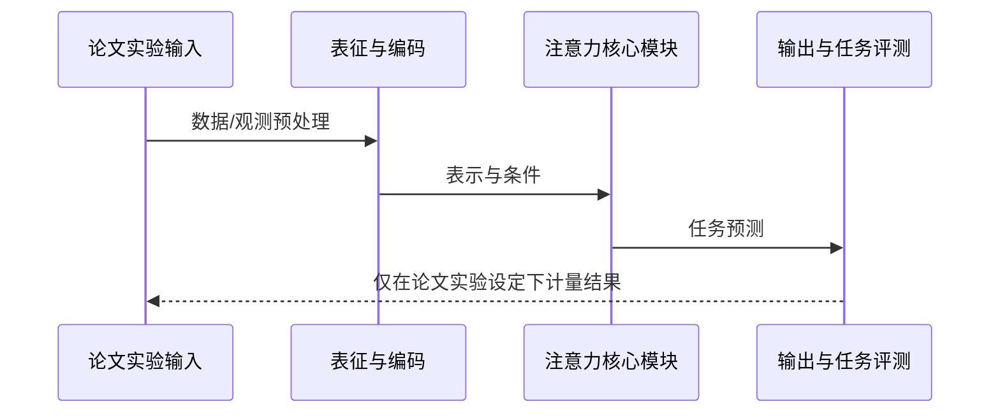

# Deformable DETR: Deformable Transformers for End-to-End Object Detection（Deformable DETR：用于端到端目标检测的可变形注意力 Transformer）

## 一句话定义

每个查询只围绕参考点在多尺度特征图中采样少数关键位置，通过可变形注意力避免标准 DETR 在高分辨率特征上的昂贵全局交互。

## 英文缩写速查

| 缩写 | 英文全称 | 简要说明 |
|---|---|---|
| DETR | Detection Transformer | 端到端目标检测 Transformer |
| MSDA | Multi-Scale Deformable Attention | 多尺度参考点稀疏注意力 |
| COCO | Common Objects in Context | 目标检测数据集 |

## 为什么重要

- **解决的问题：** 每个查询只围绕参考点在多尺度特征图中采样少数关键位置，通过可变形注意力避免标准 DETR 在高分辨率特征上的昂贵全局交互。
- **机器人关联（跨论文迁移判断，非本文直接验证）：** 适合作为视觉检测骨干的选型参照，不应和机器人动作策略精度混用。

## 核心原理

多尺度 Deformable Attention 不对所有像素计算全局 QK，而令每个 query 围绕可学习参考点，在每个 feature level 的 K 个可学习偏移位置双线性采样 feature，并用归一化权重聚合；decoder 的参考点可迭代更新。骨干与多尺度 FPN 特征可结合，训练目标仍为集合式匹配/检测损失。

**实验设计的关键取舍：** 论文比较单尺度与多尺度、是否采用多尺度可变形交叉注意力、迭代 box refinement 和两阶段设定；提高多尺度覆盖是小目标收益的关键。

## 流程总览

**图示范围：** 基于论文摘要和已公开方法主线的高层数据流；具体模块实现细节及源码调用关系待全文和代码核验，不应当作复现级结构图。

## 实验与评测

COCO 检测：Deformable DETR 标准设置约 50 个训练 epoch 达到 43.8 box AP，而原 DETR 通常训练 500 epoch；这意味着论文配置下收敛轮数约少一个数量级，不能直接表述为任意硬件训练时间 10 倍加速。小目标检测较原 DETR 改善，指标为检测 AP 而非操作成功率。

**阅读约束：** 不把跨数据集、不同硬件和不同任务的指标直接合并排名。

## 结论

1. **方法贡献：** 多尺度 Deformable Attention 不对所有像素计算全局 QK，而令每个 query 围绕可学习参考点，在每个 feature level 的 K 个可学习偏移位置双线性采样 feature，并用归一化权重聚合；decoder 的参考点可迭代更新。
2. **实证价值：** COCO 检测：Deformable DETR 标准设置约 50 个训练 epoch 达到 43.8 box AP，而原 DETR 通常训练 500 epoch；这意味着论文配置下收敛轮数约少一个数量级，不能直接表述为任意硬件训练时间 10 倍加速。
3. **应用边界：** 参考点和采样偏移可能偏离目标；需要 backbone、CUDA 算子和检测标注，迁移到机器人需要另外把检测输出接到 3D 几何和控制策略。

## 与其他工作对比

- [Transformer 基础](./paper-attention-is-all-you-need.md) 提供全局注意力基线，本文体现其在特定任务或计算约束下的变体/评估。
- [20 篇注意力架构与机器人策略对照](../comparisons/attention-architectures-robotics-20-papers.md) 按视频、三维、机器人策略与计算优化归类。

## 工程实践

- **工程建议：** 机器人小目标抓取可以将检测框当作视觉候选而不是动作命令，需结合相机标定、深度、抓取可达性。
- **公开实现/项目：** https://github.com/fundamentalvision/Deformable-DETR。正文与附录已对照，训练/推理代码尚未在本环境执行。

## 源码运行时序图

**源码核对边界：** 已定位公开实现入口 https://github.com/fundamentalvision/Deformable-DETR，本轮没有实际执行该仓库。以下图为论文方法层的前向/评测时序，非冒充已验证的函数调用栈。

## 局限与风险

- 参考点和采样偏移可能偏离目标；需要 backbone、CUDA 算子和检测标注，迁移到机器人需要另外把检测输出接到 3D 几何和控制策略。
- **原文状态：** 正文与附录已核对，归档见 [原文精读笔记](../../sources/papers/attention20_2010_04159.md)；不以论文已读等同于上机复现。

## 相关方法与任务

以下链接是**应用关联**，不是本文已在机器人场景验证这些工程收益：

- [object-detection](../methods/object-detection.md) — 参考点稀疏采样服务多尺度视觉检测
- [manipulation](../tasks/manipulation.md) — 检测模块为操作决策提供目标定位而非直接预测动作

## 关联页面

- [Attention Is All You Need](./paper-attention-is-all-you-need.md)
- [ACT 机器人动作分块](./paper-act.md)
- [20 篇注意力相关论文对照](../comparisons/attention-architectures-robotics-20-papers.md)

## 参考来源

- [本论文原始来源归档](../../sources/papers/attention20_2010_04159.md)
- [一手论文](https://arxiv.org/abs/2010.04159)

## 推荐继续阅读

- [原始论文/会议出版页](https://arxiv.org/abs/2010.04159)
- [Transformer 基础](./paper-attention-is-all-you-need.md)
