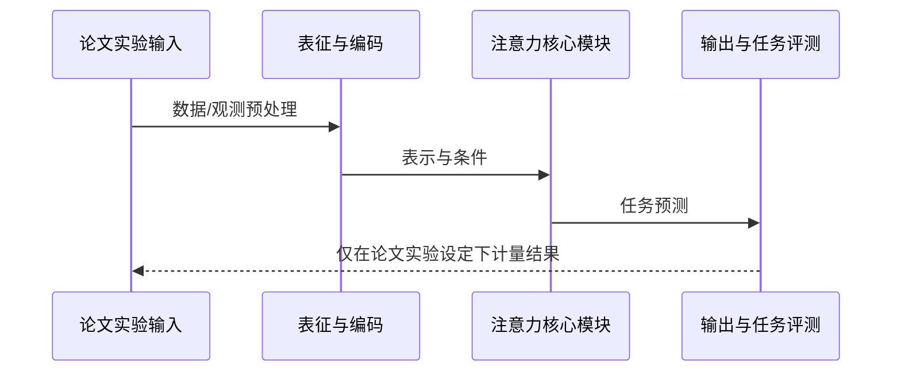

# Point Transformer（Point Transformer：面向点云的注意力算子）

## 一句话定义

针对无序三维点集，在局部邻域上应用向量注意力并结合相对位置编码，从而学习点云上的几何与特征交互。

## 英文缩写速查

| 缩写 | 英文全称 | 简要说明 |
|---|---|---|
| kNN | k-Nearest Neighbors | 构建点的局部邻域 |
| MLP | Multi-Layer Perceptron | 逐点特征变换 |
| mIoU | mean Intersection over Union | 点云分割精度指标 |

## 为什么重要

- **解决的问题：** 针对无序三维点集，在局部邻域上应用向量注意力并结合相对位置编码，从而学习点云上的几何与特征交互。
- **机器人关联（跨论文迁移判断，非本文直接验证）：** 可作为操作场景的点云编码骨干，但论文主要验证感知而非动作决策。

## 核心原理

对点云 x_i 通过 kNN 构建局部邻域，用相对坐标 p_i-p_j 的编码 δ_ij 同时影响注意力 logits 与值特征，并以向量注意力按通道加权聚合，而非直接用图像固定网格位置。配合 Transition Down/Up 的分层采样与插值形成分割网络，天然适配点顺序置换不变性。

**实验设计的关键取舍：** 论文在 S3DIS 的算子对照中，标量注意力约 64.6% mIoU，而向量注意力配合位置编码达到 70.4%，体现局部几何与逐通道建模的收益。

## 流程总览

**图示范围：** 基于论文摘要和已公开方法主线的高层数据流；具体模块实现细节及源码调用关系待全文和代码核验，不应当作复现级结构图。

## 实验与评测

S3DIS Area 5 语义分割 70.4% mIoU、76.5% mAcc、90.8% OA；S3DIS 六折 73.5% mIoU。ModelNet40 分类 93.7% OA；这些是点云感知成绩，不是移动操作或抓取成功率。

**阅读约束：** 不把跨数据集、不同硬件和不同任务的指标直接合并排名。

## 结论

1. **方法贡献：** 对点云 x_i 通过 kNN 构建局部邻域，用相对坐标 p_i-p_j 的编码 δ_ij 同时影响注意力 logits 与值特征，并以向量注意力按通道加权聚合，而非直接用图像固定网格位置。
2. **实证价值：** S3DIS Area 5 语义分割 70.4% mIoU、76.5% mAcc、90.8% OA；S3DIS 六折 73.5% mIoU。
3. **应用边界：** 依赖邻域搜索和采样，对非均匀点密度、深度缺失、噪声与 kNN 开销敏感；单篇论文没有证明闭环机器人控制性能。

## 与其他工作对比

- [Transformer 基础](./paper-attention-is-all-you-need.md) 提供全局注意力基线，本文体现其在特定任务或计算约束下的变体/评估。
- [20 篇注意力架构与机器人策略对照](../comparisons/attention-architectures-robotics-20-papers.md) 按视频、三维、机器人策略与计算优化归类。

## 工程实践

- **工程建议：** 接入视觉操作系统时需同时记录点云点数、采样策略、坐标系和实际邻域查询耗时；可作为策略输入骨干。
- **公开实现/项目：** https://github.com/POSTECH-CVLab/point-transformer。正文与附录已对照，训练/推理代码尚未在本环境执行。

## 源码运行时序图

**源码核对边界：** 已定位公开实现入口 https://github.com/POSTECH-CVLab/point-transformer，本轮没有实际执行该仓库。以下图为论文方法层的前向/评测时序，非冒充已验证的函数调用栈。

## 局限与风险

- 依赖邻域搜索和采样，对非均匀点密度、深度缺失、噪声与 kNN 开销敏感；单篇论文没有证明闭环机器人控制性能。
- **原文状态：** 正文与附录已核对，归档见 [原文精读笔记](../../sources/papers/attention20_2012_09164.md)；不以论文已读等同于上机复现。

## 相关方法与任务

以下链接是**应用关联**，不是本文已在机器人场景验证这些工程收益：

- [object-detection](../methods/object-detection.md) — 点云特征可服务三维目标定位与感知
- [manipulation](../tasks/manipulation.md) — 操作任务可利用点云几何，但论文主要验证感知

## 关联页面

- [Attention Is All You Need](./paper-attention-is-all-you-need.md)
- [ACT 机器人动作分块](./paper-act.md)
- [20 篇注意力相关论文对照](../comparisons/attention-architectures-robotics-20-papers.md)

## 参考来源

- [本论文原始来源归档](../../sources/papers/attention20_2012_09164.md)
- [一手论文](https://arxiv.org/abs/2012.09164)

## 推荐继续阅读

- [原始论文/会议出版页](https://arxiv.org/abs/2012.09164)
- [Transformer 基础](./paper-attention-is-all-you-need.md)
