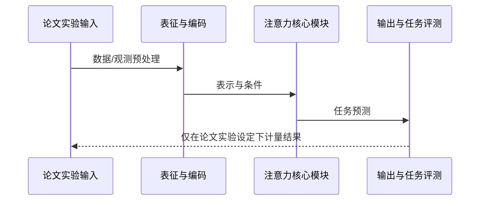

# Is Space-Time Attention All You Need for Video Understanding?（TimeSformer：视频理解只需时空注意力吗？）

## 一句话定义

将视频帧划分为 patch tokens；比较时空联合注意力与分解注意力，提出在每个 block 中分别执行时间与空间注意力的视频 Transformer。

## 英文缩写速查

| 缩写 | 英文全称 | 简要说明 |
|---|---|---|
| ViT | Vision Transformer | 视频帧 patch 表示的视觉骨干 |
| TSA | Temporal Self-Attention | 跨帧时间注意力 |
| SSA | Spatial Self-Attention | 帧内空间注意力 |

## 为什么重要

- **解决的问题：** 将视频帧划分为 patch tokens；比较时空联合注意力与分解注意力，提出在每个 block 中分别执行时间与空间注意力的视频 Transformer。
- **机器人关联（跨论文迁移判断，非本文直接验证）：** 适用于理解视频历史编码的时空交互分工，无法直接替代动作生成和控制回路。

## 核心原理

每帧切成 patch tokens，每个 Transformer block 将同一空间位置跨时间的 temporal attention 与同一帧内的 spatial attention 分开。比较 Joint Space-Time、Space Only、Divided Space-Time 等设计；分解注意力避免直接在全部帧乘以全部 patch 的 token 集上做一次密集注意力。

**实验设计的关键取舍：** 时间后空间的顺序比相反次序略强；论文研究不同帧数、patch 分辨率和预训练对精度/计算的影响，不提供动作控制时延基准。

## 流程总览

**图示范围：** 基于论文摘要和已公开方法主线的高层数据流；具体模块实现细节及源码调用关系待全文和代码核验，不应当作复现级结构图。

## 实验与评测

Kinetics-400 上 divided space-time 配置约 78.0% top-1，相应联合时空注意力对照 77.4%、仅空间注意力 76.9%；Something-Something v2 上约 59.5%（仅空间 36.6%），直接体现时间顺序对该任务的重要性。最长测试到约 96 帧，指标为视频识别。

**阅读约束：** 不把跨数据集、不同硬件和不同任务的指标直接合并排名。

## 结论

1. **方法贡献：** 每帧切成 patch tokens，每个 Transformer block 将同一空间位置跨时间的 temporal attention 与同一帧内的 spatial attention 分开。
2. **实证价值：** Kinetics-400 上 divided space-time 配置约 78.0% top-1，相应联合时空注意力对照 77.4%、仅空间注意力 76.9%；Something-Something v2 上约 59.5%（仅空间 36.6%），直接体现时间顺序对该任务的重要性。
3. **应用边界：** 模型主要离线进行视频分类，时序看见未来帧与因果机器人控制的限制不同，带来的收益需在在线因果掩码下重新验证。

## 与其他工作对比

- [Transformer 基础](./paper-attention-is-all-you-need.md) 提供全局注意力基线，本文体现其在特定任务或计算约束下的变体/评估。
- [20 篇注意力架构与机器人策略对照](../comparisons/attention-architectures-robotics-20-papers.md) 按视频、三维、机器人策略与计算优化归类。

## 工程实践

- **工程建议：** 机器人视频编码器可借鉴 divided attention，但必须限制每步可见的历史帧并测端到端推理周期。
- **公开实现/项目：** https://github.com/facebookresearch/TimeSformer。正文与附录已对照，训练/推理代码尚未在本环境执行。

## 源码运行时序图

**源码核对边界：** 已定位公开实现入口 https://github.com/facebookresearch/TimeSformer，本轮没有实际执行该仓库。以下图为论文方法层的前向/评测时序，非冒充已验证的函数调用栈。

## 局限与风险

- 模型主要离线进行视频分类，时序看见未来帧与因果机器人控制的限制不同，带来的收益需在在线因果掩码下重新验证。
- **原文状态：** 正文与附录已核对，归档见 [原文精读笔记](../../sources/papers/attention20_2102_05095.md)；不以论文已读等同于上机复现。

## 相关方法与任务

以下链接是**应用关联**，不是本文已在机器人场景验证这些工程收益：

- [bc-with-transformer](../methods/bc-with-transformer.md) — 视频历史编码与时序行为克隆的结构对照
- [robotics-transformer-rt-series](../methods/robotics-transformer-rt-series.md) — 视频 token 的时间/空间注意力可为机器人视觉编码提供参考

## 关联页面

- [Attention Is All You Need](./paper-attention-is-all-you-need.md)
- [ACT 机器人动作分块](./paper-act.md)
- [20 篇注意力相关论文对照](../comparisons/attention-architectures-robotics-20-papers.md)

## 参考来源

- [本论文原始来源归档](../../sources/papers/attention20_2102_05095.md)
- [一手论文](https://proceedings.mlr.press/v139/bertasius21a.html)

## 推荐继续阅读

- [原始论文/会议出版页](https://proceedings.mlr.press/v139/bertasius21a.html)
- [Transformer 基础](./paper-attention-is-all-you-need.md)
