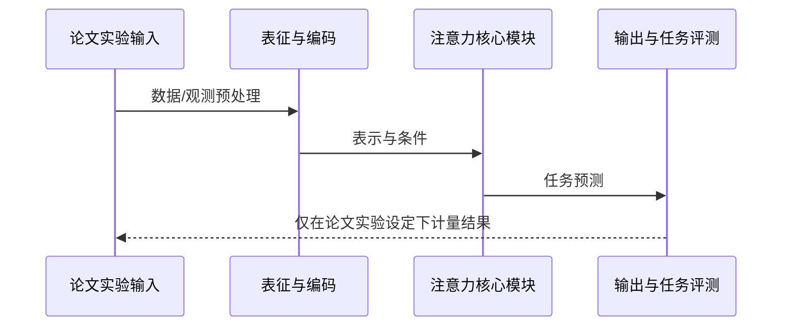

# Perceiver: General Perception with Iterative Attention（Perceiver：利用迭代注意力进行通用感知）

## 一句话定义

通过输入到固定大小 latent array 的非对称交叉注意力，把高维多模态输入压缩为潜变量，再在潜变量间迭代自注意力；避免在全部输入位置间执行昂贵的全局自注意力。

## 英文缩写速查

| 缩写 | 英文全称 | 简要说明 |
|---|---|---|
| CA | Cross-Attention | 输入到潜变量的非对称交互 |
| SA | Self-Attention | 潜变量之间的关联建模 |
| FFN | Feed-Forward Network | 注意力层之后的前馈变换 |

## 为什么重要

- **解决的问题：** 通过输入到固定大小 latent array 的非对称交叉注意力，把高维多模态输入压缩为潜变量，再在潜变量间迭代自注意力；避免在全部输入位置间执行昂贵的全局自注意力。
- **机器人关联（跨论文迁移判断，非本文直接验证）：** 为机器人多相机与本体状态的异构 token 压缩提供架构参考，实际部署需核对输入采样和延迟。

## 核心原理

Perceiver 不是在高维原始输入 token 上执行 O(M²) 自注意力，而是用固定 N 个学习到的 latent query 与 M 个输入 key/value 做交叉注意力，再在 N 个潜变量内反复 self-attention；将长输入的计算改为依赖 N×M 的交叉项及 N² 的潜层项。位置/模态信息通过 Fourier features 等注入，适用图像、音频、视频和点云。

**实验设计的关键取舍：** 论证固定 latent 数量与交叉注意力重复次数是输入长度和计算/质量的主要折中；像素位置打乱仍能利用显式位置编码而非依赖相邻卷积。

## 流程总览

**图示范围：** 基于论文摘要和已公开方法主线的高层数据流；具体模块实现细节及源码调用关系待全文和代码核验，不应当作复现级结构图。

## 实验与评测

ImageNet 图像分类 Top-1 78.0% 的示例说明无需图像卷积先验也能学习；AudioSet 音视频 mAP 约 43.5%；ModelNet40 点云分类 85.7%（低于论文列举的专用 PointNet++ 91.9%），不可宣称所有模态都最优。

**阅读约束：** 不把跨数据集、不同硬件和不同任务的指标直接合并排名。

## 结论

1. **方法贡献：** Perceiver 不是在高维原始输入 token 上执行 O(M²) 自注意力，而是用固定 N 个学习到的 latent query 与 M 个输入 key/value 做交叉注意力，再在 N 个潜变量内反复 self-attention；将长输入的计算改为依赖 N×M 的交叉项及 N² 的潜层项。
2. **实证价值：** ImageNet 图像分类 Top-1 78.0% 的示例说明无需图像卷积先验也能学习；AudioSet 音视频 mAP 约 43.5%；ModelNet40 点云分类 85.7%（低于论文列举的专用 PointNet++ 91.9%），不可宣称所有模态都最优。
3. **应用边界：** 潜变量容量和相对位置编码可能导致瓶颈；跨模态识别没有等同于具身动作生成；文中 Perceiver 与后续 Perceiver IO/PerAct 不能混称同一策略。

## 与其他工作对比

- [Transformer 基础](./paper-attention-is-all-you-need.md) 提供全局注意力基线，本文体现其在特定任务或计算约束下的变体/评估。
- [20 篇注意力架构与机器人策略对照](../comparisons/attention-architectures-robotics-20-papers.md) 按视频、三维、机器人策略与计算优化归类。

## 工程实践

- **工程建议：** 多模态 VLA 上用 latent 压缩输入需明确吞吐、输出头与时间因果性；机器人任务成功率须单独评估。
- **公开实现/项目：** https://github.com/google-deepmind/deepmind-research。正文与附录已对照，训练/推理代码尚未在本环境执行。

## 源码运行时序图

**源码核对边界：** 已定位公开实现入口 https://github.com/google-deepmind/deepmind-research，本轮没有实际执行该仓库。以下图为论文方法层的前向/评测时序，非冒充已验证的函数调用栈。

## 局限与风险

- 潜变量容量和相对位置编码可能导致瓶颈；跨模态识别没有等同于具身动作生成；文中 Perceiver 与后续 Perceiver IO/PerAct 不能混称同一策略。
- **原文状态：** 正文与附录已核对，归档见 [原文精读笔记](../../sources/papers/attention20_2103_03206.md)；不以论文已读等同于上机复现。

## 相关方法与任务

以下链接是**应用关联**，不是本文已在机器人场景验证这些工程收益：

- [bc-with-transformer](../methods/bc-with-transformer.md) — 异构观测压缩可作为 Transformer 模仿学习输入前端
- [vla](../methods/vla.md) — 视觉、语言、机器人本体 token 的融合可参考潜变量交叉注意力

## 关联页面

- [Attention Is All You Need](./paper-attention-is-all-you-need.md)
- [ACT 机器人动作分块](./paper-act.md)
- [20 篇注意力相关论文对照](../comparisons/attention-architectures-robotics-20-papers.md)

## 参考来源

- [本论文原始来源归档](../../sources/papers/attention20_2103_03206.md)
- [一手论文](https://arxiv.org/abs/2103.03206)

## 推荐继续阅读

- [原始论文/会议出版页](https://arxiv.org/abs/2103.03206)
- [Transformer 基础](./paper-attention-is-all-you-need.md)
