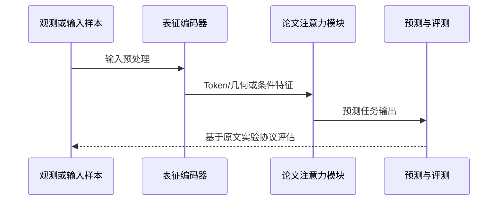

# Swin Transformer: Hierarchical Vision Transformer using Shifted Windows（Swin Transformer：使用移位窗口的层次视觉 Transformer）

## 一句话定义

在非重叠局部窗口内执行注意力，交替使用移位窗口让跨窗口信息交换；分层下采样产生多尺度视觉特征。

## 英文缩写速查

| 缩写 | 英文全称 | 简要说明 |
|---|---|---|
| W-MSA | Window Multi-Head Self-Attention | 窗口内多头自注意力 |
| SW-MSA | Shifted Window Multi-Head Self-Attention | 移位窗口跨区域连接 |
| MSA | Multi-Head Self-Attention | 多头自注意力 |

## 为什么重要

- **解决的问题：** 在非重叠局部窗口内执行注意力，交替使用移位窗口让跨窗口信息交换；分层下采样产生多尺度视觉特征。
- **机器人关联（跨论文迁移判断，非本文直接验证）：** 对相机输入的分辨率和视觉骨干选择有参考价值，需要结合实际相机帧率评估。

## 核心原理

先用 patch partition 构建 token，并通过 patch merging 逐阶段降低空间分辨率、增加通道数；同一 stage 交替进行普通窗口 W-MSA 与移位窗口 SW-MSA，使每层局部自注意力通过移动窗口跨边界交换信息。采用 cyclic shift 和 masking 让移位窗口可批量计算；相对位置偏置表达窗口内几何关系。

**消融指向：** 窗口局部计算避免在整张高分辨率图上执行全局注意力；移位窗口使跨窗口特征互通，模型层数/输入尺度/预训练数据均影响指标。

## 流程总览

**图示范围：** 基于论文摘要和已公开方法主线的高层数据流；具体模块实现细节及源码调用关系待全文和代码核验，不应当作复现级结构图。

## 实验与评测

ImageNet-1K 上 Swin-T Top-1 为 81.3%，Swin-B 为 83.5%；使用更大 ImageNet-22K 预训练的 Swin-L 可达约 87.3%，不可与仅用 1K 预训练结果混为同等训练预算。COCO 目标检测采用级联/多尺度检测头，Swin-L HTC++ 单尺度测试约 57.7 box AP；检测分数不等于机器人操作成功率。

**对照限制：** 比较同论文同任务同协议的基线，跨论文结果不作为统一排行榜。

## 结论

- **方法贡献：** 先用 patch partition 构建 token，并通过 patch merging 逐阶段降低空间分辨率、增加通道数；同一 stage 交替进行普通窗口 W-MSA 与移位窗口 SW-MSA，使每层局部自注意力通过移动窗口跨边界交换信息。
- **作者实验：** ImageNet-1K 上 Swin-T Top-1 为 81.3%，Swin-B 为 83.5%；使用更大 ImageNet-22K 预训练的 Swin-L 可达约 87.3%，不可与仅用 1K 预训练结果混为同等训练预算。
- **适用边界：** 窗口内归纳偏置限制单层全局交互，大跨度关系需要多层传播；可控的 token 复杂度不等于部署固定时延，且检测头性能不只由骨干决定。

## 与其他工作对比

- [Transformer 基础](./paper-attention-is-all-you-need.md) 提供全局注意力基线，本文体现其在特定任务或计算约束下的变体/评估。
- [20 篇注意力架构与机器人策略对照](../comparisons/attention-architectures-robotics-20-papers.md) 按视频、三维、机器人策略与计算优化归类。

## 工程实践

- **建议：** 机器人视觉骨干选型应固定图像尺寸与相机通道数测延迟、内存并检验小物体/遮挡；不要只看 ImageNet Top-1。
- **公开入口：** https://github.com/microsoft/Swin-Transformer；已读论文及附录，不等于成功编译或跑通仓库。

## 源码运行时序图

**核对范围：** 项目/源码入口见 https://github.com/microsoft/Swin-Transformer；未在本环境执行训练与推理。以下为根据论文正文确认的计算与评测时序，不冒充作者代码的逐函数调用。

## 局限与风险

- 窗口内归纳偏置限制单层全局交互，大跨度关系需要多层传播；可控的 token 复杂度不等于部署固定时延，且检测头性能不只由骨干决定。
- **原文状态：** 正文和附录已通读，并记录实验适用范围；参考 [来源精读笔记](../../sources/papers/attention20_2103_14030.md)。

## 相关方法与任务

以下链接是**应用关联**，不是本文已在机器人场景验证这些工程收益：

- [object-detection](../methods/object-detection.md) — 层次窗口视觉骨干用于多尺度目标检测
- [bc-with-transformer](../methods/bc-with-transformer.md) — 控制策略使用视觉特征时应评估骨干的延迟与感受野

## 关联页面

- [Attention Is All You Need](./paper-attention-is-all-you-need.md)
- [ACT 机器人动作分块](./paper-act.md)
- [20 篇注意力相关论文对照](../comparisons/attention-architectures-robotics-20-papers.md)

## 参考来源

- [本论文原始来源归档](../../sources/papers/attention20_2103_14030.md)
- [一手论文](https://arxiv.org/abs/2103.14030)

## 推荐继续阅读

- [原始论文/会议出版页](https://arxiv.org/abs/2103.14030)
- [Transformer 基础](./paper-attention-is-all-you-need.md)
