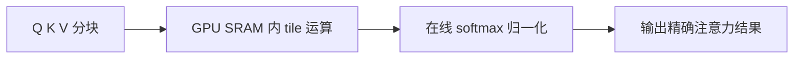
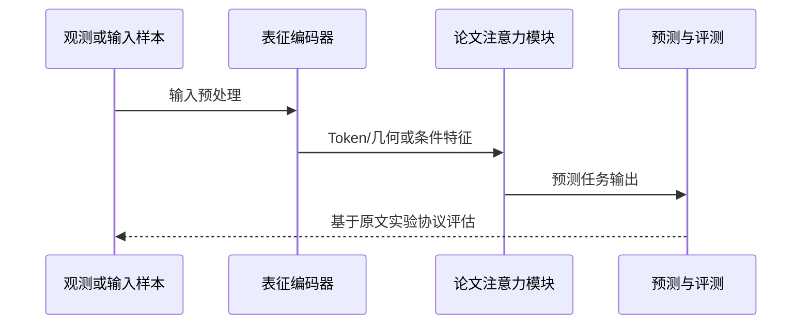

# FlashAttention: Fast and Memory-Efficient Exact Attention with IO-Awareness（FlashAttention：面向显存 IO 的精确注意力算法）

## 一句话定义

采用分块和片上 SRAM 计算以及在线归一化，减少 GPU HBM 与 SRAM 之间读写，避免将完整注意力矩阵频繁写回显存，同时保持精确注意力结果。

## 英文缩写速查

| 缩写 | 英文全称 | 简要说明 |
|---|---|---|
| HBM | High Bandwidth Memory | GPU 大容量显存 |
| SRAM | Static Random Access Memory | 片上高速缓存 |
| IO | Input/Output | 芯片存储层次间数据读写 |

## 为什么重要

- **解决的问题：** 采用分块和片上 SRAM 计算以及在线归一化，减少 GPU HBM 与 SRAM 之间读写，避免将完整注意力矩阵频繁写回显存，同时保持精确注意力结果。
- **机器人关联（跨论文迁移判断，非本文直接验证）：** 长历史视觉 token / VLA 骨干可以评估注意力核加速，不能推断机器人总控制延迟。

## 核心原理

标准注意力在 GPU HBM 上物化 N×N 分数/概率张量，IO 成本大。FlashAttention 以 SRAM 局部块遍历 Q、K、V，通过在线最大值 m 和分母 l 维护稳定 softmax 归一化，输出块逐步更新；反向传播重算局部分数而非存储整张矩阵。精确 dense FlashAttention 保持标准缩放点积注意力（浮点舍入差异除外），算术仍随 N 二次增长；论文另讨论近似 block-sparse 扩展，不能混同。

**消融指向：** 把内存读写而非 FLOP 数列为主要优化对象，并通过重算实现节约中间激活内存；最小内存写入与核配置的优势只在适配 GPU 架构时成立。

## 流程总览

**图示范围：** 基于论文摘要和已公开方法主线的高层数据流；具体模块实现细节及源码调用关系待全文和代码核验，不应当作复现级结构图。

## 实验与评测

论文在长序列 attention microbenchmark 中报告 GPU HBM 读写从约 40.3GB 降到 4.4GB、运行时间从 41.7ms 降到 7.3ms（特定 GPT-2、N=1024 及硬件配置）；BERT 和 GPT 系列训练也报告端到端加速，但加速倍数随 head_dim、序列、GPU、算子融合与模型比例变化。

**对照限制：** 比较同论文同任务同协议的基线，跨论文结果不作为统一排行榜。

## 结论

- **方法贡献：** 标准注意力在 GPU HBM 上物化 N×N 分数/概率张量，IO 成本大。
- **作者实验：** 论文在长序列 attention microbenchmark 中报告 GPU HBM 读写从约 40.3GB 降到 4.4GB、运行时间从 41.7ms 降到 7.3ms（特定 GPT-2、N=1024 及硬件配置）；BERT 和 GPT 系列训练也报告端到端加速，但加速倍数随 head_dim、序列、GPU、算子融合与模型比例变化。
- **适用边界：** 非线性 SRAM tiling 与 CUDA 代码有硬件依赖；tiny batch / 很短序列可难以取得相同加速，不能声称算法计算复杂度从 O(N²) 变成 O(N)。

## 与其他工作对比

- [Transformer 基础](./paper-attention-is-all-you-need.md) 提供全局注意力基线，本文体现其在特定任务或计算约束下的变体/评估。
- [20 篇注意力架构与机器人策略对照](../comparisons/attention-architectures-robotics-20-papers.md) 按视频、三维、机器人策略与计算优化归类。

## 工程实践

- **建议：** 在机器人 VLA、WAM 推理应区分 attention kernel 加速与整套视觉编码、action head 的真实时延，需实测目标 GPU。
- **公开入口：** https://github.com/Dao-AILab/flash-attention；已读论文及附录，不等于成功编译或跑通仓库。

## 源码运行时序图

**核对范围：** 项目/源码入口见 https://github.com/Dao-AILab/flash-attention；未在本环境执行训练与推理。以下为根据论文正文确认的计算与评测时序，不冒充作者代码的逐函数调用。

## 局限与风险

- 非线性 SRAM tiling 与 CUDA 代码有硬件依赖；tiny batch / 很短序列可难以取得相同加速，不能声称算法计算复杂度从 O(N²) 变成 O(N)。
- **原文状态：** 正文和附录已通读，并记录实验适用范围；参考 [来源精读笔记](../../sources/papers/attention20_2205_14135.md)。

## 相关方法与任务

以下链接是**应用关联**，不是本文已在机器人场景验证这些工程收益：

- [vla](../methods/vla.md) — 长视觉语言上下文的精确注意力实现优化
- [bc-with-transformer](../methods/bc-with-transformer.md) — 比较注意力核加速与整条策略推理延迟

## 关联页面

- [Attention Is All You Need](./paper-attention-is-all-you-need.md)
- [ACT 机器人动作分块](./paper-act.md)
- [20 篇注意力相关论文对照](../comparisons/attention-architectures-robotics-20-papers.md)

## 参考来源

- [本论文原始来源归档](../../sources/papers/attention20_2205_14135.md)
- [一手论文](https://arxiv.org/abs/2205.14135)

## 推荐继续阅读

- [原始论文/会议出版页](https://arxiv.org/abs/2205.14135)
- [Transformer 基础](./paper-attention-is-all-you-need.md)
