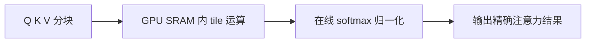

# FlashAttention: Fast and Memory-Efficient Exact Attention with IO-Awareness（FlashAttention：面向显存 IO 的精确注意力算法）

## 一句话定义

采用分块和片上 SRAM 计算以及在线归一化，减少 GPU HBM 与 SRAM 之间读写，避免将完整注意力矩阵频繁写回显存，同时保持精确注意力结果。

## 英文缩写速查

| 缩写 | 英文全称 | 简要说明 |
|---|---|---|
| HBM | High Bandwidth Memory | GPU 大容量显存 |
| SRAM | Static Random Access Memory | 片上高速缓存 |
| IO | Input/Output | 芯片存储层次间数据读写 |

## 为什么重要

- **解决的问题：** 采用分块和片上 SRAM 计算以及在线归一化，减少 GPU HBM 与 SRAM 之间读写，避免将完整注意力矩阵频繁写回显存，同时保持精确注意力结果。
- **机器人关联（跨论文迁移判断，非本文直接验证）：** 长历史视觉 token / VLA 骨干可以评估注意力核加速，不能推断机器人总控制延迟。

## 核心原理

采用分块和片上 SRAM 计算以及在线归一化，减少 GPU HBM 与 SRAM 之间读写，避免将完整注意力矩阵频繁写回显存，同时保持精确注意力结果。

## 流程总览

**图示范围：** 基于论文摘要和已公开方法主线的高层数据流；具体模块实现细节及源码调用关系待全文和代码核验，不应当作复现级结构图。

## 实验与评测

- 论文用计算/IO 分析和训练与推理 benchmark 验证加速与显存收益；常规精确 FlashAttention 不意味着把注意力理论算术复杂度从平方变线性。
- **读数边界：** 不将该论文的识别/检测/操控指标跨数据集直接比较；实验表格、随机种子与消融设置仍需全文核验。

## 结论

**这篇论文的主要价值在于注意力结构和任务约束之间的工程取舍，尚不能由摘要证实真实机器人部署收益。**

1. **结构重点** — 采用分块和片上 SRAM 计算以及在线归一化，减少 GPU HBM 与 SRAM 之间读写，避免将完整注意力矩阵频繁写回显存，同时保持精确注意力结果。
2. **实证范围** — 论文用计算/IO 分析和训练与推理 benchmark 验证加速与显存收益
3. **部署前确认** — 收益依赖 GPU 存储层次、序列长度、核实现和批量大小，部署需实测端到端而非只看 kernel。

## 与其他工作对比

- [Transformer 基础](./paper-attention-is-all-you-need.md) 提供全局注意力基线，本文体现其在特定任务或计算约束下的变体/评估。
- [20 篇注意力架构与机器人策略对照](../comparisons/attention-architectures-robotics-20-papers.md) 按视频、三维、机器人策略与计算优化归类。

## 工程实践

- 长历史视觉 token / VLA 骨干可以评估注意力核加速，不能推断机器人总控制延迟。
- 选择实现时需核实官方仓库、输入输出形状、训练数据和硬件运行条件，不应根据摘要推断可运行入口。

## 源码运行时序图

**暂不绘制：** 官方运行入口与实际源码调用关系尚未核实。此处不使用假想的通用 `sequenceDiagram` 冒充源码分析；待核验训练/推理入口后补充。

## 局限与风险

- 收益依赖 GPU 存储层次、序列长度、核实现和批量大小，部署需实测端到端而非只看 kernel。
- **资料状态：** 当前只完成题录、摘要与方法主线核对，**尚未完成全文及附录通读**；本页按草稿收录，不标注健康度满分。

## 相关方法与任务

以下链接是**应用关联**，不是本文已在机器人场景验证这些工程收益：

- [vla](../methods/vla.md) — 长视觉语言上下文的精确注意力实现优化
- [bc-with-transformer](../methods/bc-with-transformer.md) — 比较注意力核加速与整条策略推理延迟

## 关联页面

- [Attention Is All You Need](./paper-attention-is-all-you-need.md)
- [ACT 机器人动作分块](./paper-act.md)
- [20 篇注意力相关论文对照](../comparisons/attention-architectures-robotics-20-papers.md)

## 参考来源

- [本论文原始来源归档](../../sources/papers/attention20_2205_14135.md)
- [一手论文](https://arxiv.org/abs/2205.14135)

## 推荐继续阅读

- [原始论文/会议出版页](https://arxiv.org/abs/2205.14135)
- [Transformer 基础](./paper-attention-is-all-you-need.md)
