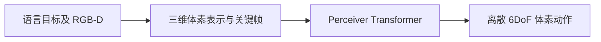

# Perceiver-Actor: A Multi-Task Transformer for Robotic Manipulation（PerAct：多任务机器人操作 Transformer）

## 一句话定义

语言目标和 RGB-D 观测经过体素化，利用 Perceiver Transformer 预测离散的下一关键帧 6DoF 体素动作，以行为克隆训练多任务操作策略。

## 英文缩写速查

| 缩写 | 英文全称 | 简要说明 |
|---|---|---|
| PerAct | Perceiver-Actor | 语言条件的多任务操作模型 |
| RGB-D | Red Green Blue Depth | 颜色及深度观测 |
| BC | Behavior Cloning | 演示驱动的监督模仿学习 |

## 为什么重要

- **解决的问题：** 语言目标和 RGB-D 观测经过体素化，利用 Perceiver Transformer 预测离散的下一关键帧 6DoF 体素动作，以行为克隆训练多任务操作策略。
- **机器人关联（跨论文迁移判断，非本文直接验证）：** 适合作为 RVT 的三维操作基线：前者体素化离散动作，后者利用虚拟多视图表示。

## 核心原理

语言目标和 RGB-D 观测经过体素化，利用 Perceiver Transformer 预测离散的下一关键帧 6DoF 体素动作，以行为克隆训练多任务操作策略。

## 流程总览

**图示范围：** 基于论文摘要和已公开方法主线的高层数据流；具体模块实现细节及源码调用关系待全文和代码核验，不应当作复现级结构图。

## 实验与评测

- 论文在 RLBench 18 个任务与真实机器人 7 个任务上验证多任务操作；从少量演示学习的结果取决于体素分辨率与示教任务范围。
- **读数边界：** 不将该论文的识别/检测/操控指标跨数据集直接比较；实验表格、随机种子与消融设置仍需全文核验。

## 结论

**这篇论文的主要价值在于注意力结构和任务约束之间的工程取舍，尚不能由摘要证实真实机器人部署收益。**

1. **结构重点** — 语言目标和 RGB-D 观测经过体素化，利用 Perceiver Transformer 预测离散的下一关键帧 6DoF 体素动作，以行为克隆训练多任务操作策略。
2. **实证范围** — 论文在 RLBench 18 个任务与真实机器人 7 个任务上验证多任务操作
3. **部署前确认** — 体素化有空间范围、分辨率和算力成本，离散动作可能在精细接触控制中需要额外闭环反馈。

## 与其他工作对比

- [Transformer 基础](./paper-attention-is-all-you-need.md) 提供全局注意力基线，本文体现其在特定任务或计算约束下的变体/评估。
- [20 篇注意力架构与机器人策略对照](../comparisons/attention-architectures-robotics-20-papers.md) 按视频、三维、机器人策略与计算优化归类。

## 工程实践

- 适合作为 RVT 的三维操作基线：前者体素化离散动作，后者利用虚拟多视图表示。
- 选择实现时需核实官方仓库、输入输出形状、训练数据和硬件运行条件，不应根据摘要推断可运行入口。

## 源码运行时序图

**暂不绘制：** 官方运行入口与实际源码调用关系尚未核实。此处不使用假想的通用 `sequenceDiagram` 冒充源码分析；待核验训练/推理入口后补充。

## 局限与风险

- 体素化有空间范围、分辨率和算力成本，离散动作可能在精细接触控制中需要额外闭环反馈。
- **资料状态：** 当前只完成题录、摘要与方法主线核对，**尚未完成全文及附录通读**；本页按草稿收录，不标注健康度满分。

## 关联页面

- [Attention Is All You Need](./paper-attention-is-all-you-need.md)
- [ACT 机器人动作分块](./paper-act.md)
- [20 篇注意力相关论文对照](../comparisons/attention-architectures-robotics-20-papers.md)

## 参考来源

- [本论文原始来源归档](../../sources/papers/attention20_2209_05451.md)
- [一手论文](https://arxiv.org/abs/2209.05451)

## 推荐继续阅读

- [原始论文/会议出版页](https://arxiv.org/abs/2209.05451)
- [Transformer 基础](./paper-attention-is-all-you-need.md)
