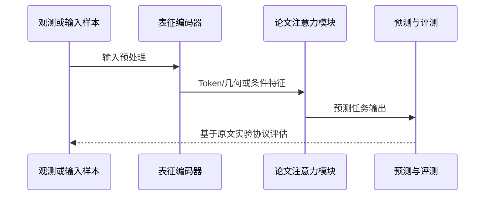

# Perceiver-Actor: A Multi-Task Transformer for Robotic Manipulation（PerAct：多任务机器人操作 Transformer）

## 一句话定义

语言目标和 RGB-D 观测经过体素化，利用 Perceiver Transformer 预测离散的下一关键帧 6DoF 体素动作，以行为克隆训练多任务操作策略。

## 英文缩写速查

| 缩写 | 英文全称 | 简要说明 |
|---|---|---|
| PerAct | Perceiver-Actor | 语言条件的多任务操作模型 |
| RGB-D | Red Green Blue Depth | 颜色及深度观测 |
| BC | Behavior Cloning | 演示驱动的监督模仿学习 |

## 为什么重要

- **解决的问题：** 语言目标和 RGB-D 观测经过体素化，利用 Perceiver Transformer 预测离散的下一关键帧 6DoF 体素动作，以行为克隆训练多任务操作策略。
- **机器人关联（跨论文迁移判断，非本文直接验证）：** 适合作为 RVT 的三维操作基线：前者体素化离散动作，后者利用虚拟多视图表示。

## 核心原理

每步融合多路 RGB-D 观测为世界坐标的稠密体素网格（约 1m³、100³），再与 CLIP 语言特征输入 Perceiver Transformer。策略把下一关键帧动作离散为三维平移体素选择、Euler 旋转 bins、夹爪状态与碰撞标记，使用行为克隆学习 Q 值式动作分类。训练样本从专家轨迹中抽取开关夹爪/低速停顿等关键帧，再用运动规划器到达预测 keypose，故不等价于直接的连续力矩闭环。

**消融指向：** Open Drawer 变体中 PerAct >70% vs 局部感受野 C2FARM-BC 约 33%；100³ 体素对精细任务有用，而较低 32³ 会损失部分定位精度，附录另对旋转增强与潜变量数量作敏感性对照。

## 流程总览

**图示范围：** 基于论文摘要和已公开方法主线的高层数据流；具体模块实现细节及源码调用关系待全文和代码核验，不应当作复现级结构图。

## 实验与评测

RLBench 多任务：18 个任务含颜色、形状、数量等变化，论文报告在每任务 10 与 100 条示教下相对 C2FARM-BC 平均提升 1.33× 与 2.83×（论文 Table 1）。真机 Franka 7 个任务，Table 2 中 Press Handsan 90%、Put Marker 70%、Sweep Beans 20%（不同每任务测试次数，不能跨任务当作等样本统计）。

**对照限制：** 比较同论文同任务同协议的基线，跨论文结果不作为统一排行榜。

## 结论

- **方法贡献：** 每步融合多路 RGB-D 观测为世界坐标的稠密体素网格（约 1m³、100³），再与 CLIP 语言特征输入 Perceiver Transformer。
- **作者实验：** RLBench 多任务：18 个任务含颜色、形状、数量等变化，论文报告在每任务 10 与 100 条示教下相对 C2FARM-BC 平均提升 1.33× 与 2.83×（论文 Table 1）。
- **适用边界：** 100³ 体素的内存/处理量、标定质量和 motion planner 依赖较强；真机失败常见夹爪误触发与数据集偏见，方法不能直接覆盖灵巧手 N-DoF 连续触觉力控。

## 与其他工作对比

- [Transformer 基础](./paper-attention-is-all-you-need.md) 提供全局注意力基线，本文体现其在特定任务或计算约束下的变体/评估。
- [20 篇注意力架构与机器人策略对照](../comparisons/attention-architectures-robotics-20-papers.md) 按视频、三维、机器人策略与计算优化归类。

## 工程实践

- **建议：** 面向 RLBench 的仿真控制必须对齐相机外参、world voxel 的边界、旋转 bins 与关键帧规划，不宜把离散高层 keypose 输出直接接 1kHz 关节 PD。
- **公开入口：** https://github.com/peract/peract；已读论文及附录，不等于成功编译或跑通仓库。

## 源码运行时序图

**核对范围：** 项目/源码入口见 https://github.com/peract/peract；未在本环境执行训练与推理。以下为根据论文正文确认的计算与评测时序，不冒充作者代码的逐函数调用。

## 局限与风险

- 100³ 体素的内存/处理量、标定质量和 motion planner 依赖较强；真机失败常见夹爪误触发与数据集偏见，方法不能直接覆盖灵巧手 N-DoF 连续触觉力控。
- **原文状态：** 正文和附录已通读，并记录实验适用范围；参考 [来源精读笔记](../../sources/papers/attention20_2209_05451.md)。

## 相关方法与任务

以下链接是**应用关联**，不是本文已在机器人场景验证这些工程收益：

- [bc-with-transformer](../methods/bc-with-transformer.md) — 从专家示教学习条件动作预测
- [manipulation](../tasks/manipulation.md) — 语言条件三维物体操作与关键帧动作

## 关联页面

- [Attention Is All You Need](./paper-attention-is-all-you-need.md)
- [ACT 机器人动作分块](./paper-act.md)
- [20 篇注意力相关论文对照](../comparisons/attention-architectures-robotics-20-papers.md)

## 参考来源

- [本论文原始来源归档](../../sources/papers/attention20_2209_05451.md)
- [一手论文](https://arxiv.org/abs/2209.05451)

## 推荐继续阅读

- [原始论文/会议出版页](https://arxiv.org/abs/2209.05451)
- [Transformer 基础](./paper-attention-is-all-you-need.md)
