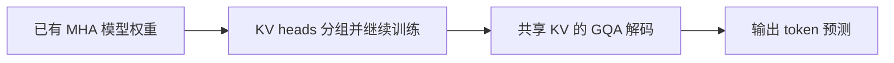
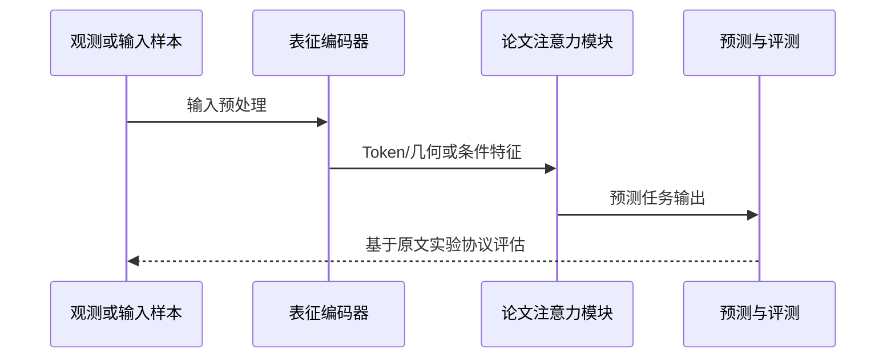

# GQA: Training Generalized Multi-Query Transformer Models from Multi-Head Checkpoints（GQA：由多头检查点训练分组查询注意力模型）

## 一句话定义

通过 grouped-query attention 让多组 query heads 共享较少的 key/value heads，提供多头注意力与单 KV 的 MQA 之间的精度-解码速度折中，并提供从已有多头模型继续训练的方案。

## 英文缩写速查

| 缩写 | 英文全称 | 简要说明 |
|---|---|---|
| GQA | Grouped-Query Attention | 多个查询头共享分组键值头 |
| MHA | Multi-Head Attention | 每头独立键值投影 |
| MQA | Multi-Query Attention | 查询头共享一个键值头 |

## 为什么重要

- **解决的问题：** 通过 grouped-query attention 让多组 query heads 共享较少的 key/value heads，提供多头注意力与单 KV 的 MQA 之间的精度-解码速度折中，并提供从已有多头模型继续训练的方案。
- **机器人关联（跨论文迁移判断，非本文直接验证）：** VLA 自回归文本与动作解码可以评估 KV cache 成本；非自回归动作扩散头不直接受益。

## 核心原理

在多头 Query 的 Transformer 层中，把 K、V 头压缩为较少的组：每一组内多个 query heads 共享一组 K/V，从而使解码 KV cache 和内存带宽成本介于 MHA 与单组 MQA 之间。由已有多头 checkpoint 把组内 K/V 权重平均得到初始共享权重，再以少量预训练训练量 uptraining，以恢复性能；GQA-G 中 G 是 K/V group 数。

**消融指向：** 随 K/V group 数改变可权衡模型质量与解码速度；附录讨论 MQA 在部分设置中的不稳定，GQA 有利于兼顾缓存成本与质量。

## 流程总览

**图示范围：** 基于论文摘要和已公开方法主线的高层数据流；具体模块实现细节及源码调用关系待全文和代码核验，不应当作复现级结构图。

## 实验与评测

论文 T5-XXL 系列举例：MHA 解码约 1.51 s，质量指标均值约 47.2；GQA-8 解码约 0.28 s，质量均值 47.1；MQA 解码约 0.24 s、均值 46.6。作者报告约 5% 原预训练预算的转换训练；这些时间依赖硬件、输入长度和模型设置，不能泛化到任何机器人动作头。

**对照限制：** 比较同论文同任务同协议的基线，跨论文结果不作为统一排行榜。

## 结论

- **方法贡献：** 在多头 Query 的 Transformer 层中，把 K、V 头压缩为较少的组：每一组内多个 query heads 共享一组 K/V，从而使解码 KV cache 和内存带宽成本介于 MHA 与单组 MQA 之间。
- **作者实验：** 论文 T5-XXL 系列举例：MHA 解码约 1.51 s，质量指标均值约 47.2；GQA-8 解码约 0.28 s，质量均值 47.1；MQA 解码约 0.24 s、均值 46.6。
- **适用边界：** 主要测自回归大型编码器-解码器语言模型；没有证明卷积视觉模型、短上下文扩散动作头或高频机器人控制的普遍优势。

## 与其他工作对比

- [Transformer 基础](./paper-attention-is-all-you-need.md) 提供全局注意力基线，本文体现其在特定任务或计算约束下的变体/评估。
- [20 篇注意力架构与机器人策略对照](../comparisons/attention-architectures-robotics-20-papers.md) 按视频、三维、机器人策略与计算优化归类。

## 工程实践

- **建议：** 只有当 VLA/WAM 部署瓶颈确实位于自回归 KV 缓存时再考虑 GQA；需与无缓存 DiT action head 分开选型。
- **公开入口：** https://arxiv.org/abs/2305.13245；已读论文及附录，不等于成功编译或跑通仓库。

## 源码运行时序图

**核对范围：** 项目/源码入口见 https://arxiv.org/abs/2305.13245；未在本环境执行训练与推理。以下为根据论文正文确认的计算与评测时序，不冒充作者代码的逐函数调用。

## 局限与风险

- 主要测自回归大型编码器-解码器语言模型；没有证明卷积视觉模型、短上下文扩散动作头或高频机器人控制的普遍优势。
- **原文状态：** 正文和附录已通读，并记录实验适用范围；参考 [来源精读笔记](../../sources/papers/attention20_2305_13245.md)。

## 相关方法与任务

以下链接是**应用关联**，不是本文已在机器人场景验证这些工程收益：

- [vla](../methods/vla.md) — VLA 自回归解码中的 KV 缓存优化
- [robotics-transformer-rt-series](../methods/robotics-transformer-rt-series.md) — 将 GQA 与 MHA 的训练/部署成本分开评估

## 关联页面

- [Attention Is All You Need](./paper-attention-is-all-you-need.md)
- [ACT 机器人动作分块](./paper-act.md)
- [20 篇注意力相关论文对照](../comparisons/attention-architectures-robotics-20-papers.md)

## 参考来源

- [本论文原始来源归档](../../sources/papers/attention20_2305_13245.md)
- [一手论文](https://arxiv.org/abs/2305.13245)

## 推荐继续阅读

- [原始论文/会议出版页](https://arxiv.org/abs/2305.13245)
- [Transformer 基础](./paper-attention-is-all-you-need.md)
