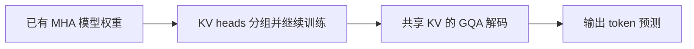

# GQA: Training Generalized Multi-Query Transformer Models from Multi-Head Checkpoints（GQA：由多头检查点训练分组查询注意力模型）

## 一句话定义

通过 grouped-query attention 让多组 query heads 共享较少的 key/value heads，提供多头注意力与单 KV 的 MQA 之间的精度-解码速度折中，并提供从已有多头模型继续训练的方案。

## 英文缩写速查

| 缩写 | 英文全称 | 简要说明 |
|---|---|---|
| GQA | Grouped-Query Attention | 多个查询头共享分组键值头 |
| MHA | Multi-Head Attention | 每头独立键值投影 |
| MQA | Multi-Query Attention | 查询头共享一个键值头 |

## 为什么重要

- **解决的问题：** 通过 grouped-query attention 让多组 query heads 共享较少的 key/value heads，提供多头注意力与单 KV 的 MQA 之间的精度-解码速度折中，并提供从已有多头模型继续训练的方案。
- **机器人关联（跨论文迁移判断，非本文直接验证）：** VLA 自回归文本与动作解码可以评估 KV cache 成本；非自回归动作扩散头不直接受益。

## 核心原理

通过 grouped-query attention 让多组 query heads 共享较少的 key/value heads，提供多头注意力与单 KV 的 MQA 之间的精度-解码速度折中，并提供从已有多头模型继续训练的方案。

## 流程总览

**图示范围：** 基于论文摘要和已公开方法主线的高层数据流；具体模块实现细节及源码调用关系待全文和代码核验，不应当作复现级结构图。

## 实验与评测

- 论文报告经 uptraining 的 GQA 接近 MHA 的质量且解码速度接近 MQA；5% 原预训练算力指论文给出的转换训练预算。
- **读数边界：** 不将该论文的识别/检测/操控指标跨数据集直接比较；实验表格、随机种子与消融设置仍需全文核验。

## 结论

**这篇论文的主要价值在于注意力结构和任务约束之间的工程取舍，尚不能由摘要证实真实机器人部署收益。**

1. **结构重点** — 通过 grouped-query attention 让多组 query heads 共享较少的 key/value heads，提供多头注意力与单 KV 的 MQA 之间的精度-解码速度折中，并提供从已有多头模型继续训练的方案。
2. **实证范围** — 论文报告经 uptraining 的 GQA 接近 MHA 的质量且解码速度接近 MQA
3. **部署前确认** — 主要针对自回归解码缓存的性能；短上下文或无缓存的机器人动作头，收益可能很小。

## 与其他工作对比

- [Transformer 基础](./paper-attention-is-all-you-need.md) 提供全局注意力基线，本文体现其在特定任务或计算约束下的变体/评估。
- [20 篇注意力架构与机器人策略对照](../comparisons/attention-architectures-robotics-20-papers.md) 按视频、三维、机器人策略与计算优化归类。

## 工程实践

- VLA 自回归文本与动作解码可以评估 KV cache 成本；非自回归动作扩散头不直接受益。
- 选择实现时需核实官方仓库、输入输出形状、训练数据和硬件运行条件，不应根据摘要推断可运行入口。

## 源码运行时序图

**暂不绘制：** 官方运行入口与实际源码调用关系尚未核实。此处不使用假想的通用 `sequenceDiagram` 冒充源码分析；待核验训练/推理入口后补充。

## 局限与风险

- 主要针对自回归解码缓存的性能；短上下文或无缓存的机器人动作头，收益可能很小。
- **资料状态：** 当前只完成题录、摘要与方法主线核对，**尚未完成全文及附录通读**；本页按草稿收录，不标注健康度满分。

## 相关方法与任务

以下链接是**应用关联**，不是本文已在机器人场景验证这些工程收益：

- [vla](../methods/vla.md) — VLA 自回归解码中的 KV 缓存优化
- [robotics-transformer-rt-series](../methods/robotics-transformer-rt-series.md) — 将 GQA 与 MHA 的训练/部署成本分开评估

## 关联页面

- [Attention Is All You Need](./paper-attention-is-all-you-need.md)
- [ACT 机器人动作分块](./paper-act.md)
- [20 篇注意力相关论文对照](../comparisons/attention-architectures-robotics-20-papers.md)

## 参考来源

- [本论文原始来源归档](../../sources/papers/attention20_2305_13245.md)
- [一手论文](https://arxiv.org/abs/2305.13245)

## 推荐继续阅读

- [原始论文/会议出版页](https://arxiv.org/abs/2305.13245)
- [Transformer 基础](./paper-attention-is-all-you-need.md)
