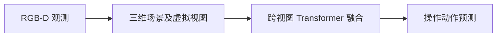
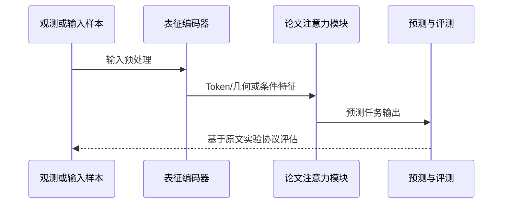

# RVT: Robotic View Transformer for 3D Object Manipulation（RVT：用于三维物体操作的机器人视图 Transformer）

## 一句话定义

从相机观测构建三维场景表示并重渲染工作空间的虚拟视图，通过跨视图注意力融合信息来预测操作动作，减少直接高分辨率体素处理的成本。

## 英文缩写速查

| 缩写 | 英文全称 | 简要说明 |
|---|---|---|
| RVT | Robotic View Transformer | 多视图三维操作策略 |
| RGB-D | Red Green Blue Depth | 颜色及深度相机输入 |
| RLBench | Robot Learning Benchmark | 机器人操作任务评测集 |

## 为什么重要

- **解决的问题：** 从相机观测构建三维场景表示并重渲染工作空间的虚拟视图，通过跨视图注意力融合信息来预测操作动作，减少直接高分辨率体素处理的成本。
- **机器人关联（跨论文迁移判断，非本文直接验证）：** 适合对比体素法 PerAct 与多视图 3D 表示的计算、准确性及相机敏感性。

## 核心原理

将 RGB-D 感知点云置于统一三维工作空间，从若干虚拟正交视角渲染 RGB、深度/几何特征，并在多视图 patch tokens 上先应用单视图 Transformer，再跨视图交互。各视图预测二维热力图并反投影到三维求平移；另预测 Euler 角离散旋转、夹爪与碰撞动作。核心不是单纯多摄像头输入，而是把三维几何重渲染成密集二维图像再学习。

**消融指向：** 附录虚拟视图像素 220 时 RLBench 平均成功率约 62.9%，100px 时 51.1%，采用透视视图约 40.2%，说明视角参数与几何重建质量会改变结果。

## 流程总览

**图示范围：** 基于论文摘要和已公开方法主线的高层数据流；具体模块实现细节及源码调用关系待全文和代码核验，不应当作复现级结构图。

## 实验与评测

RLBench 18 任务、249 variations：作者报告相对公开 PerAct 平均成功率 26% 相对提升，训练达到相当性能快约 36 倍、同类 GPU 上推理快约 2.3 倍（基线/配置限定）。真机 Franka 5 项任务合计 51 条示教，完整任务成功率约 56%；去掉 marker task 为约 82.5%，marker 任务为 0%，显示点云/细小物体并非稳健解决。

**对照限制：** 比较同论文同任务同协议的基线，跨论文结果不作为统一排行榜。

## 结论

- **方法贡献：** 将 RGB-D 感知点云置于统一三维工作空间，从若干虚拟正交视角渲染 RGB、深度/几何特征，并在多视图 patch tokens 上先应用单视图 Transformer，再跨视图交互。
- **作者实验：** RLBench 18 任务、249 variations：作者报告相对公开 PerAct 平均成功率 26% 相对提升，训练达到相当性能快约 36 倍、同类 GPU 上推理快约 2.3 倍（基线/配置限定）。
- **适用边界：** 外参标定、深度质量与虚拟投影/空间覆盖直接影响成功率；未证明零标定即插即用或跨机器人无条件泛化。

## 与其他工作对比

- [Transformer 基础](./paper-attention-is-all-you-need.md) 提供全局注意力基线，本文体现其在特定任务或计算约束下的变体/评估。
- [20 篇注意力架构与机器人策略对照](../comparisons/attention-architectures-robotics-20-papers.md) 按视频、三维、机器人策略与计算优化归类。

## 工程实践

- **建议：** 固定工作空间坐标与相机外参，分别评估薄片、细杆、反光材料的点云缺损；注意离散动作必须经规划/控制器执行。
- **公开入口：** https://github.com/NVlabs/RVT；已读论文及附录，不等于成功编译或跑通仓库。

## 源码运行时序图

**核对范围：** 项目/源码入口见 https://github.com/NVlabs/RVT；未在本环境执行训练与推理。以下为根据论文正文确认的计算与评测时序，不冒充作者代码的逐函数调用。

## 局限与风险

- 外参标定、深度质量与虚拟投影/空间覆盖直接影响成功率；未证明零标定即插即用或跨机器人无条件泛化。
- **原文状态：** 正文和附录已通读，并记录实验适用范围；参考 [来源精读笔记](../../sources/papers/attention20_2306_14896.md)。

## 相关方法与任务

以下链接是**应用关联**，不是本文已在机器人场景验证这些工程收益：

- [bc-with-transformer](../methods/bc-with-transformer.md) — 跨虚拟视图表征驱动机器人动作模仿
- [manipulation](../tasks/manipulation.md) — 三维物体操作的视图构建与预测

## 关联页面

- [Attention Is All You Need](./paper-attention-is-all-you-need.md)
- [ACT 机器人动作分块](./paper-act.md)
- [20 篇注意力相关论文对照](../comparisons/attention-architectures-robotics-20-papers.md)

## 参考来源

- [本论文原始来源归档](../../sources/papers/attention20_2306_14896.md)
- [一手论文](https://arxiv.org/abs/2306.14896)

## 推荐继续阅读

- [原始论文/会议出版页](https://arxiv.org/abs/2306.14896)
- [Transformer 基础](./paper-attention-is-all-you-need.md)
