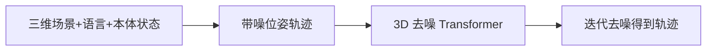

# 3D Diffuser Actor: Policy Diffusion with 3D Scene Representations（3D Diffuser Actor：结合三维场景表示的扩散策略）

## 一句话定义

将三维视觉场景、语言指令及本体状态送入三维去噪 Transformer，预测加噪机器人位姿轨迹中的噪声并迭代恢复动作轨迹。

## 英文缩写速查

| 缩写 | 英文全称 | 简要说明 |
|---|---|---|
| RGB-D | Red Green Blue Depth | 三维观测来源 |
| 6DoF | Six Degrees of Freedom | 末端位姿的平移和旋转 |
| BC | Behavior Cloning | 从示范学习动作分布 |

## 为什么重要

- **解决的问题：** 将三维视觉场景、语言指令及本体状态送入三维去噪 Transformer，预测加噪机器人位姿轨迹中的噪声并迭代恢复动作轨迹。
- **机器人关联（跨论文迁移判断，非本文直接验证）：** 在三维操作中把生成式多峰动作建模与几何表示联合考虑；工程需实测采样时延。

## 核心原理

将三维视觉场景、语言指令及本体状态送入三维去噪 Transformer，预测加噪机器人位姿轨迹中的噪声并迭代恢复动作轨迹。

## 流程总览

**图示范围：** 基于论文摘要和已公开方法主线的高层数据流；具体模块实现细节及源码调用关系待全文和代码核验，不应当作复现级结构图。

## 实验与评测

- 在 RLBench 多视图与单视图配置上，论文分别报告相对先前最优结果绝对提升 18.1 与 13.1 个百分点，同时包含 CALVIN 和实机评测。
- **读数边界：** 不将该论文的识别/检测/操控指标跨数据集直接比较；实验表格、随机种子与消融设置仍需全文核验。

## 结论

**这篇论文的主要价值在于注意力结构和任务约束之间的工程取舍，尚不能由摘要证实真实机器人部署收益。**

1. **结构重点** — 将三维视觉场景、语言指令及本体状态送入三维去噪 Transformer，预测加噪机器人位姿轨迹中的噪声并迭代恢复动作轨迹。
2. **实证范围** — 在 RLBench 多视图与单视图配置上，论文分别报告相对先前最优结果绝对提升 18.1 与 13.1 个百分点，同时包含 CALVIN 和实机评测。
3. **部署前确认** — 扩散采样步数对端到端控制周期敏感；三维表示质量与相机观测噪声会影响轨迹质量。

## 与其他工作对比

- [Transformer 基础](./paper-attention-is-all-you-need.md) 提供全局注意力基线，本文体现其在特定任务或计算约束下的变体/评估。
- [20 篇注意力架构与机器人策略对照](../comparisons/attention-architectures-robotics-20-papers.md) 按视频、三维、机器人策略与计算优化归类。

## 工程实践

- 在三维操作中把生成式多峰动作建模与几何表示联合考虑；工程需实测采样时延。
- 选择实现时需核实官方仓库、输入输出形状、训练数据和硬件运行条件，不应根据摘要推断可运行入口。

## 源码运行时序图

**暂不绘制：** 官方运行入口与实际源码调用关系尚未核实。此处不使用假想的通用 `sequenceDiagram` 冒充源码分析；待核验训练/推理入口后补充。

## 局限与风险

- 扩散采样步数对端到端控制周期敏感；三维表示质量与相机观测噪声会影响轨迹质量。
- **资料状态：** 当前只完成题录、摘要与方法主线核对，**尚未完成全文及附录通读**；本页按草稿收录，不标注健康度满分。

## 相关方法与任务

以下链接是**应用关联**，不是本文已在机器人场景验证这些工程收益：

- [diffusion-policy](../methods/diffusion-policy.md) — 扩散去噪生成动作轨迹
- [manipulation](../tasks/manipulation.md) — 三维场景条件下的操作策略

## 关联页面

- [Attention Is All You Need](./paper-attention-is-all-you-need.md)
- [ACT 机器人动作分块](./paper-act.md)
- [20 篇注意力相关论文对照](../comparisons/attention-architectures-robotics-20-papers.md)

## 参考来源

- [本论文原始来源归档](../../sources/papers/attention20_2402_10885.md)
- [一手论文](https://arxiv.org/abs/2402.10885)

## 推荐继续阅读

- [原始论文/会议出版页](https://arxiv.org/abs/2402.10885)
- [Transformer 基础](./paper-attention-is-all-you-need.md)
