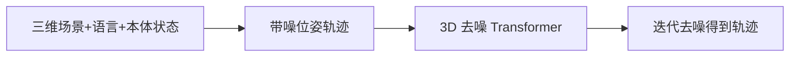
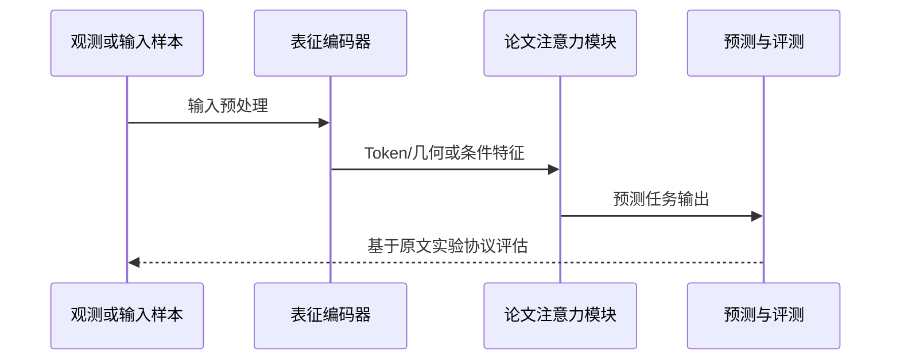

# 3D Diffuser Actor: Policy Diffusion with 3D Scene Representations（3D Diffuser Actor：结合三维场景表示的扩散策略）

## 一句话定义

将三维视觉场景、语言指令及本体状态送入三维去噪 Transformer，预测加噪机器人位姿轨迹中的噪声并迭代恢复动作轨迹。

## 英文缩写速查

| 缩写 | 英文全称 | 简要说明 |
|---|---|---|
| RGB-D | Red Green Blue Depth | 三维观测来源 |
| 6DoF | Six Degrees of Freedom | 末端位姿的平移和旋转 |
| BC | Behavior Cloning | 从示范学习动作分布 |

## 为什么重要

- **解决的问题：** 将三维视觉场景、语言指令及本体状态送入三维去噪 Transformer，预测加噪机器人位姿轨迹中的噪声并迭代恢复动作轨迹。
- **机器人关联（跨论文迁移判断，非本文直接验证）：** 在三维操作中把生成式多峰动作建模与几何表示联合考虑；工程需实测采样时延。

## 核心原理

输入来自一或多路校准 RGB-D 的三维点云、语言指令与机器人本体状态；通过点云的空间 token 表示构建条件，使用相对 3D cross-attention 的扩散 Transformer 对末端执行器位姿轨迹去噪。姿态以连续 6D rotation 编码、位置用三维平移、夹爪用二元分类；训练优化平移/旋转噪声的 L1 与夹爪 BCE。RLBench 预测下一关键帧并使用 BiRRT，CALVIN 则预测多个末端轨迹点并重新规划。

**消融指向：** 相比 2D 表征、绝对 3D 注意力或全局池化场景向量，tokenized 3D 相对注意力更有效。附录深度噪声试验单视图清洁 78.4%，扰动 0.01 后 72.4%，0.03 后 50.1%，说明深度噪声会明显削弱策略。

## 流程总览

**图示范围：** 基于论文摘要和已公开方法主线的高层数据流；具体模块实现细节及源码调用关系待全文和代码核验，不应当作复现级结构图。

## 实验与评测

RLBench 18-task 多视图表（Table 1）：3D Diffuser Actor 平均 81.3%，对比 Act3D 63.2%、RVT 62.9%；即相对 63.2 约 +18.1 个百分点。CALVIN ABC→D 5 连续子任务评测：平均完成长度 3.35（GR-1 3.06），不是每步动作成功率。真机 Franka+Azure Kinect、12 项任务各 15 条示教、每项 10 次测试，任务成功率从 20% 到 100% 不等。论文给出 RTX 2080 Ti 条件下约 600ms/6 位姿，约 10Hz 的动作/位姿吞吐，不等于执行每步 1kHz。

**对照限制：** 比较同论文同任务同协议的基线，跨论文结果不作为统一排行榜。

## 结论

- **方法贡献：** 输入来自一或多路校准 RGB-D 的三维点云、语言指令与机器人本体状态；通过点云的空间 token 表示构建条件，使用相对 3D cross-attention 的扩散 Transformer 对末端执行器位姿轨迹去噪。
- **作者实验：** RLBench 18-task 多视图表（Table 1）：3D Diffuser Actor 平均 81.3%，对比 Act3D 63.2%、RVT 62.9%；即相对 63.2 约 +18.1 个百分点。
- **适用边界：** 需要相机外参与深度；RLBench/CALVIN 多为准静态任务，未验证高速动态接触或速度控制；扩散迭代比非扩散策略慢。真机依赖 MoveIt!/BiRRT 到关键位姿的规划。

## 与其他工作对比

- [Transformer 基础](./paper-attention-is-all-you-need.md) 提供全局注意力基线，本文体现其在特定任务或计算约束下的变体/评估。
- [20 篇注意力架构与机器人策略对照](../comparisons/attention-architectures-robotics-20-papers.md) 按视频、三维、机器人策略与计算优化归类。

## 工程实践

- **建议：** 区分 RLBench 单关键帧与 CALVIN 轨迹动作，严格固定观测帧、坐标系、关键帧数及去噪步数，并实测从图像输入到规划器的总延迟。
- **公开入口：** https://github.com/nickgkan/3d_diffuser_actor；已读论文及附录，不等于成功编译或跑通仓库。

## 源码运行时序图

**核对范围：** 项目/源码入口见 https://github.com/nickgkan/3d_diffuser_actor；未在本环境执行训练与推理。以下为根据论文正文确认的计算与评测时序，不冒充作者代码的逐函数调用。

## 局限与风险

- 需要相机外参与深度；RLBench/CALVIN 多为准静态任务，未验证高速动态接触或速度控制；扩散迭代比非扩散策略慢。真机依赖 MoveIt!/BiRRT 到关键位姿的规划。
- **原文状态：** 正文和附录已通读，并记录实验适用范围；参考 [来源精读笔记](../../sources/papers/attention20_2402_10885.md)。

## 相关方法与任务

以下链接是**应用关联**，不是本文已在机器人场景验证这些工程收益：

- [diffusion-policy](../methods/diffusion-policy.md) — 扩散去噪生成动作轨迹
- [manipulation](../tasks/manipulation.md) — 三维场景条件下的操作策略

## 关联页面

- [Attention Is All You Need](./paper-attention-is-all-you-need.md)
- [ACT 机器人动作分块](./paper-act.md)
- [20 篇注意力相关论文对照](../comparisons/attention-architectures-robotics-20-papers.md)

## 参考来源

- [本论文原始来源归档](../../sources/papers/attention20_2402_10885.md)
- [一手论文](https://arxiv.org/abs/2402.10885)

## 推荐继续阅读

- [原始论文/会议出版页](https://arxiv.org/abs/2402.10885)
- [Transformer 基础](./paper-attention-is-all-you-need.md)
