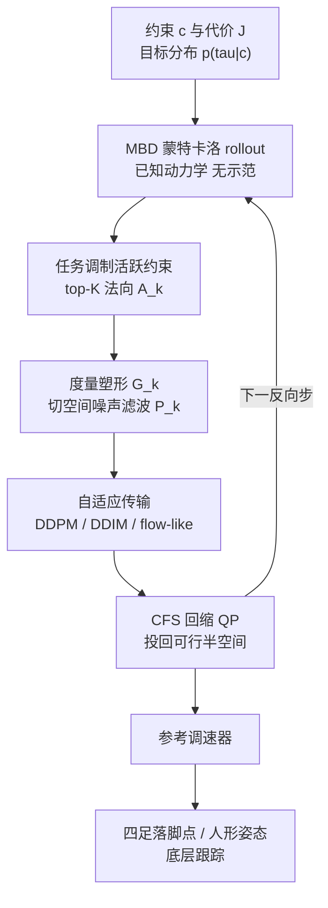
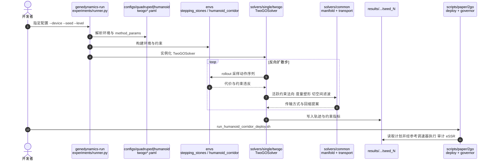

# 2GO：几何感知的模型式生成优化做受约束腿式规划

**2GO**（*Model-Based Geometry-Aware Generative Optimization for Constrained Locomotion Planning*，[arXiv:2610.07772](https://arxiv.org/abs/2610.07772)，Zhilin He、Xinyuan Wang、Changliu Liu，卡内基梅隆大学与密歇根大学）在 **Model-Based Diffusion（MBD）** 之上，用任务相关的活跃约束几何去塑形去噪方向和噪声，并以自适应传输调度混合 DDPM/DDIM/流式更新，使四足踏脚石落脚点选择与人形走廊姿态规划同时更可行。

## 一句话定义

**不训练、不需示范：用已知动力学做蒙特卡洛 rollout 的“扩散式轨迹优化”，每一步把活跃约束的法向几何转成度量塑形、切空间噪声滤波与 CFS 回缩，再由参考调速器交给底层跟踪。**

## 英文缩写速查

| 缩写 | 英文全称 | 简要说明 |
|------|----------|----------|
| 2GO | 论文简称 | 全称展开在抓取到的文本中未见，推测取自 geometry-aware generative optimization |
| CLP | Constrained Locomotion Planning | 受约束腿式运动规划问题设定 |
| MBD | Model-Based Diffusion | 用已知动力学做无示范的扩散式轨迹优化 |
| CFS | Convex Feasible Set | 局部线性化约束半空间上的近端 QP 回缩 |
| DDPM / DDIM | Denoising Diffusion Probabilistic / Implicit Models | 两种反向传输；第三种 flow-like 共享 DDIM 系数 |
| CVaR | Conditional Value at Risk | 尾部风险水平，论文取 α = 0.9 |
| pSSR / eSSR | planning / execution Success Rate | 计划成功率 / 执行成功率 |
| MDOC / MD-COAS | 同团队前作基线 | CBF 投影扩散规划；iALM + CFS 自适应调度 |

## 为什么重要

- **腿式规划的强接触约束：** 落脚点离散、碰撞与支撑约束非凸；纯优化易陷局部解，纯生成模型不保证满足约束，2GO 把“约束几何”显式放进生成过程。
- **不需要训练数据：** 与示范驱动的扩散策略不同，它直接用动力学 rollout，部署新场景无需重训。
- **一套方法跨四足与人形：** 同一求解器在 12 维控制的踏脚石和 9 维控制的人形走廊上使用。
- **代码在同一栈里可对照：** MPPI、MBD、MDOC、MD-COAS 基线和 2GO 都在 genedynamics 里，便于公平比较。

## 核心信息

| 项 | 内容 |
|----|------|
| **机构** | 卡内基梅隆大学（CMU，He、Liu）；密歇根大学（UMich，Wang） |
| **任务** | 四足踏脚石 S1/S2（16 维状态，12 维控制）；人形走廊 Zone A–D（14 维状态，9 维控制，走廊宽 1.6 m） |
| **真机** | Unitree G1，AR 渲染障碍（定性演示） |
| **算力** | NVIDIA RTX A6000（48 GB）+ 9 个 CPU 核 |
| **开源** | **已开源**：[hhhhzl/genedynamics](https://github.com/hhhhzl/genedynamics)，MIT；V1 release candidate |

## 核心原理

### 方法栈

| 模块 | 设计 |
|------|------|
| 任务调制活跃约束 | 违反代理 φ(g)·ω 选 top-K_A（局部实验 K_A = 8），归一化法向组成 A_k |
| 法向诱导度量塑形 | G_k = I + A_kᵀA_k，位移 d_k^G = G_k⁻¹[d_k⁰ + β_k] |
| 切空间随机滤波 | P_k = I − A_kᵀ(A_kA_kᵀ + ε_P I)⁻¹A_k，噪声只留切向 |
| 传输选择 | 风险 ν_k > δ_k 用 DDPM；χ_k > θ_k 用 DDIM；否则 flow-like |
| 统一更新 | Ỹ_{k−1} = Γ_k(Y_k, Ȳ_k) + η_k d_k^G + σ_eff P_k z_k，带噪声门 γ_k |
| CFS 回缩 | 度量近端 QP 投回局部线性化约束半空间，可选松弛 |
| 参考调速器 | 把洁净计划适配到底层跟踪 |

### 流程总览

## 方法

- **输入/输出：** 输入机器人动力学、约束与代价；输出满足约束的轨迹（四足：身体运动、落脚点、步态相位；人形：机体位置、姿态、手臂间隙）。
- **先验与采样：** MBD 把轨迹优化当作后验采样，p(τ|c) ∝ exp(−J/λ)·1_F(c)(τ)。2GO 的改动集中在三处：约束几何如何改位移、如何改噪声、如何选择传输类型。
- **自适应性：** 风险（CVaR，α = 0.9）驱动传输选择，噪声门按局部变化率调节；Fig. 4 使用固定 100 步扩散。
- **已知近似：** 约束法向用一步动作空间近似，而非全时域雅可比；规范的概率流映射未单独评测。

## 源码运行时序图

官方仓库 [hhhhzl/genedynamics](https://github.com/hhhhzl/genedynamics)（归档见 [sources/repos/genedynamics.md](../../sources/repos/genedynamics.md)）以 YAML 配置驱动实验；2GO 的求解器位于 `genedynamics/solvers/single/twogo/`：

最短复现路径：`pip install -e ".[optimization]"` → `genedynamics-run configs/humanoid/corridor_2d/main/twogo_zone_a.yaml --device cpu --seed 0 --level 0 --dry-run` 校验 → 去掉 `--dry-run` 跑单例；论文矩阵用 `bash scripts/paper/2go/run_stepping_stones_main.sh`。

## 实验与评测

设置：5 个种子，每种子 10 条干净轨迹；目标容差 0.20 m，执行允许 0.05 m 摆动末端足误差；基线 MPPI、MBD、MDOC、MD-COAS。数值转录自抓取文本，存在解析误差风险。

| 环境 | 方法 | pSSR | pV | pT (s) | eSSR |
|------|------|------|----|--------|------|
| S1 踏脚石 | MPPI | 0.40 | 2.20 | 2.87 | 0.20 |
| S1 | MDOC | 0.88 | 1.00 | 18.37 | 0.80 |
| S1 | MD-COAS | 0.32 | 0.85 | 288.22 | 0.00 |
| S1 | **2GO** | **0.98** | **0.47** | 21.51 | 0.80 |
| S2 踏脚石 | MDOC | 0.68 | 1.11 | 19.73 | 0.20 |
| S2 | **2GO** | **0.88** | **0.61** | 23.19 | 0.40 |
| Zone A | MDOC / 2GO | 0.96 / 0.96 | 0.00 / 0.00 | 18.04 / 14.08 | 1.00 / 1.00 |
| Zone B | MDOC | 0.90 | 0.77 | 39.16 | 0.20 |
| Zone B | 2GO | 0.48 | 1.82 | 37.09 | 0.20 |
| Zone C | MDOC / 2GO | 1.00 / 1.00 | 0.00 / 1.23 | 10.94 / 14.23 | 1.00 / 1.00 |
| Zone D | MDOC | 0.86 | 0.08 | 10.14 | 0.40 |
| Zone D | **2GO** | **0.98** | **0.00** | 11.34 | 0.60 |

- MPPI 规划最快（1–3 s 量级），但在人形 Zone A–D 的 pSSR 全为 0.00；MBD 同为 0.00，说明无约束几何的采样难以在窄通道成功。
- **真机：** Unitree G1 在 AR 渲染的四个区域完成撞墙前恢复、多模态绕行、窄走廊、球间通过和终点站立；速度/偏航角速度/高度指令送入内置运动控制器。演示为定性，AR 不含真实接触。
- 论文的配对候选 CFS 消融与几何/自适应随机性消融（附录 B–F）在本次读到的文本中缺失，归档未转录数值。

## 工程实践

- **环境：** Python 3.10–3.12，JAX 后端；GPU 路径见仓库 `docs/recipes/gpu-planning.md`；有 CPU 无仿真示例 `examples/plan_to_goal.py`。
- **命名：** 求解器 key 为 `2go`，配置文件名为 `twogo`，指同一算法。
- **关键配置：** `twogo.yaml` 中 horizon 16、`twogo_active_topk` 8、`twogo_transport_schedule: adaptive`、CVaR α 0.9。
- **开源状态（核查日 2026-10-12）：** 仓库含大量源码、配置、测试与 Docker，MIT 许可，README 标注 V1 release candidate；docs 称人形走廊的行走执行仍属 deferred，仅规划配置作为 V1 契约，真机演示的部署脚本需 MuJoCo + PyTorch 与自备硬件。论文未列独立项目页。
- **运行时间：** 2GO 规划约 11–37 s（视环境），比 MPPI 慢一个量级，需要离线或低频使用（推测）。

## 结论

**2GO 的核心是让“约束几何”进入生成式轨迹优化的去噪过程，在多数踏脚石与走廊设置下把计划成功率提到最高，但在 Zone B 的挤压场景弱于 MDOC。**

1. **看 pSSR 与 pV：** S1 上 0.98 / 0.47 cm，S2 上 0.88 / 0.61 cm，均优于四个基线。
2. **别忽略弱项：** Zone B 的 pSSR 0.48 对 MDOC 0.90。
3. **规划成本较高：** 约 11–37 s，MPPI 约 1–3 s，实时使用需要滚动时域或加速。
4. **计划成功 ≠ 执行成功：** S1 的 eSSR 0.80，S2 仅 0.40，取决于参考接口与调速器。
5. **真机仅为定性：** G1 的 AR 演示不含真实刚体接触。
6. **复现门槛低：** CPU 示例与配置驱动，适合作为约束规划基线。

## 与其他工作对比

| 对照 | 差异读法 |
|------|----------|
| MBD | 2GO 的基底；无约束几何，人形走廊 pSSR 为 0.00 |
| MDOC / MD-COAS | 同团队前作；分别用 CBF 投影和 iALM + CFS 自适应调度；2GO 增加度量塑形与切空间噪声 |
| [MPPI](../methods/mppi.md) | 规划最快，但强约束场景几乎不成功 |
| [轨迹优化](../methods/trajectory-optimization.md) | 传统优化依赖初值；2GO 用采样 + 回缩减轻局部解 |
| [BK-MBD](./paper-bkmbd-koopman-diffusion.md) | 同样基于 MBD，用 Koopman 升维加速批量推演以面向实时控制；2GO 则侧重约束几何，二者关注点不同 |

## 局限与风险

- **适用边界：** 局部可行性依赖邻域假设和模型误差界，非全局保证；法向为一步近似。
- **证据：** 数值表转录自被截断的抓取文本；基线是否按各自最优调参原文可见部分未说明；真机为 AR 定性演示。
- **开源：** 已开源，但 V1 的人形执行仍属 deferred，部署需自备硬件与重依赖。
- **同仓多论文：** genedynamics 同时承载 MDOC、MD-COAS 等，使用时按论文编号和 `method` 键区分。

## 关联页面

- [人形/四足前沿周报 2026-10-05~10-09](../overview/frontier-humanoid-quadruped-2026-10-05-10-09.md)
- [运动控制任务页](../tasks/locomotion.md)
- [人形运动任务页](../tasks/humanoid-locomotion.md)
- [轨迹优化](../methods/trajectory-optimization.md)
- [扩散模型](../concepts/diffusion-model.md)
- [Unitree G1](../entities/unitree-g1.md)

## 参考来源

- [2GO 论文归档](../../sources/papers/2go_arxiv_2610_07772.md)
- [genedynamics 仓库归档](../../sources/repos/genedynamics.md)
- [人形/四足周报来源](../../sources/blogs/frontier_humanoid_quadruped_2026_10_05_10_09.md)

## 推荐继续阅读

- [Model-Based Diffusion for Trajectory Optimization（MBD）](https://arxiv.org/abs/2407.01573)
- [MBD 项目页](https://lecar-lab.github.io/mbd/)
- [genedynamics 仓库](https://github.com/hhhhzl/genedynamics)
