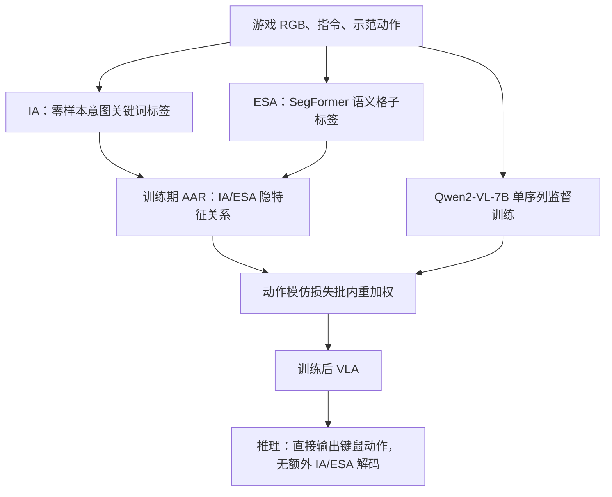

# 3A-VLA：三维游戏世界中的抽象对齐动作学习

**英文题名：** 3A-VLA: Abstraction-Aligned Action Learning for Vision-Language Agents in 3D Game Worlds。官方原文：[arXiv:2602.02212v2](https://arxiv.org/abs/2602.02212v2)。已核对 v2 正文与必要附录，**未独立复现训练/真机**。

## 一句话定义
3A-VLA 通过 IA 稀疏意图关键词、ESA 场景语义格子的**训练期辅助监督**和 AAR 加权模仿损失，让视觉游戏代理更关注可操作信息；推理仍直接生成动作，**不执行额外高层规划器**。

## 英文缩写速查
| 缩写 | 英文全称 | 简要说明 |
|---|---|---|
| VLA | Vision-Language-Action | 视觉语言动作模型 |
| IA | Intention Abstraction | 意图抽象，稀疏关键词辅助标签 |
| ESA | Environment Semantics Abstraction | 环境语义抽象，8×8 稀疏网格 |
| AAR | Abstraction Alignment Reweighting | 按 IA–ESA 对齐关系重加权动作模仿损失 |

## 为什么重要
三维游戏中，高维观测、语言目标与离散动作存在语义粒度落差。 论文的价值在于将这一失败模式单独建模，而非依靠笼统的端到端指标解释。

## 核心机制
1. **基本模型**：基于 Qwen2-VL-7B，以第一人称 RGB 单帧和文字指令训练离散键鼠动作，序列中**先生成动作**再输出 IA/ESA 辅助标签；独立环境微调。
2. **IA（§3.2）**：通过零样本 Qwen2-VL-7B 将冗长指令压成可用关键词；是训练监督而非推理期另一个规划模型。
3. **ESA（§3.3）**：用预训练 SegFormer-B2 的场景语义，按优先级池化为 8×8、每格 K=2 的语义 token；类别包含人、载具、掩体、物品等交互线索。
4. **AAR（§3.4）**：从 IA/ESA 隐状态做 stop-gradient 均值池化、归一化后 Hadamard 乘积，由 MLP 输出**批内相对**权重，配合熵正则；这是学习的训练样本损失权重，**不代表校准过的示范可信度**。
5. **推理**：IA/ESA 与 AAR 不作为独立推理输出，维持标准 VLA 动作接口；论文还分别评估了训练所得表征在 token 剪枝下的可压缩性。

## 流程总览
以下为论文原文中的数据/控制流程，不表示本站运行了代码。

## 工程实践
- **训练/部署边界**：训练使用 IA、ESA 和 AAR，推理不需要额外抽象解码器，也不存在显式规划记忆。
- **设置（§4.1）**：Minecraft 约 50 小时、Game for Peace 约 200 小时的**独立**示范；每环境单独微调 Qwen2-VL-7B，训练 8×H20，推理 1×L40S。ESA 为 8×8、K=2，输入 640×360 RGB。
- **项目状态**：公开 [项目主页](https://3a-vla.github.io/)，其 Code 链接指向 `zhouzheyuan/3a-vla` 但核验时返回 404；配套 HF 资源与论文所用 Qwen2-VL-7B 实验配置不能直接画等号，**暂无可静态分析的官方可运行入口**。见 [项目来源](../../sources/sites/3a-vla-2602-02212.md)。

## 源码运行时序图
**不适用**：已核对 [项目页](https://3a-vla.github.io/) 所列 Code 链接但返回 404，无法静态分析真实源码入口。

## 实验与评测
- **Minecraft（Table 1）**：Combat MCU Mini/All 成功率 45.9%/35.4%，对照 OpenHA 40.0%/31.9%；任务分组与环境评测不同。
- **Game for Peace（Table 2）**：作者报告 3A-VLA 六原子任务平均成功率 66.4%，受控 IL+CoT+Caption 为 55.3%；100 次共享 episode manifest。
- **Minecraft 消融（Table 3）**：Vanilla IL 24.6%，IA 30.2%，ESA 30.6%，IA+ESA 36.5%，完整 AAR 40.4%；证明三部分有叠加效果，但都是作者实测。
- **跨游戏（Table 5）**：Game for Peace 战斗数据训练后，不做目标游戏微调，Valorant Hit SR 42.9%、Minecraft 25.7%、CS2 40.7%；不是机器人跨本体证据。
- **剪枝（Table 7）**：另一组**增强版 IA+ESA、关闭 AAR**配置下，75% token 剪枝成功率 42.1→41.5，延迟 1.1→0.3 秒，不能将该数字套用默认完整训练配置。

**证据边界：** 指标均来自指定版本论文/官方材料，并非本站独立复现；具体基线、统计区间与硬件已按表号区分。

## 局限与风险
原文 §5 明确：**单帧、反应式策略，没有显式时序记忆和长期规划**；ESA 缺少地形/碰撞几何，不等于理解真实环境可通行性。实验是三维游戏交互与键鼠动作，不存在已验证的实体机器人力矩控制；评测基线及性能属于论文指定设置。

## 与其他工作对比
- 在[九篇研究趋势地图](../overview/embodied-trends-2026-11-h1.md)中按“技术介入层”定位，不能比较跨论文不同任务、机器人和数据集的绝对指标。
- 相关基础：[VLA](../methods/vla.md)、[机器人操作](../tasks/manipulation.md)。

## 结论
**核心结论：三种抽象是训练信号，不是推理时的多层规划架构。**
- IA 与 ESA 提供互补的稀疏语义监督；AAR 给动作模仿损失添加连续的对齐权重。
- 原文 Minecraft 消融 24.6→40.4 个百分比数值，均属于作者同协议实验。
- 原文 §5 明确没有长期记忆/规划，适合读“训练数据语义过滤”，不宜当作完整游戏规划器。
- 复现前核验项目页 Code 链接与发布权重具体架构，当前没有可核实源码训练入口。

## 关联页面
- [VLA](../methods/vla.md)
- [机器人操作](../tasks/manipulation.md)
- [2026.11 上半月九篇论文技术图](../overview/embodied-trends-2026-11-h1.md)
- [VLA 纵深路线](../../roadmap/depth-vla.md)

## 参考来源
- [3A-VLA 项目页检查](../../sources/sites/3a-vla-2602-02212.md)
- [论文来源核对](../../sources/papers/3a-vla-2602-02212.md)
- [策展资料](../../sources/blogs/duomo_embodied_2026_11_first_half.md)
- [arXiv 指定版本](https://arxiv.org/abs/2602.02212v2)

## 推荐继续阅读
- [指定版本 arXiv HTML](https://arxiv.org/html/2602.02212v2)
- [VLA 纵深路线](../../roadmap/depth-vla.md)
