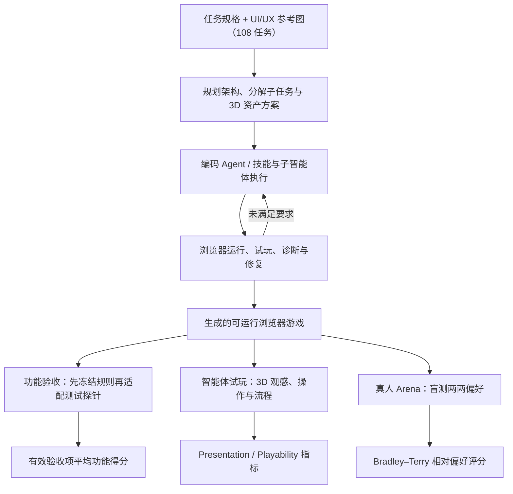

# 3D GameDev Arena：超长时程游戏开发智能体评测 / Long-Horizon Game Development Agent Benchmark

## 一句话定义

**3D GameDev Arena** 是一套从空项目开始编写浏览器游戏的长时程 Coding Agent 基准：以 108 个任务、功能验收、智能体试玩及真人盲选三个互补视角，检验“写出功能”是否真正成为“可玩、受欢迎的游戏”。

## 英文缩写速查

| 缩写 | 英文全称 | 简要说明 |
|---|---|---|
| LLM | Large Language Model | 驱动规划、编程和修复的语言模型 |
| QA | Quality Assurance | 游戏体验检查与智能体试玩评估 |
| BT | Bradley–Terry | 用真人两两选择估计相对偏好强度的模型 |
| UI/UX | User Interface / User Experience | 输入规格所附的界面与交互体验参考 |
| CLI | Command-Line Interface | 论文评测配置使用的不同编程智能体运行环境 |

## 为什么重要

传统 Coding Agent 评测往往偏重短期修 bug 或可重复单测。本基准要求从空目录整合场景、3D 资产、交互、游戏机制和浏览器运行，并进行多轮试玩、调试，因而提供“代码测试正确”和“最终用户真正满意”之间的实证对照。**它是软件和游戏开发评测，不是机器人运动控制或真实世界物理安全评测。**

## 核心信息

| 项目 | 原文信息 |
|---|---|
| 论文 | [arXiv:2611.24073v1](https://arxiv.org/abs/2611.24073)（2026-11-18，预印本） |
| 作者 | Bizhe Bai、Jiliang Jian、Yuqing Yan、Tao Chen、Ying Wen |
| 机构 | 复旦大学、上海创智学院、西安交通大学、上海交通大学 |
| 任务 | 108 个从零开始的游戏开发任务，14 个类别、两档难度，包含不同程度的 3D 游戏要求 |
| 起点 | 文字需求 + UI/UX 参考图；没有 starter code、预置资源或测试 hook |
| 输出 | 独立可运行的浏览器游戏，`index.html` 为规定入口 |
| 官方试玩 | https://baibizhe.github.io/gamearena/（跳转后的运行状态与开源边界尚待核实） |

## 核心原理

### 任务和开发协议

论文 §3 和附录 B/F 给出：任务文本同时规定玩法、交付边界、完整机制与验收标准，Agent 从空工作区选择技术栈；第 1 阶段规划工程架构与资产来源，第 2 阶段通过子智能体分工实现，并在浏览器里做烟测、试玩和错误修复。**规划、实现、测试、修复形成长链闭环**，不能仅用最后是否能加载首页来衡量。

### 流程总览

### 三轨评测：通过测试 ≠ 被玩家喜欢

1. **非视觉功能验收（§4.1、附录 C）：** 在生成代码前固定验收规则；生成游戏后可改造测试探针以适应不同技术栈，但不得重写游戏实现；无效验收项从均值中排除。功能分是各有效规则满足比例的等权平均。
2. **Agent Playtesting（§4.2、附录 D）：** 试玩代理记录关键时刻，针对固定参考判断 3D presentation，分别衡量控制与游戏流程；论文说明部分时刻使用辅助方法到达，不能等同完整自然游玩过程。
3. **Human Arena（§4.3、附录 E）：** 向人类盲选呈现两种游戏并做配对投票，以 Bradley–Terry 估计配置的相对吸引力；其分值不是功能正确率。

## 工程实践

借鉴该评测协议做多步软件或机器人仿真系统验收时，建议先固定可执行验收条件，再在真实浏览器/模拟器环境获取 trace 和截图，将“基本运行正确、交互可用、使用者偏好”分开测。**这是从论文引出的工程迁移建议，并非作者已经完成机器人系统验证。**

| 检查项 | 建议保留的证据 | 不能证明的内容 |
|---|---|---|
| 功能 | 规格对应的验收条件、测试探针和失败率 | 使用者会喜欢这个成品 |
| 端到端体验 | 实际运行、点击/操作轨迹、试玩片段和失败复现 | 自动等价于安全或真实部署可信 |
| 偏好 | 盲选协议、对手抽样、平局/跳过处理与评分方法 | 精确、绝对的用户满意度 |

### 源码运行时序图

**不适用（截至 2026-11-20 尚未核验到官方可运行的评测/游戏生成代码入口）。** 试玩 URL 的公开 GitHub Pages 文件只有外部跳转；不能凭论文中的算法叙述伪造某个 `train.py`、`eval.py` 或 runtime module 的调用时序。上方 Mermaid 是**论文方法流程图**，不是代码级调用图。

## 实验与评测

论文 Table 2 按组合配置而非独立模型进行比较（评分越高越好，分数口径不同）：

| 论文配置（Model + Harness） | 功能分 | 3D 观感 | 可玩性 | BT 偏好分 |
|---|---:|---:|---:|---:|
| codex-gpt-6.1-sol | 64.7 | 57.8 | 68.4 | 69.11 |
| codex-gpt-6-astra | 59.4 | 58.5 | 69.5 | 69.24 |
| kimi-k3 | 59.8 | 42.3 | 64.9 | 25.86 |
| zcode-glm-5.3 | 51.2 | 23.5 | 54.9 | 35.78 |

- 每游戏构建中位数约 692–1,067 次工具调用，归一化执行耗时随配置而异；论文极值是 14,407 次调用、2.13B tokens、608 资产，**不是平均量**。
- 论文观察：更大代码库/更多调用不自动带来玩家偏好上升；可运行的浏览器验证对复杂交互十分关键。
- 对照模型被绑定到各自的 CLI/Harness 与运行协议，结果无法单独隔离底层模型能力。

## 结论

**这篇论文最有价值的是将“规格功能通过”与“实际可玩且被玩家偏好”分开验收；单一静态代码评分不足以判断长时程 Coding Agent 的产品交付质量。**

1. 先冻结规格验收项，再允许测试探针适配，避免边改产品边改考题。
2. 功能分、智能体试玩与真人 BT 分开报告，不要把数值直接横向混成一种“准确率”。
3. 关注试玩与修复反馈闭环，而非靠增加生成代码量堆高指标。
4. 保留浏览器失败 trace、资产来源和交互中断证据，优先定位系统级卡点。
5. 引入机器人仿真工程时，应额外补动力学、控制频率、故障恢复、安全门禁，而非将游戏 BT 分移植成控制性能。

## 与其他工作对比

- [Coding Agent 验证闭环](../methods/coding-agent-verification-loops.md) 聚焦 E2E、属性、差分测试能否证明软件达到指定行为；GameDev Arena 进一步引入**人类体验偏好**，用于补充“验收通过”的盲区。
- [Agent 驱动的混沌压测](../methods/agent-driven-chaos-testing-loop.md) 聚焦故障注入与恢复韧性；本论文侧重从零生成及试玩体验，不替代异常/容错压测。
- [AI Agent 评测](../concepts/ai-agent-evaluation.md) 对照评测器独立性、被测系统与评测规则是否相互污染。

## 局限与风险

- **源码与公开试玩尚待核验：** [站点来源档案](../../sources/sites/3d-gamedev-arena.md) 记录可核查的 GitHub Pages 跳转壳；不能据此确认试玩后端、benchmark 数据和 runnable code 已开源。也不应据此断言闭源。
- **评测口径：** 功能分忽略无效验收项，代理采样片段存在可达性与覆盖偏差；论文记录的试玩关键时刻部分由辅助方式抵达。
- **偏好并非绝对质量：** BT 分受抽样、对手集、用户构成及计分规则影响；不同配置中模型与工具链耦合。
- **证据层级：** 本页核对论文 HTML 全文与表格，不代表本地复现或验证论文各个系统结果；论文为 2026-11-18 v1 预印本。
- **应用边界：** 游戏软件成功不等于仿真控制精度、Sim2Real 迁移效果或真机安全可信。

## 与具身评测的边界

- [具身大模型评测基准选型闭环](../queries/embodied-eval-benchmark-selection-loop.md)：仅作**评测设计的跨领域对照**。GameDev Arena 的软件功能、试玩与真人偏好三轨可启发过程/结果分层评估，但其游戏开发分数不能充当机器人操作成功率、物理预测精度或 Sim2Real 证据。

## 关联页面

- [Coding Agent 验证闭环](../methods/coding-agent-verification-loops.md)
- [Agent 驱动的混沌压测](../methods/agent-driven-chaos-testing-loop.md)
- [AI Agent 评测](../concepts/ai-agent-evaluation.md)
- [多 Agent 编码管理与认知把关](../concepts/coding-agent-orchestration-and-cognitive-oversight.md)

## 参考来源

- [论文全文核对归档（arXiv:2611.24073v1）](../../sources/papers/3d_gamedev_arena_arxiv_2611_24073.md)
- [官方试玩项目页访问/开源状态归档](../../sources/sites/3d-gamedev-arena.md)

## 推荐继续阅读

- [arXiv v1 HTML 正文及完整附录](https://arxiv.org/html/2611.24073v1)
- [作者给出的线上试玩入口](https://baibizhe.github.io/gamearena/)（实际访问及源码开放程度未核验）
