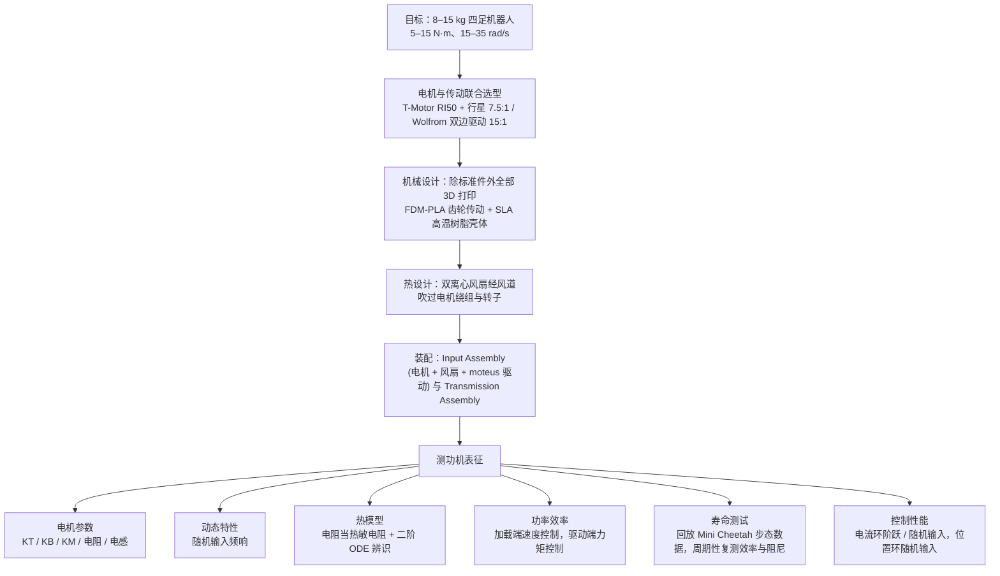

# 3D Printed Open-Source Actuators for Legged Locomotion

## 一句话定义

**Urs, Enninful Adu, Rouse & Moore（密歇根大学，[arXiv:2202.12395](https://arxiv.org/abs/2202.12395)）** 给出两种面向 **8–15 kg** 腿式机器人的 **3D 打印 QDD** 执行器：成品电机 + 打印件 + 低减速比，并做完整机械/电气/热与寿命表征——是「执行器设计教材型」开源论文。

## 英文缩写速查

| 缩写 | 英文全称 | 简要说明 |
|------|----------|----------|
| QDD | Quasi-Direct Drive | 准直驱，低减速比、高背驱动性的作动方案 |
| PMSM | Permanent Magnet Synchronous Motor | 永磁同步电机 |
| BOM | Bill of Materials | 物料清单，硬件零部件列表 |
| SLA | Stereolithography | 光固化 3D 打印（文中高温树脂壳体） |
| FDM | Fused Deposition Modeling | 熔融沉积 3D 打印（PLA 传动件） |

## 为什么重要

- 不只展示「能转」，还测 **热限制、连续/峰值力矩、效率、背隙、疲劳**。
- 核心教学点：不能只看电机峰值力矩；散热可使热限制下可用力矩接近 **翻倍**。
- **420k** 步态循环后效率约降 **2%**、背隙增约 **26 mrad**，证明塑料 QDD 可用于严肃研究原型。

## 流程总览

图依据：论文 §2 Actuator Design（2.1–2.3）、§3 Characterization Methods（3.1–3.6）

## 核心信息

| 项 | 内容 |
|----|------|
| **机构** | 密歇根大学（University of Michigan） |
| **电机** | T-Motor RI50；\(K_T\approx0.105\) N·m/A |
| **传动** | 行星 **7.5:1**；bilateral / Wolfrom 类 **~15:1** |
| **驱动** | moteus r4.5（开源） |
| **成本** | 每执行器材料 &lt;$200 USD |
| **开源** | 论文宣称机械/电气/软件完全开源；**截至 2026-07-25 未在 arXiv HTML 钉死稳定 GitHub** |

## 核心原理

- 目标包络：约 5–15 N·m、15–35 rad/s，输出惯量 \(10^{-4}\)–\(10^{-2}\) kg·m² 量级。
- 输入组件（高温 SLA 壳体 + 电机 + 风扇散热 + moteus）与传动组件（FDM PLA 齿轮）分体装配。
- 热模型与主动风冷把塑料执行器的热限力矩拉近金属设计。

## 源码运行时序图

**不适用**（截至入库日未能定位可运行的官方公开仓库入口；以论文表征方法与 moteus 驱动栈为工程参照）。若作者实验室后续发布 CAD/固件链接，应补 `sources/repos/` 并回填本节。

## 工程实践

| 项 | 建议 |
|----|------|
| 读论文顺序 | 设计动机 → 电机/减速共选 → 热方案 → 表征表 → 寿命试验 |
| 指标 | 把「峰值」与「热连续」分开画回 TN 图 |
| 驱动 | 对照 [moteus](./moteus.md) 板级与力矩模式 |
| 与打印摆线 | 对照 [BHL](./berkeley-humanoid-lite.md)：同为打印传动，本篇评测更系统 |

## 评测

| 维度 | 论文报告要点 |
|------|----------------|
| 热 | 主动散热后，热限制可用力矩接近 **翻倍** |
| 寿命 | **420k** 步态循环后效率约降 **2%** |
| 背隙 | 同循环后背隙增约 **26 mrad** |
| 成本 | 每执行器材料 &lt;$200；对照金属加工执行器门槛 |

## 对比

| 对照对象 | 差异 |
|----------|------|
| [OpenTorque](./opentorque-actuator.md) / [Doggo](./stanford-doggo-and-pupper.md) | 同为成品电机 QDD，本篇评测更系统（热/寿命/背隙） |
| [Berkeley Humanoid Lite](./berkeley-humanoid-lite.md) | BHL 是整机+打印摆线；本篇是单关节表征教材 |
| [moteus](./moteus.md) | 本篇选用 moteus r4.5 作驱动实例 |

## 结论

**这是开源腿式 QDD 里少数把热、效率、背隙和长寿命循环写清楚的教材型工作；学完应改变「只盯峰值力矩」的选型习惯。**

- 选型时优先要 **热限制连续力矩** 与温升，而不是 datasheet 峰值。
- 塑料关节可用，但必须有 **主动散热与应力友好的打印取向/金属销增强**。
- **420k** 循环量级的效率/背隙变化，是判断「研究原型是否经得起日用」的参考尺。
- 驱动可走开源 moteus；整机验收仍要自己的台架 TN/TI。
- 复现前先确认作者是否仍维护公开 CAD/电气仓（入库时链接待核实）。

## 局限与风险

- 开源代码入口待核实，短期以方法与数据表为主。
- 尺度绑定 8–15 kg 四足类；外推到重型人形需重做热与强度预算。

## 关联页面

- [开源 QDD 执行器项目对比](../comparisons/open-source-qdd-actuator-projects.md)
- [执行器驱动链选型闭环](../queries/actuator-drive-chain-selection-loop.md)
- [moteus](./moteus.md)
- [Actuator 102 · 热学与力矩控制](../overview/humanoid-actuator-102-thermal-and-control.md)
- [电机 TN 曲线](../concepts/motor-torque-speed-curve.md)

## 参考来源

- [sources/papers/3d_printed_open_source_actuators_legged_arxiv_2202_12395.md](../../sources/papers/3d_printed_open_source_actuators_legged_arxiv_2202_12395.md)
- [开源 QDD 执行器学习策展](../../sources/personal/open_source_qdd_actuator_learning_curator.md)
- [arXiv PDF](https://arxiv.org/pdf/2202.12395)：已通读方法部分（实验与附录以略读为准）：§2 Actuator Design、§3 Characterization Methods

## 推荐继续阅读

- 论文：<https://arxiv.org/abs/2202.12395>
- [moteus 仓库](https://github.com/mjbots/moteus)
