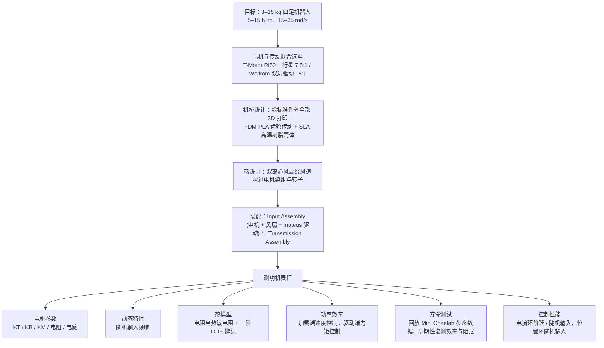

# 3D Printed Open-Source Actuators for Legged Locomotion

## 一句话定义

**Urs, Enninful Adu, Rouse & Moore（密歇根大学，[arXiv:2202.12395](https://arxiv.org/abs/2202.12395)）** 给出两种面向 **8–15 kg** 腿式机器人的 **3D 打印 QDD** 执行器：成品电机 + 打印件 + 低减速比，并做完整机械/电气/热与寿命表征——是「执行器设计教材型」开源论文。

## 英文缩写速查

| 缩写 | 英文全称 | 简要说明 |
|------|----------|----------|
| QDD | Quasi-Direct Drive | 准直驱，低减速比、高背驱动性的作动方案 |
| PMSM | Permanent Magnet Synchronous Motor | 永磁同步电机 |
| BOM | Bill of Materials | 物料清单，硬件零部件列表 |
| SLA | Stereolithography | 光固化 3D 打印（文中高温树脂壳体） |
| FDM | Fused Deposition Modeling | 熔融沉积 3D 打印（PLA 传动件） |

## 为什么重要

- 不只展示「能转」，还测 **热限制、连续/峰值力矩、效率、背隙、疲劳**。
- 核心教学点：不能只看电机峰值力矩；散热可使热限制下可用力矩接近 **翻倍**。
- **420k** 步态循环后效率约降 **2%**、背隙增约 **26 mrad**，证明塑料 QDD 可用于严肃研究原型。

## 流程总览

图依据：论文 §2 Actuator Design（2.1–2.3）、§3 Characterization Methods（3.1–3.6）

## 核心信息

| 项 | 内容 |
|----|------|
| **机构** | 密歇根大学（University of Michigan） |
| **电机** | T-Motor RI50；\(K_T\approx0.105\) N·m/A |
| **传动** | 行星 **7.5:1**；bilateral / Wolfrom 类 **~15:1** |
| **驱动** | moteus r4.5（开源） |
| **成本** | 每执行器材料 &lt;$200 USD |
| **开源** | 论文宣称机械/电气/软件完全开源；**截至 2026-07-25 未在 arXiv HTML 钉死稳定 GitHub** |

## 核心原理

- **目标包络与电机选择**：面向 8–15 kg 四足（5–15 N·m、15–35 rad/s、输出惯量 $10^{-4}\text{–}10^{-2}\,\text{kg}\cdot\text{m}^2$），选用内转子 **T-Motor RI50**（Wye 接，$R_\phi=705\pm3\,\text{m}\Omega$，$L_e=2559\pm2\,\mu\text{H}$，$K_T=0.105\pm0.002\,\text{N}\cdot\text{m/A}$，$K_M=0.118\,\text{N}\cdot\text{m/W}^{1/2}$，$J_m=9.01\times10^{-6}\,\text{kg}\cdot\text{m}^2$），靠较低机身质量和较高减速比在相同输出惯量下取得高响应。
- **双构造子装配**：Input Assembly（高温 SLA 树脂壳体 + RI50 + 双 30×10 mm 离心风扇风道 + moteus r4.5 `$84`）与 Transmission Assembly（FDM PLA `$3.5` 齿轮 + 30° 压力角 + 金属定位销与螺钉预紧防层间剥离，含 **7.5:1 行星 482 g** 与 **15.04:1 Wolfrom 双边驱动 536 g**）。
- **二阶热阻建模与自校准热敏电阻**：用铜绕组线间电阻标定平均绕组温度 $T_w = 139.564 R_{ll} - 177.826$（$R^2=0.99$）；强制风冷将二阶热模型总热阻从 **7.77 °C/W** 降至 **2.27 °C/W**（~3.5×），从而把连续力矩提升近一倍（7.5:1 连续 4.4 N·m / 2 s 峰值 19.1 N·m；15.04:1 连续 8.8 N·m / 2 s 峰值 38.2 N·m）。

## 源码运行时序图

**不适用**（论文给出 `www.embirlab.com/3dpactuator`，截至入库日未能定位公开可运行的 GitHub 仓库入口；控制驱动层使用商用开源 **moteus r4.5**，实测 $i_q$ 电流阶跃上升时间 $2.65\pm1.88\,\text{ms}$、-3 dB 带宽 $102\pm1\,\text{Hz}$、位置环 11–30 Hz）。若作者后续补公开仓库入口，再补全实机源码时序图。

## 工程实践

| 项 | 建议 |
|----|------|
| 读论文顺序 | 设计动机 → 电机/减速共选（Table 1/2）→ 热方案（Table 3）→ 表征表 → 寿命试验 |
| 指标 | 把 **2 s 峰值（19.1 / 38.2 N·m）**、**20 s 峰值（7.5 / 15 N·m）** 与 **热连续（4.4 / 8.8 N·m）** 分开画回 TN 图 |
| 打印工艺 | 齿轮轴向沿 Z 轴打印令切向载荷落在 XY 强平面内；关键承力接口用金属销 + 螺栓预紧抑制 FDM 分层；近电机壳体须用 SLA-HT（防 PLA 软化） |
| 驱动与电感 | moteus r4.5 驱动高电感 RI50（$L_e\approx2.56\,\text{mH}$）时电流带宽约 102 Hz，显著低于低电感外转子方案，需匹配母线电压裕量 |

## 评测

| 维度 | 论文实测（Table 2/3 & §4） |
|------|----------------|
| 热（§4.3） | 双离心风冷使热阻由 **7.77 °C/W → 2.27 °C/W**（~3.5×），连续电流/力矩近 **翻倍**（7.5:1 4.4 N·m / 15:1 8.8 N·m） |
| 寿命（§4.5） | 57 h / **420k** 步态循环无失效；前 8–10 h 效率因塑料微粉暂降 3.5%，磨合后回升，总体约降 **2%** |
| 背隙（§4.5） | 双执行器对拖总背隙差从 56 mrad 增至 82 mrad（**+26 mrad**，单机线性增长 $250\pm30\,\mu\text{rad/hr}$） |
| 带宽与辨识 | 机械系统辨识 40 Hz 内相干度 >0.9（VAF 92%–98%）；电流环 -3 dB **102±1 Hz**、上升 2.65 ms；位置环 11–30 Hz |
| 成本 | 单执行器材料 **<$200 USD**（RI50 `$62` + moteus `$84` + 轴承 `$15` + SLA-HT `$16` + 紧固件/风扇/PLA） |

## 对比

| 对照对象 | 差异 |
|----------|------|
| [OpenTorque](./opentorque-actuator.md) / [Doggo](./stanford-doggo-and-pupper.md) | 同为成品电机 QDD，本篇评测更系统（热/寿命/背隙） |
| [Berkeley Humanoid Lite](./berkeley-humanoid-lite.md) | BHL 是整机+打印摆线；本篇是单关节表征教材 |
| [moteus](./moteus.md) | 本篇选用 moteus r4.5 作驱动实例 |

## 结论

**这是开源腿式 QDD 里少数把热、效率、背隙和长寿命循环写清楚的教材型工作；学完应改变「只盯峰值力矩」的选型习惯。**

- 选型时优先要 **热限制连续力矩** 与温升，而不是 datasheet 峰值。
- 塑料关节可用，但必须有 **主动散热与应力友好的打印取向/金属销增强**。
- **420k** 循环量级的效率/背隙变化，是判断「研究原型是否经得起日用」的参考尺。
- 驱动可走开源 moteus；整机验收仍要自己的台架 TN/TI。
- 复现前先确认作者是否仍维护公开 CAD/电气仓（入库时链接待核实）。

## 局限与风险

- 开源代码入口待核实，短期以方法与数据表为主。
- 尺度绑定 8–15 kg 四足类；外推到重型人形需重做热与强度预算。

## 关联页面

- [开源 QDD 执行器项目对比](../comparisons/open-source-qdd-actuator-projects.md)
- [执行器驱动链选型闭环](../queries/actuator-drive-chain-selection-loop.md)
- [moteus](./moteus.md)
- [Actuator 102 · 热学与力矩控制](../overview/humanoid-actuator-102-thermal-and-control.md)
- [电机 TN 曲线](../concepts/motor-torque-speed-curve.md)
- [Joint Actuator Parameter Identification（关节执行器参数辨识）](../methods/joint-actuator-parameter-identification.md) — 把反射惯量、摩擦与背隙表征对应到关节模型，不能仅凭减速比外推性能。
- [Locomotion](../tasks/locomotion.md) — 42 万步态循环和 8–15 kg 平台范围构成足式应用边界，重型人形需重新验证。

## 参考来源

- [sources/papers/3d_printed_open_source_actuators_legged_arxiv_2202_12395.md](../../sources/papers/3d_printed_open_source_actuators_legged_arxiv_2202_12395.md)
- [开源 QDD 执行器学习策展](../../sources/personal/open_source_qdd_actuator_learning_curator.md)
- [arXiv PDF](https://arxiv.org/pdf/2202.12395)：已通读方法部分（实验与附录以略读为准）：§2 Actuator Design、§3 Characterization Methods

## 推荐继续阅读

- 论文：<https://arxiv.org/abs/2202.12395>
- [moteus 仓库](https://github.com/mjbots/moteus)
