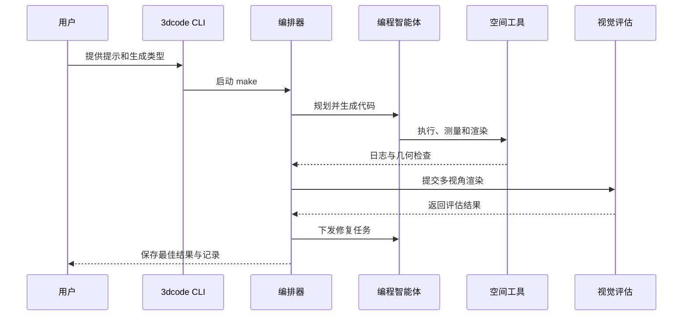

# 3DCodeVerse：以代码构建三维世界

## 一句话定义

3DCodeVerse 结合三维可执行代码数据集和多智能体生成框架，以代码生成、检查并迭代修改三维资产。

## 英文缩写速查

| 缩写 | 英文全称 | 简要说明 |
|------|----------|----------|
| LLM | Large Language Model | 规划任务并生成代码 |
| VLM | Vision-Language Model | 检查多视角渲染 |
| DAG | Directed Acyclic Graph | 编排生成与组装任务 |
| URDF | Unified Robot Description Format | 描述机器人或关节结构 |

## 核心机制

规划器将需求拆分为组件和约束，智能体生成代码并组装；执行日志、空间测量和多视角视觉评估共同驱动局部修复。几何测量可限制或否决与之冲突的视觉评分。成果是可执行、可编辑的程序，支持 Blender、Three.js、URDF 等环境。

项目页的 2M 指约 201 万代码与条件配对，来自约 26.96 万个程序，不等于 200 万个不同程序。数据来自公开资源、格式转换及智能体生成，验证覆盖因来源而异。

## 源码运行时序图

官方 `harness/README.md` 提供 `3dcode doctor` 和 `3dcode make` 入口；实际运行需按官方指南配置模型和环境。

## 评测与结论

论文在 805 项固定任务上报告微调改善执行率；其 90% 人工偏好胜率仅针对论文所述的同一模型、特定对象任务和对照条件。

这是一套以可验证代码为中心的资产生成研究框架，适合探索三维建模和仿真资产制作。

- 先确定目标环境及尺度、碰撞、关节等约束，再检查生成代码。
- 视觉好看不代表几何与物理属性正确，真实仿真用途仍需额外验证。
- 项目官方公开代码与数据；代码 Apache-2.0，数据许可独立，商业使用应逐项核对。
- 论文展示 MuJoCo 应用，并未证明生成资产自动具备准确物理参数或可直接训练机器人。

## 与其他工作对比

- **对 [3D Model Anything](./3d-model-anything.md)：** 二者都用编程智能体迭代生成可编辑三维内容；3D Model Anything 以 LiDAR 与照片等实景扫描为证据重建室内场景，3DCodeVerse 则以需求描述与可执行代码数据集驱动资产生成，并用几何测量约束视觉评分。前者偏「还原现有场景」，后者偏「按约束创建资产」。
- **对 [Agentic Real2Sim](./paper-agentic-real2sim.md)：** Agentic Real2Sim 把真机交互 episode 转为可回放的 MuJoCo 孪生；3DCodeVerse 虽展示 MuJoCo 应用，但未证明生成资产具备准确物理参数，选型时应区分「可回放孪生」与「可编辑资产」两种目标。

## 关联页面

- [3D Model Anything](./3d-model-anything.md) — 用实景扫描证据重建可编辑室内场景。
- [Gitingest](./gitingest.md) — 代码上下文准备工具，可作为代码阅读的辅助。

## 参考来源

- [论文归档](../../sources/papers/3dcodeverse.md)
- [项目页归档](../../sources/sites/3dcodeverse.md)
- [官方仓库归档](../../sources/repos/3dcodeverse.md)

## 推荐继续阅读

- [论文](https://arxiv.org/abs/2610.22341)
- [Harness 使用说明](https://github.com/gaoypeng/3dcodeverse/tree/main/harness)
