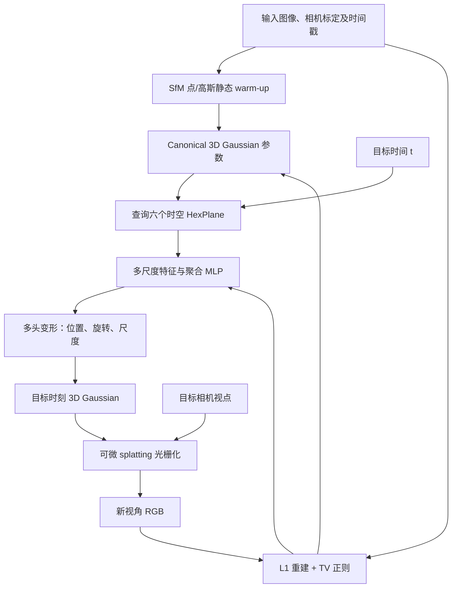

# 4D Gaussian Splatting：面向动态场景实时渲染的时空高斯变形

## 一句话定义

4D Gaussian Splatting（4D-GS，Wu et al., CVPR 2024）并非为每个时间戳存储一套高斯，而是**维护 canonical 3D Gaussian 集合**，以 HexPlane 多分辨率时空编码和轻量多头变形网络预测任意时刻的位置、旋转、尺度变化，最后用 3D Gaussian Splatting 渲染新视角。

## 英文缩写速查

| 缩写 | 英文全称 | 本项目含义 |
|---|---|---|
| 4D-GS | 4D Gaussian Splatting | 随时间变形的 3D 高斯场表示 |
| 3D-GS | 3D Gaussian Splatting | 静态显式高斯参数和可微 splatting 渲染 |
| HexPlane | Hexagonal Plane Decomposition | 六个二维坐标/时空平面组成的时空特征 |
| SfM | Structure from Motion | 3D 高斯初始化可使用的重建点 |
| NVS | Novel View Synthesis | 按时间与视点重建图像 |
| PSNR | Peak Signal-to-Noise Ratio | 渲染保真度指标 |
| SSIM | Structural Similarity Index Measure | 图像结构相似性指标 |
| LPIPS | Learned Perceptual Image Patch Similarity | 感知距离，越低越好 |

## 为什么重要

原始 3D-GS 通常针对静态场景；若把每个时刻所有高斯独立存储，内存可近似随时间帧数和高斯数量相乘增长。4D-GS 保留同一 canonical 几何，用时空变形场共享运动信息：论文给出的复杂度比较是逐时刻显式存储的 `O(tN)` 与共享变形场的 `O(N+F)`。该方法主要解决**动态新视角合成**，不是无需额外估计就可直接替代机器人 SLAM 定位器。

## 核心原理与方法

1. **场景参数**：canonical Gaussian 保存中心 `X`、旋转 `r`、尺度 `s`、不透明度 `alpha`、球谐颜色 `C`。
2. **时空编码**：对 `(x,y,z,t)` 查询六类二维平面 `(x,y),(x,z),(y,z),(x,t),(y,t),(z,t)`，经多尺度插值构造 HexPlane 时空特征；轻量 MLP 聚合相邻高斯的时空联系。
3. **变形预测**：不同 MLP 头分别预测 `delta X`、`delta r`、`delta s`，得到对应时间的 `G'(t)`；论文 Eq.8 定义参数更新。颜色/不透明度变形属于附录讨论的扩展，不是主干默认三个头。
4. **可微渲染**：将变形后的三维高斯按相机位姿 splat/alpha blend 输出目标帧图像；用 L1 色彩重建和体素总变差正则训练（Eq.9）。
5. **静态 warm-up**：论文 §4.3 在约前 3000 次迭代先训练静态 3D 高斯，避免变形网络刚开始就承受所有动态优化压力；后续再训练动态阶段。

## 流程总览（论文 §4 与 Fig.3/4）



## 源码运行时序图

按作者 [hustvl/4DGaussians@843d5ac](https://github.com/hustvl/4DGaussians/tree/843d5ac636c37e4b611242287754f3d4ed150144) 的 README、`train.py`、`scene/gaussian_model.py`、`scene/deformation.py`、`gaussian_renderer` 调用关系编译；**未在 GPU 实际训练**。

```mermaid
sequenceDiagram
    autonumber
    participant CLI as train.py
    participant S as Scene
    participant G as GaussianModel
    participant DEF as scene/deformation.py
    participant R as gaussian_renderer.render
    participant OPT as torch optimizer
    CLI->>G: GaussianModel(sh_degree, hidden_params)
    G->>DEF: 初始化 deform_network 与 HexPlaneField
    CLI->>S: Scene(dataset, gaussians)
    CLI->>CLI: scene_reconstruction(stage=coarse)
    loop coarse 优化
        CLI->>R: render(viewpoint, gaussians, stage=coarse)
        R-->>CLI: render_pkg RGB
        CLI->>OPT: 重建损失反传和参数更新
    end
    CLI->>CLI: scene_reconstruction(stage=fine)
    loop fine 优化
        CLI->>R: render(viewpoint, gaussians, stage=fine)
        R->>DEF: deform_network(point, times_sel)
        DEF-->>R: 变形后的 XYZ、scale、rotation
        R-->>CLI: 可微 RGB 与中间量
        CLI->>OPT: L1/SSIM/时空正则反传与更新
        CLI->>G: 视参数配置进行 densify/prune
    end
    CLI->>G: 保存 checkpoint / 高斯表示
```

实际项目以 `train.py` 调用 `scene_reconstruction` 的 coarse/fine 作为两个阶段；源码还有网络 GUI、batch 采样和数据集类型的差异。图不表示所有数据集固定执行一样的训练迭代数。

## 实验与评测

以下为 [论文 arXiv:2310.08528v3](https://arxiv.org/html/2310.08528) §5 的具体条件，避免将单一 FPS 当成普适保证。

| 数据集与条件 | PSNR | 训练时间 | FPS | 存储 |
|---|---:|---:|---:|---:|
| D-NeRF 合成数据，800×800（Table 1） | **34.05 dB** | **8 min** | **82** | **18 MB** |
| HyperNeRF vrig，960×540（Table 2） | **25.2 dB** | **30 min** | **34** | **61 MB** |
| Neu3D，1352×1014（Table 3） | **31.15 dB** | **40 min** | **30** | **90 MB** |

**消融证据（合成数据 Table 4）：** 完整模型 PSNR 34.05；去掉 HexPlane 降至 27.05；不做静态初始化为 31.91；去掉位置变形头为 26.67。可见时空编码和位置变形是关键，不宜把方法简化为“只对静态 3DGS 添加时间输入”。

**实验平台**：作者主要在单张 RTX 3090 上测试，表中 FPS 与渲染分辨率、Gaussian 数量、模型大小有关，不能推断移动机器人边缘 GPU 具有相同帧率。

## 结论

**总判：4D-GS 的效率来自共享 canonical Gaussian 与时空变形场，并在合成场景达到实时渲染；它不自动解决动态 SLAM 的传感器定位问题。**

1. 处理动态对象时，保留静态高斯 + 查询时刻变形比为每帧新建高斯更省空间。
2. 六个时空平面的信息是性能关键，消融结果优于仅用 MLP。
3. warm-up 训练决定是否能稳定收敛，特别是缺少 SfM 初始化点时。
4. 速度读数必须连同分辨率、硬件、合成/真实数据类别报告。
5. 与 RGB-D SLAM 或机器人数据采集相接时，仍需另做相机位姿、时钟同步和几何标定。

## 与其他工作对比

| 方法 | 表示 | 不可混淆的边界 |
|---|---|---|
| 静态 3D-GS | 每场景一套静态高斯 | 对动态运动缺乏显式建模 |
| Deformable 3D Gaussians | 通过变形网络对 3D 高斯进行时间建模 | 4D-GS 将 HexPlane 时空编码作为核心 |
| SplaTAM / MonoGS | 增量式高斯地图 + 摄像机位姿估计 | 目标是稠密 SLAM，非已知视角动态 NVS |

## 工程实践

- 官方 README [训练脚本](https://github.com/hustvl/4DGaussians): `python train.py -s data/dnerf/bouncingballs --port 6017 --expname "dnerf/bouncingballs" --configs arguments/dnerf/bouncingballs.py`。
- 渲染入口：`python render.py --model_path output/dnerf/bouncingballs --skip_train --configs arguments/dnerf/bouncingballs.py`；指标入口：`python metrics.py --model_path output/dnerf/bouncingballs`。
- 根据数据类型先准备 D-NeRF、HyperNeRF 或多相机 Neu3D 的相机参数/图像；自有数据 README 指向 COLMAP/nerfstudio 预处理流程。
- 用 `train.py` 的 coarse/fine 启动参数、时间维度配置和是否预热进行对照；记录峰值显存、精度、存储、FPS，不要只记录 FPS。

## 局限与风险

论文 §5.5 和附录明确指出：大运动、缺少背景点、相机位姿不准确时变形拟合困难；单目视频中静态/动态运动耦合也常陷入局部最小；城市场景中大量高斯查询会导致算力与内存压力。作者附录还说明颜色/不透明度随时变形虽改善某些视频效果，却可能损害真实几何追踪。

## 关联页面

- [FeatDepth：单目深度与位姿学习](./paper-featdepth.md)
- [LVI-SAM：多模态 SLAM](./paper-lvi-sam.md)

## 参考来源

- [4D-GS 原始论文逐节记录](../../sources/papers/vision3d_4d_gaussians_20261108.md)
- [4D-GS 作者源码与运行记录](../../sources/repos/vision3d_4d_gaussians_20261108.md)
- [作者完整论文](https://arxiv.org/html/2310.08528)（arXiv:2310.08528v3；含附录）
- [作者源码](https://github.com/hustvl/4DGaussians)（master `843d5ac`）

## 推荐继续阅读

- [项目主页](https://guanjunwu.github.io/4dgs/)
- [4D-GS 完整附录：参数、消融与局限](https://arxiv.org/html/2310.08528#A1)
