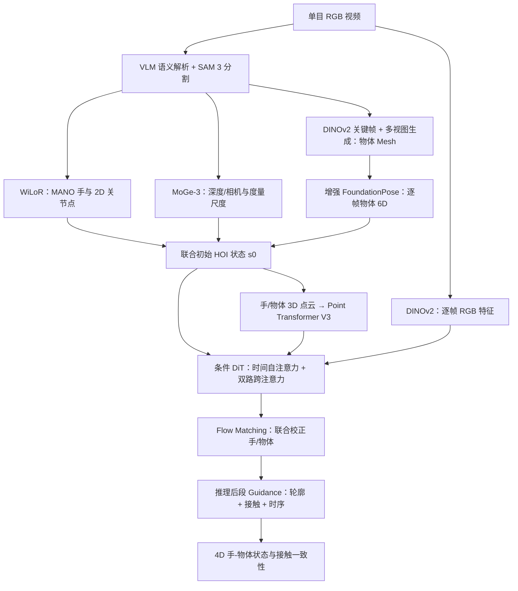
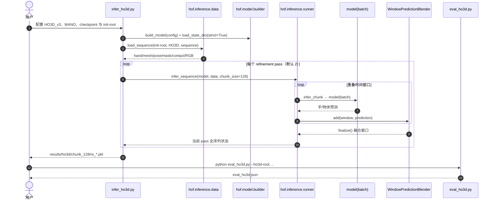

# 4D-HOF — Hand-Object Flow Matching for Feed-Forward 4D Interaction Reconstruction（手-物体流匹配驱动的前馈式 4D 交互重建）

## 一句话定义

**4D-HOF** 把单目视频中视觉基础模型给出的粗糙手部 MANO 和物体 6D 轨迹作为 **条件流匹配（Flow Matching）** 起点，学习联合校正手–物体的时空几何与接触，而不是从纯随机噪声生成交互或逐视频独立完成长时间优化。

## 英文缩写速查

| 缩写 | 英文全称 | 简要说明 |
|---|---|---|
| HOI | Hand-Object Interaction | 手物体交互 |
| FM | Flow Matching | 以速度场运输状态分布 |
| MANO | Model with Articulated and Non-rigid defOrmations | 参数化 3D 手部网格 |
| VFM | Vision Foundation Model | 提供初始几何/姿态的视觉基础模型 |
| DiT | Diffusion Transformer | 此处用作时序速度场网络骨干 |
| CD_h | Hand-relative Chamfer Distance | 衡量交互中手相对物体几何一致性的误差 |

## 为什么重要

传统 4D HOI 重建严重依赖逐序列优化，遮挡/姿态初值出错时昂贵且脆弱；单纯生成式先验从随机噪声出发又难守住具体物体几何。本文用「**高信息量但不完美的初始化 → 学习到的交互状态分布**」作为桥，将视觉先验和物理可行性统一在前馈重建过程里。对视频到机器人动作数据（video-to-action / retargeting），价值是提供 **更稳定的手、物体与接触轨迹**，并非直接输出机器人控制策略。

## 核心信息

| 项 | 内容 |
|---|---|
| 作者 | Shiqi Li、Sean Cho、Yijie Li、Fengzhi Guo、Bowen Wen、Cheng Zhang |
| 机构 | 美国得克萨斯农工大学（Texas A&M University）、英伟达（NVIDIA） |
| 论文 | [arXiv:2610.08782](https://arxiv.org/abs/2610.08782)，2026-10-06 |
| 项目/源码 | [官方项目页](https://tamu-visual-ai.github.io/4D-HOF/) · [GitHub](https://github.com/TAMU-Visual-AI/4D-HOF) |
| 输入 | 单目 RGB 视频；原始论文全流程还调用 VLM、手估计、深度/相机和物体配准 |
| 输出 | 时间序列的手部 MANO 姿态、物体 mesh + 6D 位姿、接触一致的 4D HOI 状态 |
| 已公开的复现范围 | HO3D-v3 初始化文件 + checkpoint 的推理/评估；不是从任意视频直接一键运行全流程 |

## 流程总览

下图根据论文 §3 与附录 A 重绘，区分 **论文完整系统** 和目前公开仓库的 **HO3D refinement 子模块**。



## 核心原理

### 1. 有结构的源分布，不是纯噪声

- 手：每帧 MANO 参数与相机系手掌平移；WiLoR 的逐帧结果结合 MoGe-3 内参通过重投影最小二乘对齐。
- 物体：按 DINOv2 图像特征选择不同视角关键帧，生成多视图后建 mesh；增强 FoundationPose 做双向姿态估计、旋转测地距离过滤（60°）与可见区域 mask IoU 筛选。
- 因为手与物体来自不同感知模型，初始几何在尺度、深度、接触、旋转上可能互相矛盾。论文把这种粗状态记为 `s0`，与训练集目标 `s1` 之间建立生成式桥。

### 2. Conditional Bridge Matching

训练从真实 HOI 轨迹添加结构化扰动得到近似 `s0`；在插值状态 `s_t` 下训练速度场，使其朝目标 `s1` 运动。论文采用的核心形式为：

```text
L_hof = E[ || v_theta(s_t, t, mesh, MANO_shape, RGB)
             - (s1 - s_t)/(1 - t) ||² ]
```

总损失 `L_total = L_hof + L_3D + L_inter + L_reg`，分别约束状态搬运、3D 重建、交互/接触与保持可靠手部初值。论文附录说明训练噪声模拟偶发大幅物体姿态失配；网络有时间 self-attention、3D 点云 cross-attention 与图像 cross-attention。

理论引用 [Stochastic Interpolants](../../sources/papers/stochastic_interpolants_jmlr_2025.md) 统一 flow/diffusion，但不能把本文看成对该理论的完整实现或新的物理仿真器。

### 3. Test-time Guidance

推理时不是重训权重，而是在流积分**后段**沿 `∇G(s_t)` 施加小幅纠正：`G_sil` 贴近像素轮廓，`G_inter` 减少非物理穿透/改善接触，`G_temp` 惩罚时间序列速度与加速度跳变。这种迭代指导仍有计算成本，**前馈不等于没有迭代步骤**。

## 实验与评测

论文使用 HO-Cap、OakInk、SHOWMe 训练，在 HO3D-v3（18 条序列）和 DexYCB（20 条序列）做跨数据集评测；与 HOLD、MagicHOI、AGILE、CHOIR 对比。以下均为作者的具体协议数值，不能和其他 paper 的不同数据/指标跨协议比较。

| 指标（越低越好，除 CA/SR） | 4D-HOF | 同协议对照 |
|---|---:|---:|
| HO3D-v3 CD_h (cm²) | **5.98** | AGILE 15.81 |
| HO3D-v3 接触准确率 CA (%) | **97.27** | CHOIR 90.99 |
| HO3D-v3 MPJPE (mm) | 4.40 | AGILE **3.92** |
| HO3D-v3 序列成功率 SR (%) | 100.0 | CHOIR 94.4 |
| DexYCB MPJPE (mm) | **6.84** | AGILE 19.06 |
| DexYCB CD_h (cm²) | **48.85** | AGILE 94.60 |

**耗时口径：** 作者报告每序列总约 **24 分钟**（预处理约 23 分钟，flow refinement 约 1 分钟），比 HOLD/MagicHOI/AGILE 更快；与 CHOIR 的约 30 分钟相比并非「端到端快很多倍」。全链仍受前端模型和物体生成开销制约。

**消融：** 去掉时序模块使 HO3D-v3 jerk (JM) 1.61→4.26；仅基础模型 + guidance 的 CD_h 为 41.75（完整模型 5.98）；关闭 guidance 则 CD_h 5.98→8.03，说明大幅收益来自联合交互先验而非仅靠测试期调参。

## 与其他工作对比

| 组件/方法 | 负责什么 | 不能替代什么 |
|---|---|---|
| [WiLoR](../methods/wilor.md)（CVPR 2025） | RGB 中手部定位 + MANO 重建 | 不能保证手与对象的统一物理 4D 接触 |
| [FoundationPose](../../sources/papers/foundationpose_cvpr_2024.md)（CVPR 2024） | 物体 6D 初始姿态和跟踪 | 遮挡导致的误跟踪需要联合纠正 |
| [Stochastic Interpolants](../../sources/papers/stochastic_interpolants_jmlr_2025.md)（JMLR 2025） | 连续状态搬运的理论工具 | 不是具体 HOI 数据集或 reconstruction 网络 |
| 4D-HOF | 结合以上几何初值学习手/物体时序交互先验 | 当前不能直接替代下游机器人动力学/接触策略 |

## 源码运行时序图

下面是 **2026-11-12 官方 GitHub 当前公开 HO3D 推理源码** 的静态调用图，非论文未公开的基础模型前处理/训练代码。



## 工程实践

1. 按官方 README 运行 `bash setup_env.sh`，安装 MANO 授权文件到 `_DATA/mano/MANO_RIGHT.pkl`，另取得 HO3D_v3；使用 `bash download_assets.sh` 下载 `checkpoints/4dhof.pth` 与预计算 HO3D 初始化。
2. 运行 `python infer_ho3d.py --ho3d-root /path/to/HO3D_v3`；默认窗口 128 帧、重叠步距比例 0.5、两轮 refinement，结果在 `results/ho3d/`。
3. `python eval_ho3d.py --ho3d-root /path/to/HO3D_v3` 计算与官方 18 序列协议对齐的指标；现有仓库未提供完整训练入口，不要将单项推理脚本当成论文全流程一键复现。
4. 面向机器人模仿学习时仍需手与机器人的关节映射、目标物坐标系标定、可达性 / 碰撞 / 接触校验；项目页展示五种机器人手的 retargeting，但这不是论文方法自动满足所有机器人机械约束的证据。

## 结论

**4D-HOF 的关键是把「视觉初值到合理接触轨迹」做成可学习的条件运输过程；主要创新在联合交互细化而非单独的手或物体检测。**

- 有结构的初值显著比纯噪声适合条件恢复，但前端错误过大仍会传染后续流程。
- 强时序模块和手/物体共同建模是减少接触误差与抖动的核心，不要把改进全部归功于 guidance。
- 评测时同时看 `CD_h`、CA、JM、MPJPE、SR；只看单一几何分数会忽略交互质量。
- 估算工程延迟应合并前端初始化耗时；论文中的约一分钟仅对应后续 refinement。
- 当前开源可复核 HO3D 推理/评估，训练与零起点原始视频处理须视为未完整公开。

## 局限与风险

- 论文主要针对 **单手 + 刚体**；双手协同、铰接物和可形变物尚是未来工作。
- 严重遮挡和 MoGe-3 点图失真会使尺度/初始化超出训练扰动分布，后续桥无法保证恢复。
- 交互重建指标不等于机器人可执行动作的动力学、力控制或实时控制指标。
- **代码当前部分开放**：预处理结果是下载的外部文件；主仓库提供 HO3D refinement/评估，不应声称训练或原始视频端到端管线已经发布。

## 关联页面

- [WiLoR 手部定位与重建](../methods/wilor.md)
- [Manipulation 操作任务](../tasks/manipulation.md)
- [GRAIL：HOI 到人形机器人运动数据](./paper-grail.md)

## 参考来源

- [4D-HOF 全文原始归档](../../sources/papers/4d_hof_arxiv_2610_08782.md)
- [4D-HOF 项目页原始归档](../../sources/sites/4d-hof.md)
- [4D-HOF 官方代码与调用链](../../sources/repos/4d-hof.md)
- [Stochastic Interpolants（JMLR）](../../sources/papers/stochastic_interpolants_jmlr_2025.md)
- [WiLoR（CVPR）](../../sources/papers/wilor_cvpr_2025.md)
- [FoundationPose（CVPR）](../../sources/papers/foundationpose_cvpr_2024.md)

## 推荐继续阅读

- [论文 HTML 全文与附录](https://arxiv.org/html/2610.08782v1)
- [官网交互式 3D 示例](https://tamu-visual-ai.github.io/4D-HOF/)
- [HO3D 公开推理与评估源码](https://github.com/TAMU-Visual-AI/4D-HOF)
