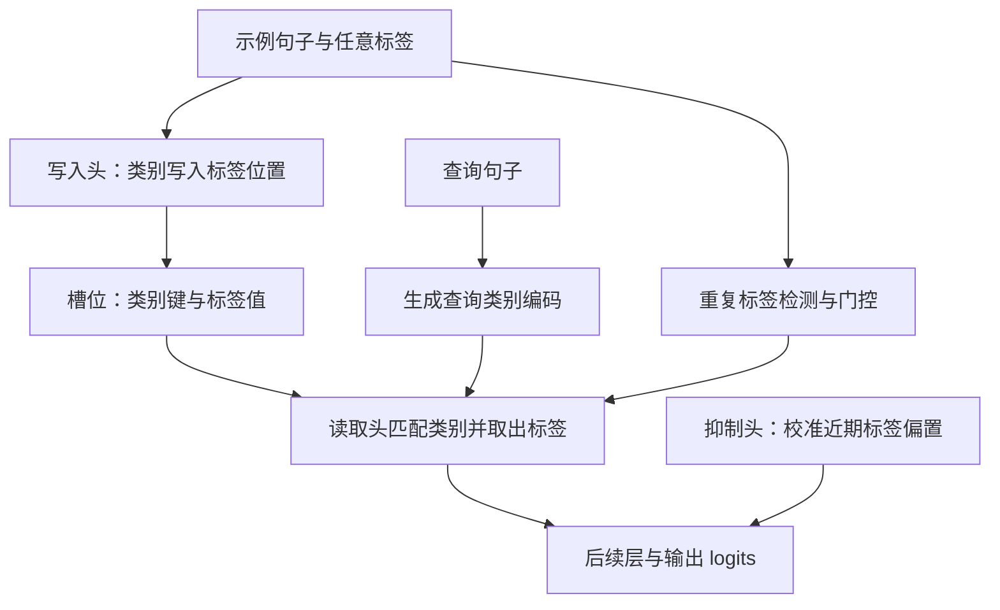
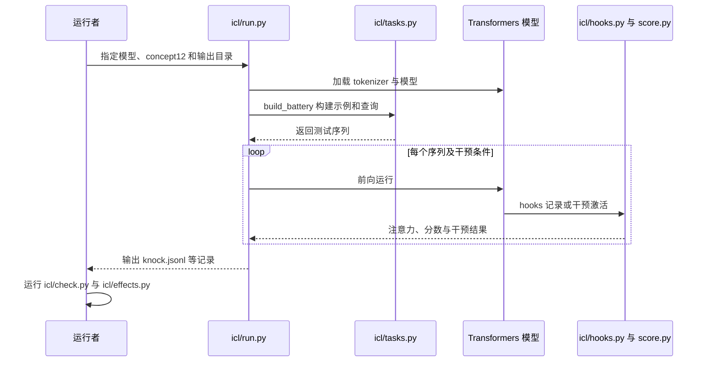

# A Circuit for In-Context Learning / 上下文学习的电路

## 一句话定义

**论文提出并干预验证：在所研究的少样本短句分类任务中，模型使用标签位置上的关联记忆完成门控检索。**

## 英文缩写速查

| 缩写 | 英文全称 | 简要说明 |
|------|----------|----------|
| ICL | In-Context Learning | 仅凭提示中的示例完成任务、不更新参数；本页特指文中的少样本句子分类设置 |
| KV | Key-Value | 标签 token 的残差流同时保存类别键（key）与标签值（value），两者在注意力的不同侧被读取 |
| MLP | Multilayer Perceptron | 与注意力头并列的残差写入组件；论文用其直接贡献做对数几率账本，晚期 MLP 对翻转起反向作用 |
| LoRA | Low-Rank Adaptation | 论文用 LoRA 做 400 步微调，检验刹车头是否随多示例训练增强（结果：未增强） |

## 核心信息

| 项目 | 内容 |
|------|------|
| 机构 | 斯坦福大学（Stanford University） |
| 作者 | Andrew Gao、William Gao（同等贡献） |
| 原文版本 | [arXiv:2611.05344v1](https://arxiv.org/abs/2611.05344v1)，预印本，未经同行评审 |
| 代码 | [官方仓库](https://github.com/andrewgcodes/in-context-learning-circuit)；许可 MIT（据本站仓库归档记录，未独立核实） |

## 为什么重要

- **动机**：少样本 ICL 不需要训练目标，也不改参数，却能在一次前向传播内学到模型预训练时无法记忆的任意标签映射。此前工作找到了若干零件（归纳头、任务向量、标签 token 的作用等），但没有给出它们如何组成一个可工作的算法。
- **本文贡献**：在 Qwen3-4B、SmolLM3-3B、Llama-3.2-3B 三个 3–4B 基础模型上，给出一条从示例到预测的完整组合链条，每一步都有因果干预和随机对照。
- **读者能得到什么**：可以用来解释少样本提示为什么成功或失败，例如标签是否重复、示例顺序、类别是否在查询位置线性可读等。
- **对机器人的意义（推断，未在论文中验证）**：论文只研究短句分类，不涉及动作、视觉或具身任务。它提供的是诊断思路（先探测类别信号是否可读，再写提示），而非可直接用于 VLA 或机器人规划的结论。

## 核心原理

### 输入、机制与输出

- **输入**：若干行 `句子 -> 标签` 示例，加上查询句和箭头，模型输出下一个 token。
- **指标**：对数几率间隔（margin）= 正确标签的 log 概率减去另一标签的 log 概率，单位为 nats。margin 为正表示模型偏向正确答案。
- **三类关键机制**（论文 Figure 2 的电路概括）：

| 阶段 | 主要组件（Qwen3-4B 中） | 作用 |
|------|------------------------|------|
| 写入 | 约 20 个写入头，层 10–23 | 从标签 token 回看其所属句子，把类别方向写入该 token 的残差流，形成「键」；标签身份则作为「值」 |
| 门控 | 16 个重复 token 检测头（层 1–9）与池化头（层 20–23） | 检测提示中是否有标签重复，汇总为方向 g；g 降低读取头对位置 0（sink）的 logit，从而打开读取 |
| 读取与输出 | 约 90 个读取头（上层）、查询编码头 L22h10 与 L23h26、拷贝头（层 30–35）、约 24 个刹车头（层 22–34） | 读取头按查询类别匹配键并复制对应标签值；刹车头对最近看到的标签写入反向信号，抵消近因偏置 |

- **空读取（null action）**：读取头的 softmax 必须把注意力分配到某处，论文中这一位置是位置 0 的 sink。当没有标签重复、g 未打开时，读取头大多落在 sink 上，不复制任何标签。

### 读取规律

在 12 示例、各类槽位数固定的设置中，单个读取头对匹配槽位的注意力质量 $m$ 可用如下 softmax 形式描述：

$$m = \frac{n_m e^{L}}{n_m e^{L} + (N - n_m) + n_{\text{rest}} + e^{L_{\text{sink}}}}$$

其中 $N$ 为槽位总数，$n_m$ 为类别与查询匹配的槽位数，$L$ 为匹配槽位的 logit，非匹配槽位 logit 置 0，$L_{\text{sink}}$ 为 sink 的 logit，$n_{\text{rest}}$ 为其余位置的未归一化质量。每个头的三个常数中只有两个可辨识（$n_{\text{rest}}$ 与 $e^{L_{\text{sink}}}$ 仅以和的形式出现）。该式在 12 示例内拟合后可预测「每类一个槽位」的情形，但外推到 18 示例时失败（见实验与评测）。

### 因果验证方式

论文的每个环节都依赖三类操作：

- **twin（孪生提示）**：两条提示逐 token 相同，仅在一处不同（如替换一个示例的类别、交换标签、改查询类别）。
- **激活替换（handoff）与头消融**：把孪生提示的激活补丁到原提示中，或对头做均值消融，并与同层随机头集合比较。
- **方向转向**：在查询位置沿模型自身使用的剂量加入方向（如 g），并与同范数随机方向比较。

## 流程总览

中层写入头将示例句子的类别方向写入其标签 token 的残差流；标签身份在值侧，类别信息在键侧。查询侧与读取头结合，检索匹配类别对应的标签。门控依据整个提示的标签重复情况，而非要求目标标签自身必定重复：只出现一次的标签，只要提示中其他标签有重复，仍可被正确检索。

## 源码运行时序图

该图依据官方 README 和 `icl/run.py` 中已核读的入口；尚未逐项核读全部 hooks、后处理模块，也未运行复现。

## 工程实践

| 项目 | 内容 |
|------|------|
| 复现入口 | 官方 README 给出 `python icl/run.py Qwen/Qwen3-4B-Base concept12 seed=1 out=runs/example`，随后运行 `icl/check.py runs/example` 与 `icl/effects.py effects.tsv runs/example` |
| 算力与依赖 | 论文所有实验在单张 H100 上以 bfloat16 运行，使用 HuggingFace 实现；README 称 4B 完整 battery 约一小时（据归档记录，未复现） |
| 默认数据 | 消融尺度所用文本默认取自 `NeelNanda/pile-10k`（据归档记录） |
| 提示构造 | 标签需为单 token（`zorp` 除外）；两 token 标签以首 token 承载键；孪生提示需逐 token 对齐，同类同长对照用于排除「仅句子内容」的影响 |
| 关键指标 | margin（nats）及其 95% 配对 bootstrap 区间；读取头对 sink 与匹配槽位的注意力质量；门控投影 g；每项干预都要与同范数随机方向或随机头集合比较 |
| 写提示前的诊断 | 论文在讨论中建议：对少样本任务，先探测查询位置的类别信号是否线性可读（论文中不可读的类别如奇偶、第三个字母，即使加入示例也难学习）。这是论文的推断性建议，尚未在其他任务上验证 |
| 机器人应用 | 本文仅研究短句分类，未涉及机器人数据或动作输出，因此**不直接适用**于机器人任务；可借鉴的是诊断与对照的做法 |

## 实验与评测

- **模型与设置**：主要研究 Qwen3-4B-Base、SmolLM3-3B-Base、Llama-3.2-3B，使用激活替换、头消融、方向转向及随机对照。Qwen3 族另在 0.6B、1.7B、4B、8B 上各做一次普查，并在 4B 指令版上复用基础模型的头集合做检验。
- **示例数量与检索率**：论文在引言中报告，每类 1、2、6 个示例时，正确标签检索率约 20%、60–80%、96%。
- **门控强度因模型而异**：在四示例、唯一标签提示中，Llama 仍输出标签的比例为 67%，Qwen 为 10%。
- **核心因果结果（Qwen3-4B，新抽样数据复核）**：
  - 标签交换时，第 21–29 层标签 token 的值承载了大部分翻转效应；句子替换时效应则经由键传递。在 Llama 中，键的写入集中于第 7–20 层。
  - 将 20 个读取头的输出从孪生提示替换进来，承载了类别翻转效应的约 60%（稀有词标签 −1.08 / −1.80 nats）。
  - 联合消融 20 个读取头 −0.74 nats（随机 20 头 +0.02）；联合消融 24 个刹车头 +1.39 nats（随机 24 头 +0.22）。
  - 同时消融 16 个重复检测头会使门控投影明显下降；仅 Qwen 的行为层效应清楚复现，SmolLM3 与 Llama 仅在门控特征层面复现。
- **读取律的外推**：拟合于 12 示例的常数能预测每类一个槽位的情形（Qwen 中位误差 0.07，Llama 0.04），但外推到 18 示例时中位误差升至 0.15 与 0.13，92–94% 的头被高估。论文解释：sink 质量与匹配槽位总注意力近似为各头固有常数，额外槽位只是分割同一预算。
- **自然概念与词标签**：在 Qwen3-4B 上，词标签（如 animal/food）使 intact margin 升至约 5.4 nats；其中跟随示例的部分（R）约 2.7–2.9，跟随词义的部分（P）约 2.2–2.7 nats，这解释了为何翻转标签时 margin 接近零。
- **规模与指令微调**：Qwen3 族 0.6B 至 8B 中，翻转标签的 margin 从 −0.03 升至 +1.05 nats，与 Wei et al. (2023) 的规模效应一致；论文将其归因于刹车头对词义的压制随规模增强，而读取群体也随之增强。指令版 Qwen3-4B 上两部分的强度约放大 2.5 倍、比例不变，基础模型的 189 个头在其中仍能携带检索。
- **从零训练的玩具模型**：在 3.4M 参数的合成任务中，只有在「唯一标签提示的检索被惩罚」的训练分布下，门控才会形成（4 个种子中 4 个形成门控）。

## 与其他工作对比

- **ICL 的函数层面解释**：Garg et al. (2022)、Akyürek et al. (2022)、von Oswald et al. (2022) 在合成函数类或线性回归任务上论证，注意力可实现梯度下降或岭回归。本文研究预训练语言模型和自然文本，发现的主要是键值检索，未见类似梯度更新的步骤。
- **标签词与任务信息**：Cho et al. (2024)、Zheng et al. (2024)、Hu et al. (2025) 指出标签 token 承载任务信息。本文补充了这些信息写在哪一侧注意力、由哪些头写入、以及什么开关控制读取。
- **任务向量与功能向量**：Hendel et al. (2023)、Todd et al. (2023) 从少数头的输出中提取任务表示。本文的查询编码（query code）与之相近，但它由两个头写入，且位于读取头的匹配坐标中。
- **归纳头**：Olsson et al. (2022) 确立了归纳头作为 ICL 的复制机制。本文的读取头可视为以类别特征为匹配键的归纳头；重复检测头则是归纳电路的前半部分，被用来汇报「有东西可复制」。
- **刹车头与注意力汇**：Wang et al. (2022) 的负向 name mover、McDougall et al. (2023) 的 copy suppression 与本文的刹车头同为负向写入，但本文强调它们是功能上的群体。Xiao et al. (2023) 描述了注意力汇（sink）；本文赋予其检索中的「空读取」位置功能。
- **近因偏置**：Yu & Ananiadou (2024) 将其归因于查询与标签位置的键相似度；本文进一步指出读取头确实带有近因梯度（0.5–0.85 nats），而刹车头负责抵消。
- **行为层面的规模效应**：Wei et al. (2023) 指出大模型更多依据示例而非标签词义。本文在同一模型族内复现了这一曲线，并给出对应的刹车头群体。

## 结论

**该研究给出特定分类场景下可进行因果干预的关联检索解释：写入、门控与读取三步组成一个由若干群体构成的检索算法。**

1. **构造示例时**：标签重复会影响模型是否输出标签，顺序与模型先验也会改变结果；这些效应应在目标任务和模型上验证。
2. **标签重复是提示整体信号**，不应理解为每个待查标签都必须出现两次。
3. **论文的组件多为群体而非单头**：删除单个头的影响通常很小（最大约 0.14 nats），因此不宜以「找到一个负责头」作为复现目标。
4. **不能直接外推**：论文结论仅限两类、短句、单 token 标签、最多 12 示例的设置，不能直接用于机器人 VLA、多步推理或长文本。
5. **官方代码已公开**；完整模型实验需依 README 配置模型与依赖。

## 局限与风险

- **适用边界**：论文自陈的范围是两类标签检索与功能选择，短句、单 token 标签、最多 12 个示例，3–4B 基础模型（另有 Qwen3 族 0.6B–8B 的普查）。指令遵循、长文本任务与多类绑定不在范围内（见论文讨论一节）。
- **外推失败**：读取律无法外推到 18 示例；作者本人未能解释每头预算固定的成因。
- **模型间差异**：三个模型的读取头位置、门控强度与连接强度不同（如 Llama 的门控较弱）；连接切断在 SmolLM3 与 Llama 上只部分复现，门控的前半段在行为层仅在 Qwen 清楚复现。
- **对照方法的陷阱**：作者在附录中记录了自己首版对照（以相邻提示作参考）引入的偏差，导致一项数值被高估；本页引用的数字均采用论文修正后的对照。
- **训练动态结论为推断**：OLMo-2 检查点与玩具模型的结果提示了组件形成顺序，但不能直接等同于大模型的训练过程。
- **风险**：不应把「标签可被检索」直接等同于「模型理解了任务」，也不应将结论迁移到机器人策略或具身任务而不重新验证。
- **未核实**：本页未运行官方代码，也未逐项核读 hooks 与后处理模块；许可证信息来自本站仓库归档记录。

## 关联页面

- [机器人上下文学习](../concepts/robot-in-context-learning.md)
- [LLM 机器人控制接口](../concepts/llm-robotics-control-interfaces.md)

## 参考来源

- [论文归档](../../sources/papers/a_circuit_for_in_context_learning_2611_05344.md)
- [官方代码归档](../../sources/repos/in-context-learning-circuit.md)
- [论文全文 v1（arXiv HTML）](https://arxiv.org/html/2611.05344v1)

## 推荐继续阅读

- [官方代码与交互演示](https://github.com/andrewgcodes/in-context-learning-circuit)
- [In-context learning and induction heads（Olsson et al., 2022）](https://arxiv.org/abs/2209.11895)，论文所依赖的归纳头背景
- [Interpretability in the wild：GPT-2 small 的间接宾语识别电路（Wang et al., 2022）](https://arxiv.org/abs/2211.00593)，论文借用的电路评估标准（忠实性、完备性、最小性）的来源
