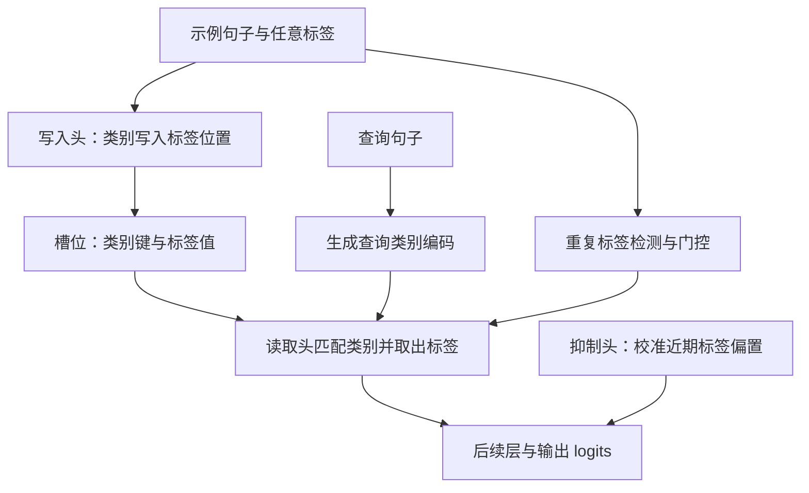
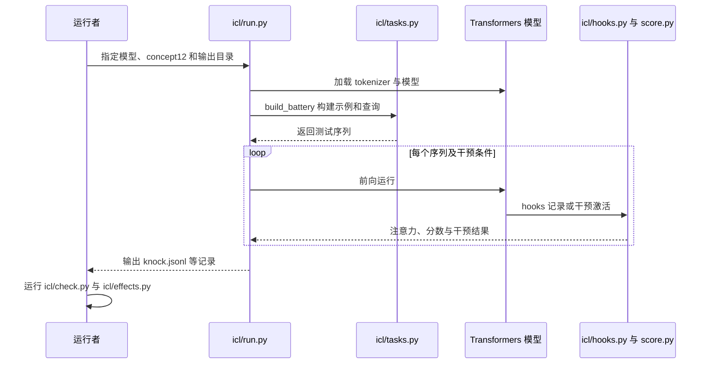

# A Circuit for In-Context Learning / 上下文学习的电路

## 一句话定义

**论文提出并干预验证：在所研究的少样本短句分类任务中，模型使用标签位置上的关联记忆完成门控检索。**

## 英文缩写速查

| 缩写 | 英文全称 | 简要说明 |
|------|----------|----------|
| ICL | In-Context Learning | 根据上下文示例适应任务，无需参数更新 |
| KV | Key-Value | 标签位置存储类别键和标签值 |
| MLP | Multilayer Perceptron | Transformer 中的多层感知机 |

## 核心信息

| 项目 | 内容 |
|------|------|
| 机构 | 斯坦福大学（Stanford University） |
| 作者 | Andrew Gao、William Gao |
| 原文版本 | [arXiv:2611.05344v1](https://arxiv.org/abs/2611.05344v1) |
| 代码 | [官方仓库](https://github.com/andrewgcodes/in-context-learning-circuit)，MIT |

## 流程总览

中层写入头将示例句子的类别方向写入其标签 token 的残差流；标签身份在值侧，类别信息在键侧。查询侧与读取头结合，检索匹配类别对应的标签。门控依据整个提示的标签重复情况，而非要求目标标签自身必定重复。

## 源码运行时序图

该图依据官方 README 和 `icl/run.py` 中已核读的入口；尚未逐项核读全部 hooks、后处理模块，也未运行复现。

## 实验与评测

- 主要模型为 Qwen3-4B、SmolLM3-3B、Llama-3.2-3B。使用激活替换、消融及随机头对照等因果干预。
- 论文报告每类 1、2、6 个示例时，正确标签检索率约 20%、60–80%、96%；这是文中指定任务与设置的结果。
- 读取规律在训练的固定长度设置内及向较少槽位预测有效，但从 12 个示例外推至 18 个示例失败。不同模型门控强度不同：唯一标签提示中 Llama 仍输出标签比例为 67%，Qwen 为 10%。
- 在 Qwen3 的自然标签实验中按筛选标准得到 89 个读取头；数量因模型、数据与筛选方式变化，不能视为普遍常数。

## 结论

**该研究给出特定分类场景下可进行因果干预的关联检索解释。**

1. 构造示例时可留意标签重复、顺序与模型先验，但应在目标任务验证。
2. 标签重复是提示整体信号，不应理解为每个待查标签都必须出现两次。
3. 不能直接将短句分类结论用于机器人 VLA、多步推理或长文本。
4. 官方代码已公开；模型实验的硬件和依赖应依 README 配置。

## 局限与待完成

论文附录与全部相关源码尚未逐段核读；本节点为草稿。未进行模型复现，也未运行仓库 CI。本研究的解析边界见论文 §14。

## 关联页面

- [机器人上下文学习](../concepts/robot-in-context-learning.md)
- [LLM 机器人控制接口](../concepts/llm-robotics-control-interfaces.md)

## 参考来源

- [论文归档](../../sources/papers/a_circuit_for_in_context_learning_2611_05344.md)
- [官方代码归档](../../sources/repos/in-context-learning-circuit.md)
- [论文全文 v1](https://arxiv.org/html/2611.05344v1)

## 推荐继续阅读

- [官方代码与交互演示](https://github.com/andrewgcodes/in-context-learning-circuit)
