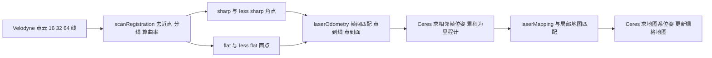

# A-LOAM：LOAM 的 Eigen + Ceres 简化实现

**A-LOAM**（Advanced implementation of LOAM，[HKUST-Aerial-Robotics/A-LOAM](https://github.com/HKUST-Aerial-Robotics/A-LOAM)）是只有代码仓库、没有独立论文的项目，所实现的算法出自 Zhang & Singh 的 LOAM（RSS 2014）。本页依据对仓库 README 与核心源码的静态通读（详见 [来源归档](../../sources/papers/a-loam.md)），未编译未运行。

## 一句话定义

**作者自述：** 用 Eigen 与 Ceres Solver 简化 LOAM 代码结构，「clean and simple without complicated mathematical derivation」，可作 SLAM 初学者的学习材料（README）。**读码所见：** 三个 ROS 节点（特征提取、scan-to-scan 里程计、scan-to-map 建图），位姿用四元数加平移，残差由 Ceres 自动求导，没有回环与 IMU。

## 英文缩写速查

| 缩写 | 英文全称 | 简要说明 |
|------|----------|----------|
| LOAM | Lidar Odometry and Mapping | Zhang & Singh 的激光里程计与建图方法（RSS 2014），A-LOAM 的算法来源 |
| A-LOAM | Advanced implementation of LOAM | 本项目，LOAM 的简化重写 |
| SLAM | Simultaneous Localization and Mapping | 同步定位与建图 |
| ROS | Robot Operating System | 节点通信中间件，README 要求 Kinetic 或 Melodic |
| PCL | Point Cloud Library | 点云库，用于 KD 树与体素滤波 |
| KD-tree | k-dimensional tree | 近邻搜索结构，用于特征点关联 |
| Ceres | Ceres Solver | 非线性最小二乘库，代码用其 AutoDiff 与 Huber 核 |
| Huber | Huber loss | 鲁棒核，代码里参数 0.1 |

## 为什么重要

- LOAM 原实现代码较难读，A-LOAM 把优化部分换成 Ceres 自动求导，三个核心 cpp 约 2000 行，常被用作理解激光里程计的入门代码（后一半是我的判断，仓库内无引用数据支撑）。
- 它是后来许多激光 SLAM 工作的对照基线或起点，例如 [LeGO-LOAM](./lego-loam.md) 在 LOAM 基础上加地面分割（见该页），[LIO-SAM](./lio-sam.md) 转向因子图与 IMU 紧耦合。本页只据 A-LOAM 代码，未核对这些工作是否直接以 A-LOAM 为起点。
- 综述文章称它「根据 LOAM 论文复现代码」。核对结论见下文「与综述说法的差异」。

## 核心原理与流程总览

### 1. scanRegistration：特征提取
- 仅支持 16、32、64 线 Velodyne，按仰角手写线号映射；去 NaN 与小于 `minimum_range` 的近点。
- 每点按方位角算相对时间，写入 `intensity = scanID + 0.1 * relTime`。
- 曲率取该点前后各 5 点的坐标差平方和；每线分 6 段排序，每段取曲率最大的 2 个为 sharp（至多 20 个为 less sharp），曲率最小的 4 个为 flat，其余点体素 0.2 下采样为 less flat；曲率阈值 0.1。
- 选中点的 ±5 邻域（相邻点距离平方不超过 0.05 时）标记为不再选取。本文件内没有找到专门的遮挡或掠射面剔除代码（据此推断与 LOAM 原论文不完全一致，原论文细节我未逐条对照）。

### 2. laserOdometry：scan-to-scan
- sharp 点在上一帧 less sharp 点云中取 1 近邻，再在相邻扫描线内找第二点，构成直线；flat 点同理找三点构成平面。距离平方阈值 25。
- 残差为点到线距离（叉积除以线段长，3 维）与点到面距离（1 维）；Ceres AutoDiff、Huber(0.1)、DENSE_QR、每次最多 4 次迭代，每帧重新关联并优化 2 轮。
- **运动畸变补偿默认关闭：** `#define DISTORTION 0`，此时插值比 s 恒为 1。置 1 才会按 `intensity` 小数部分对位姿做 slerp 插值（匀速假设）。

### 3. laserMapping：scan-to-map
- 世界划分为 21×21×11 个 50 m 立方体，取当前立方体周围 5×5×3 个拼成局部地图并建 KD 树；用里程计位姿推初值。
- 角点：5 近邻做协方差特征分解，最大特征值大于次大的 3 倍才当作直线；面点：5 近邻最小二乘拟合平面，任一点到平面距离超过 0.2 则弃用。
- 优化设置与里程计相同（Huber 0.1、DENSE_QR、每次最多 4 次迭代、2 轮）；地图点按 `mapping_line_resolution`、`mapping_plane_resolution` 体素下采样。

## 工程实践

- 环境（README）：Ubuntu 16.04 或 18.04、ROS Kinetic 或 Melodic、Ceres、PCL；提供 VLP-16（NSH indoor outdoor 数据）与 KITTI（HDL-64）两个示例以及 Docker 支持。
- 默认 launch 参数（VLP-16 版）：`mapping_skip_frame=1`、`minimum_range=0.3`、线分辨率 0.2、面分辨率 0.4。launch 注释写建议用 1，会自动调节频率。
- 节点间用时间戳严格同步，不同步直接 `ROS_BREAK`（laserOdometry.cpp），移植到自己的传感器时需注意。
- 线号映射是为 Velodyne 手写的，换其他雷达需要改 scanRegistration（读码所得）。

## 与综述说法的差异

综述文章（《激光雷达 SLAM 算法最新综述》转载稿）的原句：「香港科技大学 Qin 根据 LOAM 论文复现代码，开源 A-LOAM 算法，使用 Eigen 矩阵库和 Ceres-Solver 非线性优化库代替原本复杂的数学推导，代码简洁易懂，适合初学者学习」。

| 说法 | 核对 |
|------|------|
| 根据 LOAM 论文复现 | 部分不符。README 写「modified from LOAM and LOAM_NOTED」，署名 Modifier，源文件保留 Ji Zhang（CMU）与 SwRI 版权头，是改写既有代码，并非从论文复现。作者是 Tong Qin 与 Shaozu Cao 两人。 |
| Eigen + Ceres 代替复杂数学推导 | 与 README 自述一致，代码里用 AutoDiff，无手推 Jacobian。 |
| 简洁易懂适合初学者 | 作者自述如此（README）；「易懂」为主观评价，未经第三方验证。 |
| （LOAM 的）匀速假设线性插值补偿 | 代码里有实现但默认关闭（`DISTORTION 0`），默认运行不补偿。 |
| （LOAM 的）无回环与后端 | A-LOAM 代码确实没有；「大场景漂移」仓库内无实验支撑，未验证。 |

## 局限

- **性质：** 这是代码仓库而非论文，没有作者给出的精度、耗时或消融实验，README 只有 KITTI 截图和 GIF，因此无法在本页给出任何定量结论。
- **无回环、无 IMU、无图优化：** 在源码中检索未发现这些模块，长距离累积漂移只能靠 scan-to-map 抑制（推测，未实测）。
- **传感器绑定：** 只支持 16、32、64 线 Velodyne 的手写线号映射。
- **畸变补偿默认关闭**，高速运动或旋转下可能受影响（推测，未实测）。
- **维护状态：** 读取的 `devel` 分支最新提交为 2019-03-28；README 针对 ROS 1 与 Ubuntu 16.04/18.04，在较新系统上能否直接编译未验证。
- **我的核对范围：** 仅静态读，未编译运行；`laserMapping.cpp` 的缓存与发布样板代码只扫读；`kittiHelper.cpp`、Docker、rviz 配置未细读。

## 关联页面

- [激光雷达 SLAM 综述整理（2026 转载文）](../concepts/lidar-slam-survey-2026.md)
- [LeGO-LOAM](./lego-loam.md)：在 LOAM 之上加入地面分割与地面优化
- [LIO-SAM](./lio-sam.md)：因子图加 IMU 紧耦合的激光惯性方案
- [LVI-SAM](./paper-lvi-sam.md)：激光、视觉、惯性融合
- [FAST-LIO](./fast-lio.md)、[Point-LIO](./point-lio-unilidar.md)：迭代卡尔曼滤波路线的激光惯性里程计
- [Cartographer](./cartographer.md)：基于子图与回环的另一类 2D/3D SLAM
- [Ceres Solver](./ceres-solver.md)：A-LOAM 使用的优化库
- [状态估计](../concepts/state-estimation.md)、[激光雷达感知](../concepts/lidar-sensing.md)、[传感器融合](../concepts/sensor-fusion.md)
- [激光 SLAM / LIO / VIO 选型对比](../comparisons/lidar-slam-lio-vio-selection.md)

## 参考来源

- [来源归档：A-LOAM 仓库通读](../../sources/papers/a-loam.md)（本页全部代码层结论的出处）
- 仓库 README 与源码：<https://github.com/HKUST-Aerial-Robotics/A-LOAM>（读取 `devel` 分支 `e51f88c`）
- 算法来源论文：J. Zhang and S. Singh, LOAM: Lidar Odometry and Mapping in Real-time, RSS 2014（经 A-LOAM README 引述，本页未读该论文全文）

## 继续阅读

- 先读 `scanRegistration.cpp` 的曲率与特征选择，再读 `lidarFactor.hpp` 的三个残差，最后读 `laserMapping.cpp` 的 cube 地图管理。
- 想看加回环与地面约束的版本，读 [LeGO-LOAM](./lego-loam.md)；想看紧耦合 IMU 的版本，读 [LIO-SAM](./lio-sam.md)。
