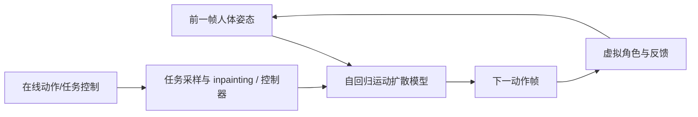
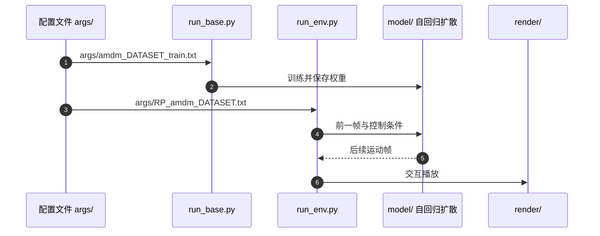

# A-MDM：自回归扩散角色交互控制

## 一句话定义

根据前一帧姿态自回归生成后续运动，提供实时 inpainting、任务采样及强化学习高层控制，重点在虚拟角色交互。

## 英文缩写速查

| 缩写 | 英文全称 | 简要说明 |
|---|---|---|
| A-MDM | Auto-Regressive Motion Diffusion Model | 本论文缩写 |
| MLP | Multi-Layer Perceptron | 轻量去噪网络 |
| RL | Reinforcement Learning | 高层交互控制训练 |

## 为什么重要

- 将本研究放进从可控角色动画、实时生成到 G1 真机视觉闭环的对照坐标；输入和输出属于不同技术层级。
- 对工程部署而言，必须分别核查动作生成时间、动作跟踪控制频率和整机成功率。

## 核心信息

| 项 | 内容 |
|---|---|
| 论文/会议 | [ACM TOG / SIGGRAPH 2024](https://arxiv.org/abs/2306.00416v4) |
| 机构 | 论文作者来自多个机构；本次以原始作者表为准，不推断单一归属 |
| 作者 | Yi Shi, Jingbo Wang, Xuekun Jiang, Bingkun Lin, Bo Dai, Xue Bin Peng |
| 项目主页 | [作者官方入口](https://yi-shi94.github.io/amdm_page/) |
| 开源 | [官方仓库](https://github.com/Yi-Shi94/AMDM)（依赖和模型文件另行准备） |
| 原文阅读状态 | **未完成全文与全部附录核对，暂为 draft** |

## 流程总览

基于可核对的一手论文机制绘制主干模块关系：

## 核心原理

A-MDM 根据历史姿态逐步采样下一帧，用轻量 MLP 条件扩散而非一次生成全时长块；交互目标由任务采样、运动补全以及可训练高层控制接口影响生成。

## 实验与评测

原文比较长时连续生成、交互可控性和动作多样性；官方代码提供 LAFAN1 / 100STYLE 预训练权重和交互运行方式。

## 结论

**研究价值在于 根据前一帧姿态自回归生成后续运动，提供实时 inpainting、任务采样及强化学习高层控制，重点在虚拟角色交互。；对比时必须看清控制层级和数据口径。**

1. 生成模型输出的运动序列并不自动满足真实机器人动态平衡和接触约束。
2. 相关数值只对应论文实验配置，不能横向等同于另一系统的真机成功率。
3. 将该工作与相邻项目区分为 **生成、跟踪、视觉条件适配、闭环执行** 等不同接口。

## 源码运行时序图

依据官方 README 及已核对的代码入口，仅描述可明确确认的运行链路：

## 工程实践

官方 README 给出的训练入口 `python run_base.py --arg_file args/amdm_DATASET_train.txt`，推理 `python run_env.py --arg_file args/RP_amdm_DATASET.txt`，inpainting 使用 `args/PI_amdm_DATASET.txt`。

## 局限与风险

实时角色动作合成不直接等于物理 G1 控制；不应与 CVPR 2024 的 AAMDM 混为同一论文。

**阅读阻塞：** 仅核对论文的主要方法/结果段落、作者项目页及可用仓库入口；尚未完成全部原文与附录的通读及代码运行验证。按知识库规则保留 draft，未声称原文通读。

## 关联页面

- [从动作生成到人形闭环：方法与证据对比](../comparisons/generative-motion-to-humanoid-closed-loop.md)
- [扩散式动作生成](../methods/diffusion-motion-generation.md)
- [ARDY：交互可控动作生成](./ardy.md)
- [Kimodo：运动生成主干](./kimodo.md)

## 参考来源

- [a_mdm_interactive_character_control_primary.md](../../sources/papers/a_mdm_interactive_character_control_primary.md)
- [a-mdm-interactive-character-control-primary.md](../../sources/sites/a-mdm-interactive-character-control-primary.md)
- [a-mdm-interactive-character-control-official.md](../../sources/repos/a-mdm-interactive-character-control-official.md)

## 推荐继续阅读

- [原始论文](https://arxiv.org/abs/2306.00416v4)
- [作者项目主页](https://yi-shi94.github.io/amdm_page/)
- [官方源码](https://github.com/Yi-Shi94/AMDM)
