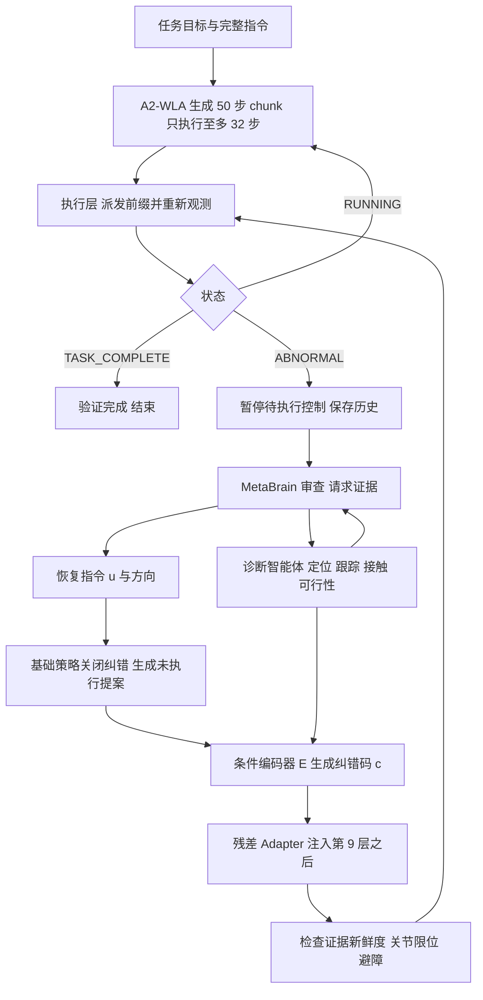
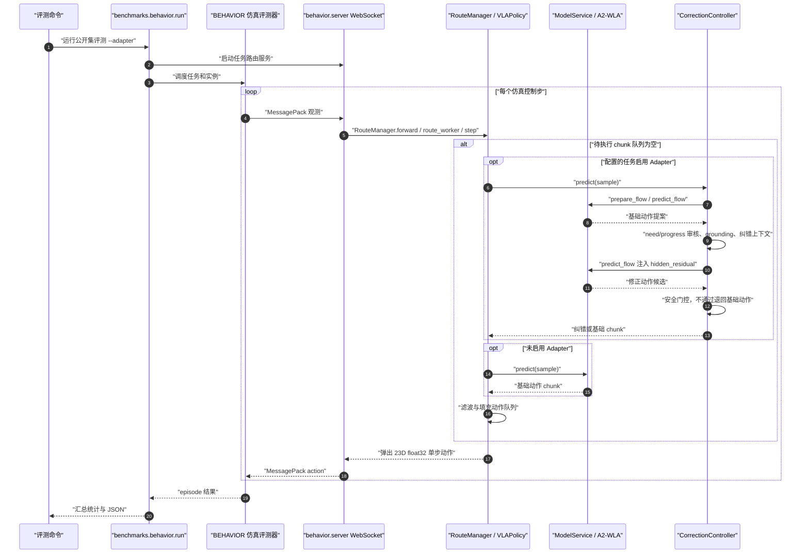

# A²-MEAS：用「纠错码」把诊断接入连续控制

**A²-MEAS**（*Toward the Era of Agentic Embodied Intelligence*，[arXiv:2611.09124](https://arxiv.org/abs/2611.09124)，[项目页](https://a2-meas.github.io/)，[代码](https://github.com/AutoLab-SAI-SJTU/A2MEAS)）由上海交通大学人工智能学院 AutoLab 与 Anyverse Dynamics 研究实验室（论文首页署名）提出。它是一个具身多智能体框架：VLM 协调器 MetaBrain 维护任务目标并给出恢复指令，诊断智能体提供定位、跟踪、接触等证据，动作模型 A²-WLA 生成连续控制；中间用一个学习出来的「纠错码」接口，让诊断真正改变下一段动作。本期收录于「具身智能小站」2026-11-10 更新（深读篇）。

## 一句话定义

**把恢复指令、空间证据、执行历史和一份未执行的基础动作提案编码成纠错码，经残差 Adapter 改写动作专家隐状态，使失败后的诊断能改变下一条轨迹，底座冻结、部署时所有权重固定。**

## 英文缩写速查

| 缩写 | 英文全称 | 简要说明 |
|------|----------|----------|
| A²-MEAS | 论文标题写为 A²-MEAS，全称文中未展开 | 整个多智能体框架（MetaBrain + 诊断智能体 + A²-WLA + 纠错接口） |
| A²-WLA | 论文正文未展开全称（项目页标题写 World-Language-Action 模型） | 底座动作模型：VLA + 运动感知历史 + 潜空间世界模型 |
| MetaBrain | 论文自定名 | VLM 协调器：维护任务目标、验证进度、诊断失败、写恢复指令（公开集用 Qwen3.8-27B） |
| VLA | Vision-Language-Action | 视觉语言动作策略 |
| WAM | World Action Model | 世界动作模型，动作生成与未来视觉动态联合建模 |
| Q-score | 任务目标条件满足比例 | BEHAVIOR 的部分完成度指标，与完整成功率不是同一个量（§5.1 式 23） |
| SR | Success Rate | 完整任务成功率，要求整个任务完成 |
| CorrectionContext | 纠错上下文 | 表 2 的结构化字段：目标、失败窗口、已执行动作、历史块、纠错文本、方向、空间证据、基础提案 |
| Adapter | 残差适配器 | 在动作专家第 9 层后加 `α ⊙ C_φ(h, c)` 的小模块 |
| FAST | Frequency-space Action Sequence Tokenization | 动作频域离散化，用作骨干的预训练监督（§3.4.2） |
| IK | Inverse Kinematics | 逆运动学，表 13 里 VLM+IK 对照用 |
| BEHAVIOR 2026 | BEHAVIOR Challenge 2026 | 100 个家居全身操作任务、官方 20,000 条遥操作演示约 1,950 小时（§3.4.1） |

## 为什么重要

- **长流程里一次失败会毁掉后续前提。** 论文的出发点（§1）：「重试」这个决定并没有告诉控制器下一次该怎么不同；需要让新推断出的纠正在控制过程里可用。这一点与常见的「VLM 重规划、动作模型照旧」不同，A²-MEAS 把诊断变成动作模型的条件输入。
- **接口设计可复用。** 异构智能体只要按同一份 CorrectionContext 模式提供字段，就可以不共享架构地影响连续控制（§2、§2.6）；新工具只需保持字段语义和坐标约定。
- **评测同时报 Q-score 与完整成功率。** 论文用任务级图（图 11）说明高 Q 不等于高成功（如 Storing food Q 0.838 但只成功 1/10），这对读 BEHAVIOR 类榜单有直接参考意义。
- **作者与本站判断分开：** 以上是论文自述的动机；这套接口在真实失败状态下是否有效，论文的直接证据只有真机咖啡任务两个步骤（见局限）。

## 核心原理（方法）

### 流程总览

### 机制要点

1. **运行循环（§1.1、§1.2）。** 局部环路反复「观测、生成 chunk、执行前缀」；任务级环路在监控到异常时暂停，让 MetaBrain 审查证据，验证恢复后回到名义环路。共享执行记录 `R_t` 存目标、实际派发的控制和观测结果。
2. **诊断智能体（§2.2、表 1）。** 感知定位、时空定位、交互与可行性三类功能；六类问询（状态属性、空间、交互、时间、实例、可行性）；使用 DINO 特征、SAM 分割、跟踪、深度或 3D、机器人状态与解析运动学。验证区分「否定」与「证据不足」：后者触发额外观测（在感知预算内），而不是直接当作失败。
3. **纠错码与 Adapter（§2.3–2.4、式 2–3、图 3）。** 四个输入编码成连续向量 `c_t`，每个 chunk 固定；Adapter 读取每个动作位置的隐状态，所以同一个 chunk 内不同位置的调整可以不同（先抬起、后重新接近）。
4. **纠错数据（§2.5、式 4、图 5）。** 离线在演示状态上让冻结策略出提案，与专家延续比较，偏差大且在关键步的窗口作为样本；标注由开放词表定位、SAM 掩码和 MetaBrain 生成纠错文本，不确定的空间字段置空。监督是「控制空间偏差到隐状态残差」的间接学习，论文强调这不是对 MetaBrain 内部表示的蒸馏。
5. **A²-WLA（§3）。** 运动感知历史编码（相邻帧对表征相减后做门控交叉注意力）、多视角潜空间世界模型（反向模型产生共享转移潜变量，部署时由骨干预测）、动作专家交替交叉注意当前与预测的未来上下文；训练用流匹配、FAST 预训练、知识隔离（见 [知识隔离](./paper-knowledge-insulation.md) 论文页）、Local Muon 优化器等（§3.4）。
6. **运行预算（§2.6）。** 每次异常最多额外两个视角（各 5 秒）、三次物理重试，MetaBrain 请求 10 秒超时，整个恢复事件 60 秒上限；预算不会因重发问询而重置。

## 源码运行时序图

以下仅对应官方 `evaluation` 分支的公开 BEHAVIOR 运行链：`benchmarks/behavior/run.py`、`a2meas/behavior/server.py`、`a2meas/behavior/policy.py` 和 `a2meas/behavior/correction/controller.py`；不是论文完整系统的已验证复现。

复现入口：`runtime/model/bin/python -m benchmarks.behavior.run ... --adapter`（需先备齐权重、资产和硬件）。其中 `--adapter` 仅对 `configs/behavior/adapter.json` 所列任务生效。本次只核对源码调用链，未执行 GPU benchmark。

## 工程实践

- **训练规模（§3.4.4、表 3）：** 基础三阶段各用 64 GPU；连续动作阶段全局 batch 2,048、500,000 步；纠错阶段 8 GPU、batch 256、6,000 步、学习率 1e-4 余弦衰减到 1e-5。
- **吞吐优化（§4.1）：** 批量 JPEG 解码、Arrow 共享内存缓存、前缀计算共享（多个噪声-时间对共用一次骨干前向）、静态缓存与分桶减少 Triton 重编译、分片 Local Muon；8 GPU 达 427.1 samples/s，对比 π0.5 参考实现 106 samples/s。论文给出的是各自选 batch 的实现间对比，不是控制变量实验。
- **服务部署（§4.2）：** 27B 的 MetaBrain 用 BF16、两卡张量并行；A²-WLA 单独一卡；仿真与策略通过同步 WebSocket 通信；30 Hz 下 32 步前缀约 1.07 秒。
- **评测基础设施（§4.3、表 4）：** 8 张 Pro6000，每卡 3 个 worker 并发 24 个仿真 worker，1,000 episode 用 18.1 小时；对比的 159.4 小时是由估计的 1,275 小时串行耗时按理想线性缩放推算得到。
- **复现注意：** 论文把「完整四输入纠错接口」（仿真）与「失败历史条件 Adapter」（真机）区分为两个变体；隐藏集提交的是 2B 协调器版本。官方仓库现已发布推理/评测实现，但训练基础设施与完整纠错配置不能据此认定全部开源。
- **官方开源状态（2026-11-11）：** 已核验 [项目页](../../sources/sites/a2-meas.md) 与 [源码入口](../../sources/repos/a2meas.md)。官方 `evaluation` 分支具备 BEHAVIOR 2026、RoboTwin 2.0 的推理和评测代码、一个 Adapter、权重获取指引；README 明确省略完整 Adapter 配置及部分任务执行策略（包括导航）。训练脚本与训练基础设施不在当前 README 的公开复现路径内。
- **论文完整系统 ≠ 当前发布版：** 论文 BEHAVIOR 100 任务公开集 Q **0.6411**、成功率 **45.40%**；官方 README 的发布版复现表 Q **0.5287**、成功率 **32.40%**，RoboTwin 发布版平均 **95.05%**。本次没有运行 GPU 评测。

## 实验与评测

| 设置 | 结果（论文章节） |
|------|------------------|
| BEHAVIOR 2026 公开集，100 任务 × 10 实例（表 5） | 单模型 0.4597 / 27.20%，多模型 0.6040 / 40.60%（406/1000），完整系统 0.6411 / 45.40%（454/1000），覆盖任务 70 / 80 / 88 |
| 官方发布版复现表（README，2026-11-11） | BEHAVIOR **0.5287 / 32.40%**，RoboTwin **95.05%**；只含一个 Adapter，部分策略省略，不能视作论文完整系统复现 |
| 官方隐藏集（§5.2.3） | A²-MEAS 0.4975 / 32.05%（2B 协调器），A²-WLA 0.4951 / 30.95% |
| 50 任务子集（表 7） | 单模型 0.4522 / 25.60%，25 个特化 checkpoint 0.5755 / 37.40%，完整系统 0.6191 / 41.40%；RLC 0.2605 / 11.20% |
| RoboTwin 2.0（表 8） | A²-WLA 93.98%，完整系统 95.05%，π0.5 79.75%，G0.5 93.25%，MotuBrain 95.95% |
| 真机 12 任务（表 9–10） | π0.5 26.67%，A²-WLA 完整 57.92%（每任务 20 次，关闭高层纠错） |
| 真机咖啡恢复（图 13） | 回退后：基础重试 14/100、8/100，历史条件 Adapter 94/100、82/100；从原始起点：基础 71/100、76/100，加 Adapter 98/100、95/100 |
| 基础模型消融（表 11，Selected12） | 动作策略初始化 0.4846 / 39.72%，加世界模型 0.5183 / 42.50%，加运动编码 0.5279 / 45.56%，加技能采样 0.5546 / 46.67%，加成功 rollout 0.5905 / 50.28% |
| Adapter 条件消融（表 12，120 episodes） | 无 Adapter 0.5310 / 41.67%，完整 0.6108 / 52.50%，缺语言与定位 43.33%，缺长历史 44.17%，缺候选 47.50%，缺定位 49.17% |
| 纠错接口对比（表 13） | 指令复述 / VLM+IK / 残差 Adapter：物理恢复 46.27 / 52.05 / 54.93%，最终完成 38.81 / 45.21 / 43.66% |
| 新实例泛化（图 14） | Adapter 0.6782 / 58.33%，基础 0.6185 / 50.83%，去纠错语言 0.6336 / 52.50% |

读法提示：

- 45.40% 是完整成功率，Q-score 0.6411 是部分目标满足度，二者不能混用；论文自己也强调高 Q 与低成功共存（§5.2.2、§7.2）。
- 从多模型 40.60% 到完整系统 45.40% 的差距包含 MetaBrain、诊断智能体与学习纠错的合并贡献；论文用固定策略的 Adapter 消融（表 12、图 14）单独检验纠错机制，但那是 12 任务子集上的 120 episode 结果。
- 表 13 里「更高的物理恢复率」没有带来更高的最终完成率（Adapter 43.66% 低于 VLM+IK 45.21%），论文如实写了这一点。

## 与其他工作对比

| 对照 | 差异读法 |
|------|----------|
| [LaWAM](./paper-lawam.md)、[WAVE-0](./paper-wave-0-latent-future-prediction.md) | A²-WLA 的潜空间世界模型明确借鉴了二者的潜动作思路（§3.2 引用 LaWAM 与 Wave-0）；A²-MEAS 的新增点在上层的纠错接口 |
| [MotuBrain](./paper-motubrain.md) | RoboTwin 2.0 上论文表 8 里 MotuBrain 95.95% 高于 A²-MEAS 的 95.05%，但协议各自报告，论文也这样说明 |
| [π0.5](./paper-pi05-open-world-vla.md) | 真机短程对比的基线（26.67% 对 57.92%）；两者训练配方不同，论文写明不同配置用不同完整训练流程（§5.4.1） |
| RLC（2025 BEHAVIOR 冠军，论文 [18]） | 论文称其使用显式阶段转换逻辑、重开夹爪启发式、收音机专用回滚规则；2.21 倍的比较跨基准版本与训练配置（摘要、§1） |
| [世界动作模型概念页](../concepts/world-action-models.md) | 本文属于 WAM 路线上「简单架构 + 数据与配方」一支，外加 agent 层纠错 |

## 结论

A²-MEAS 的主张是：长程能力主要靠动作模型自身学习，agent 层在关键点做验证和纠错；论文提供底座消融、固定策略纠错消融与两步真机恢复证据。

- 评测同时报告 **Q-score** 与**完整任务成功率**，不可将 0.6411 读作 64.11% 完成率。
- 复现时区分论文系统和官方**部分开源发布版**：BEHAVIOR 0.6411/45.40% 与 0.5287/32.40% 是不同配置。
- 先复用 `evaluate.py`、BEHAVIOR/RoboTwin 评测入口和权重配置；不可假设已提供完整训练脚本。
- 失败恢复需要保存真实执行的控制与历史，并验证恢复动作可执行性，避免原样重试。

## 局限与风险

**论文自己承认的（§5.2.3、§6.5.2、§7.3）：**

- 纠错需暂停执行做诊断，不适合需要立即反应的事件。
- 纠错训练样本来自演示状态上的策略偏差，不是真实失败，存在分布差距；需要收集失败状态及后续结果。
- 量化评测集中在家居仿真；多机型、多环境、多次独立训练的稳定性仍待检验。
- 隐藏集用的是 2B 协调器，论文说不能完整代表 27B 系统；2B 版本更常不必要地打断。
- 车翻倒、灯落缝隙、食物散落等场景破坏会让恢复超出机器人物理能力。
- 完整成功任务仅 11/100 任务十次全成功，8 个任务 Q 低于 0.2（图 11）。

**本站读到的未验证之处（作者自述之外的判断）：**

- 数字对比的限定：「2.21 倍于 RLC」跨不同基准版本；训练吞吐 4.03 倍是各自 batch 的实现比较；评测 8.8 倍的基线是推算值，论文自己说需要同卡实测基线来拆分贡献（§4.3）。
- 真机 94/100 与 82/100 是「回退到失败后起点」的特定恢复步骤，对照是同一冻结策略的重试；同时图 13 显示从原始起点基础策略已有 71/100 与 76/100，因此 14/100 的低值部分反映了失败状态本身更难，而非常规成功率。各条件为 100 次试验，未报方差。
- 真机变体与完整接口不是同一模块（参数约 86 万、读失败历史，不含语言和空间证据四输入编码），所以真机结果不能直接当作完整纠错码接口的真机验证；论文也明确区分了二者。
- 公开集结果来自「published self-report」类榜单与论文自述记录，且 A²-MEAS 公开集 0.6411 与隐藏集 0.4975 之间差距较大，公开集过拟合程度论文未量化（推测）。
- 多模型配置依赖按任务选择 checkpoint 与执行配置（§6.2，选择在评测前固定），完整系统与其比较的收益里是否也含选择效应，论文以固定策略消融单独检验。
- **当前公开实现边界已核实：** 仓库只放出一个 Adapter 与部分任务策略，论文完整配置及训练栈未全部开放；官方 README BEHAVIOR 0.5287/32.40% 与论文 0.6411/45.40% 不同，不能宣称已独立复现论文成绩。该论文是系统与技术报告，不是单一算法论文。

## 关联页面
- [具身智能小站 11-10：22 篇论文阅读坐标](../overview/embodied-station-2026-11-10-22-papers-technology-map.md)

- [VLA（Vision-Language-Action）](../methods/vla.md)
- [世界动作模型](../concepts/world-action-models.md)
- [流匹配具身策略](../concepts/flow-matching-embodied-policy.md)
- [动作分块](../methods/action-chunking.md)
- [Agentic 操作策略](../methods/agentic-manipulation-policies.md)
- [具身三层控制架构](../concepts/embodied-three-layer-control-architecture.md)
- [全身控制](../concepts/whole-body-control.md)
- [仿真与真机评测差距](../concepts/sim-vs-real-eval-gap.md)
- [BEHAVIOR-1K](./behavior-1k.md)
- [LaWAM](./paper-lawam.md)
- [WAVE-0](./paper-wave-0-latent-future-prediction.md)
- [MotuBrain](./paper-motubrain.md)
- [知识隔离 VLA](./paper-knowledge-insulation.md)
- [π0.5](./paper-pi05-open-world-vla.md)

## 参考来源

- [a2-meas-agentic-embodied-intelligence_arxiv_2611_09124.md](../../sources/papers/a2-meas-agentic-embodied-intelligence_arxiv_2611_09124.md)
- [项目主页核查归档](../../sources/sites/a2-meas.md)
- [官方源码与运行入口归档](../../sources/repos/a2meas.md)
- [arXiv:2611.09124](https://arxiv.org/abs/2611.09124)
- [项目页](https://a2-meas.github.io/)

## 推荐继续阅读

- [arXiv PDF（v1）](https://arxiv.org/pdf/2611.09124v1)
- [代码仓库](https://github.com/AutoLab-SAI-SJTU/A2MEAS)
- [世界动作模型概念页](../concepts/world-action-models.md)
- [BEHAVIOR-1K](./behavior-1k.md)
