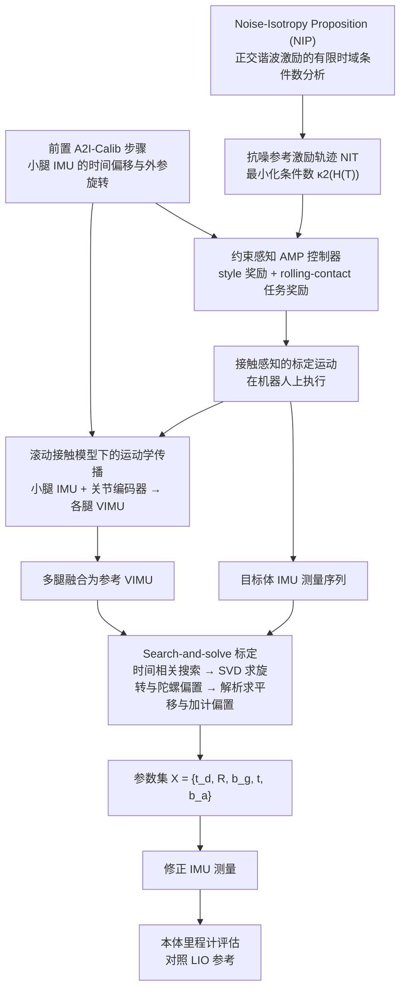

# A2I-Calib++：面向腿式机器人全身多 IMU 的运动学驱动抗噪主动标定

**A2I-Calib++**（*A2I-Calib++: A Kinematics-Driven Anti-noise Active Calibration Framework for Whole-Body Multi-IMU Systems on Legged Robots*，[arXiv:2610.29438](https://arxiv.org/abs/2610.29438)）收录于 senlanke「具身运控lab」10-19–10-23 前沿论文动态（人形/四足）。本页依据**周报条目 + arXiv 摘要页**整理，流程图依据论文方法部分（见参考来源），未逐页核对实验数字；指标与结论以论文为准。

## 一句话定义

**A2I-Calib++：面向腿式机器人全身多 IMU 的运动学驱动抗噪主动标定——设计噪声各向同性激励轨迹，以带滚动接触奖励的 AMP 控制器执行；再利用小腿 IMU、关节运动学和接触约束构造虚拟参考 IMU，同时估计时间偏移、旋转、平移和惯性偏置。**

## 英文缩写速查

| 缩写 | 英文全称 | 简要说明 |
|------|----------|----------|
| RL | Reinforcement Learning | 强化学习 |
| WBC | Whole-Body Control | 全身控制 |

## 为什么重要

- 周报所述待解决的问题：日常腿式运动激励不足，而足端冲击、振动和打滑又会干扰多 IMU 时空外参及偏置标定。

## 流程总览

图依据：论文 §IV-A 系统概览 / Fig.2、§IV-B Search-and-Solve、§IV-C NIT 轨迹生成、§IV-D 接触约束 VIMU。

## 核心机制

| 项 | 内容 |
|----|------|
| **arXiv** | [2610.29438](https://arxiv.org/abs/2610.29438) · [PDF](https://arxiv.org/pdf/2610.29438) |
| **作者（arXiv）** | Fangyu Jiang, Chaoran Xiong, Kehui Ma, Zhen Sun, Zeyu Zhang, Ling Pei |
| **机构（周报所述，未逐条核实）** | 上海交通大学、Openmind Smart Robotics、江西智联先进技术研究院 |
| **arXiv 评论栏** | （无） |
| **开源** | arXiv 摘要页与评论未见代码或项目页链接（仅核对 arXiv 摘要页，不代表未发布）（2026-10-26） |
| **周报所述创新点** | 设计噪声各向同性激励轨迹，以带滚动接触奖励的 AMP 控制器执行；再利用小腿 IMU、关节运动学和接触约束构造虚拟参考 IMU，同时估计时间偏移、旋转、平移和惯性偏置。 |

### arXiv 摘要节选（英文原文）

> Recently, multi-node inertial measurement unit (multi-IMU) systems have shown promise for robust odometry in legged robots. Multi-IMU fusion can improve legged robot odometry but requires accurate spatiotemporal calibration among the sensors.

## 源码运行时序图

**不适用**：arXiv 摘要页与评论未见代码或项目页链接（仅核对 arXiv 摘要页，不代表未发布），无可对齐的官方代码流程。

## 实验与评测

- 周报与摘要给出的数字/场景已写入上表「创新点」与摘要节选；其余实验细节、基线与成功率定义请回到论文正文。
- 读法：先对齐任务设定、传感器与成功定义（仿真/真机），再解读 headline 数字，勿跨论文直接比较。

## 与其他工作对比

| 维度 | 读法 |
|------|------|
| **同周对照** | 见 [人形/四足周报技术地图](../overview/senlanke-weekly-2026-10-19-23-humanoid-quadruped-technology-map.md)，按方向浏览同期论文 |
| **开源状态** | arXiv 摘要页与评论未见代码或项目页链接（仅核对 arXiv 摘要页，不代表未发布） |

## 结论

**A2I-Calib++：面向腿式机器人全身多 IMU 的运动学驱动抗噪主动标定。**

1. 本页是入库级摘要，复现前请核对论文正文、附录与代码仓库。
2. 指标须连同实验条件解读。
3. 关注 arXiv 版本更新与代码发布。

## 关联页面

- [senlanke-weekly-2026-10-19-23-humanoid-quadruped-technology-map](../overview/senlanke-weekly-2026-10-19-23-humanoid-quadruped-technology-map.md)
- [locomotion](../tasks/locomotion.md)

## 参考来源

- [a2i-calib-plus-multi-imu-legged-calibration_arxiv_2610_29438.md](../../sources/papers/a2i-calib-plus-multi-imu-legged-calibration_arxiv_2610_29438.md)
- [wechat_senlanke_weekly_humanoid_quadruped_2026-10-19_23.md](../../sources/blogs/wechat_senlanke_weekly_humanoid_quadruped_2026-10-19_23.md)
- [arXiv:2610.29438](https://arxiv.org/abs/2610.29438)
- [arXiv PDF](https://arxiv.org/pdf/2610.29438)：已通读方法部分（实验与附录以略读为准）：§III 问题建模、§IV-A–D 方法（AMP 控制器奖励与观测表仅略读）

## 推荐继续阅读

- [arXiv PDF](https://arxiv.org/pdf/2610.29438)
