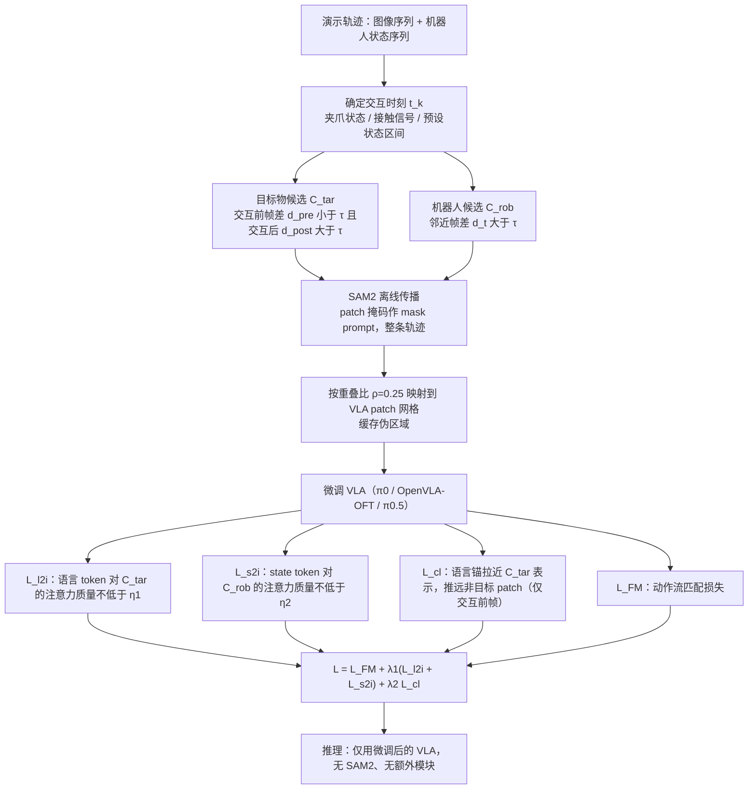

# A³-VLA：感知引导的注意力对齐

**A³-VLA**（*Automatic Perception-Guided Attention Alignment for Robot Manipulation*，[arXiv:2611.06447v1](https://arxiv.org/abs/2611.06447)，2026-11-04，NeurIPS 2026 格式）来自中国科学技术大学、上海人工智能实验室等（作者 Shengzhe Zhang、Qi Zhang、Dazhong Shen、Chao Wang、Shaopeng Zhai、Hui Xiong）。本页依据论文 v1 全文与附录。

## 一句话定义

**A³-VLA 是一种只改微调损失、不改网络结构的 VLA 训练框架：从演示轨迹中的「交互引起的视觉变化」自动得到目标物与机器人的粗区域，经 SAM2 离线细化后，用注意力下界损失与语言–区域对比损失把 VLM 骨干的注意力拉回任务相关区域。**

## 英文缩写速查

| 缩写 | 英文全称 | 简要说明 |
|------|----------|----------|
| VLA | Vision-Language-Action | 视觉–语言–动作模型 |
| VLM | Vision-Language Model | VLA 的视觉语言骨干 |
| SAM2 | Segment Anything Model 2 | 本文用于离线沿轨迹传播掩码，见 [paper-sam2](./paper-sam2.md) |
| C_tar / C_rob | candidate target / robot regions | 目标物 / 机器人的 patch 级候选区域 |
| L_l2i / L_s2i | language-to-image / state-to-image attention loss | 语言 / 状态 token 查询图像 patch 的注意力分配损失 |
| L_cl | contrastive learning loss | 语言锚与目标区域 / 非目标区域的对比损失 |
| TP / NP | texture / noise perturbation | 表 5 的纹理 / 高斯噪声扰动 |
| SR / TP(表 3) | success rate / task progress | 真机成功率 / 任务进度分（注意与 TP 纹理扰动同缩写） |

## 为什么重要

- 论文指出的失败模式：VLA 失败不一定是动作生成错，而是 VLM 骨干的注意力没落在指令指定的物体上（Fig.1：π0、OpenVLA-OFT 在 VLABench 的 Select Poker 任务上指令→图像注意力指向错误目标）。动作损失（流匹配或自回归）从不直接监督注意力。
- 区别于 CoT-VLA 的视觉链式推理、π0.5 / Gemini Robotics 的开放世界知识：作者认为这些引导要么间接、要么与任务无关；A³-VLA 的信号来自**本任务演示轨迹自身**，无需人工标注（作者表述）。
- 实用性：骨干无关（实验覆盖 π0、OpenVLA-OFT、π0.5），推理时只跑微调后的 VLA（作者表述）。

## 核心方法 / 机制

### 1. 候选区域生成（§3.2，离线）

1. 取交互时刻 t_k（粗略时刻，可由夹爪状态、接触信号或预设状态区间得到；附录 Fig.8 示例为 gripper=-1，Fig.9 为 gripper=0）。
2. 目标物：对每个 patch (i,j) 计算交互前窗口 [t_k−2w, t_k−w] 与交互后窗口 [t_k, t_k+w] 内相邻帧差的平均 L2 范数（式 2、3），取 `d_pre < τ` 且 `d_post > τ` 的 patch 为 C_tar（交互前不动、交互后变化）。
3. 机器人：全程活动，取 `d_t = ||I^{t+w} − I^t|| > τ` 的 patch 为 C_rob（式 4）。
4. τ=10（论文称对该值不敏感）；窗口 w 等于视频帧率；多次交互的轨迹按交互时刻分段、各段取并集。
5. SAM2 细化（附录 A.6）：把交互帧的 patch 二值掩码作为 mask prompt，目标与机器人分别沿整条轨迹传播，得到时间一致的伪掩码；再映射回 VLM patch 网格：patch 与掩码重叠比例 > ρ=0.25 则计入 C_tar^t / C_rob^t（式 11、12）；伪掩码预先缓存。

### 2. 注意力分配损失（§3.3）

取 VLM **最后一层**注意力并对头平均。语言 token 对每个图像 patch 的注意力先对 N_l 个语言 token 平均得到 M̄^{l2i}，再对目标区域求和并施加平方 hinge：

- L_l2i = [max(0, η1 − Σ_{(i,j)∈C_tar} M̄^{l2i}_{(i,j)})]²
- L_s2i = [max(0, η2 − Σ_{(i,j)∈C_rob} M^{s2i}_{(i,j)})]²（state token→图像 patch）

只设注意力质量**下界**（软约束，η1=η2=0.25），不强制分布形状。

### 3. 对比学习损失（§3.4）

语言 token 表示均值为锚 P̄^{lan}；C_tar 内 patch 表示均值为正 P̄^{img+}；其余 patch 均值为负 P̄^{img−}（式 8）。

- L_cl = −log( exp(sim(P̄^{img+}, P̄^{lan})) / ( exp(sim(P̄^{img+}, P̄^{lan})) + exp(sim(P̄^{img−}, P̄^{lan})) ) )，sim 为余弦相似度（式 9）。
- 只在交互**之前**的帧上施加（此时目标较少被机械臂遮挡）。

### 4. 联合训练（§3.5）

L = L_FM + λ1 (L_l2i + L_s2i) + λ2 L_cl，λ1=0.1，λ2=0.01（式 10）。L_FM 是 π0 式流匹配损失（式 1）。

## 流程总览

图依据：论文 Fig.2、§3.2–§3.5、附录 A.6。

## 实验与评测

**设置（§4.1、A.5）：** VLABench 五个任务套件（Chemistry Tube、Fruit、Poker、Toy、Mahjong），每套 500 条演示、测 50 episode；RoboTwin 2.0 四个任务（Beat Block Hammer、Click Bell、Move Playingcard Away、Place Burger & Fries），每任务 100 条演示、测 100 episode；真机为松灵（Songling）机械臂的厨房任务，每任务 80 条演示、评测 20 次，另记任务进度分（完成 1、中途失败 0.5、与指令不符 0）。各环境任务联合训练；基线均在对应基准数据上微调；训练 8×H200；π0 / π0.5 batch 32 / 256、30k 步，OpenVLA-OFT 每卡 8、50k 步。

**表 1 VLABench 成功率（Table 1）**

| 方法 | Chemistry | Fruit | Poker | Toy | Mahjong | 平均 |
|------|-----------|-------|-------|-----|---------|------|
| Octo | 0.02 | 0.00 | 0.00 | 0.02 | 0.04 | 0.02 |
| OpenVLA | 0.08 | 0.06 | 0.04 | 0.10 | 0.06 | 0.07 |
| RDT | 0.12 | 0.16 | 0.08 | 0.10 | 0.06 | 0.10 |
| π0-FAST | 0.20 | 0.34 | 0.18 | 0.22 | 0.10 | 0.21 |
| π0 | 0.52 | 0.60 | 0.54 | 0.40 | 0.30 | 0.47 |
| A³-VLA (π0) | 0.82 | 0.66 | 0.82 | 0.46 | 0.42 | 0.64 |
| OpenVLA-OFT | 0.32 | 0.18 | 0.14 | 0.12 | 0.04 | 0.16 |
| A³-VLA (OpenVLA-OFT) | 0.62 | 0.50 | 0.22 | 0.36 | 0.30 | 0.40 |
| π0.5 | 0.30 | 0.42 | 0.64 | 0.32 | 0.40 | 0.41 |
| A³-VLA (π0.5) | 0.74 | 0.50 | 1.00 | 0.42 | 0.68 | 0.67 |

**表 2 RoboTwin 2.0 成功率（Table 2）**

| 方法 | Block Hammer | Click Bell | Playing Card | Burger & Fries | 平均 |
|------|------|------|------|------|------|
| OpenVLA | 0.00 | 0.09 | 0.14 | 0.00 | 0.06 |
| RDT | 0.17 | 0.44 | 0.30 | 0.08 | 0.23 |
| π0 | 0.29 | 0.56 | 0.70 | 0.12 | 0.42 |
| A³-VLA (π0) | 0.36 | 0.65 | 0.79 | 0.26 | 0.52 |
| OpenVLA-OFT | 0.06 | 0.26 | 0.39 | 0.10 | 0.20 |
| A³-VLA (OpenVLA-OFT) | 0.08 | 0.37 | 0.46 | 0.18 | 0.27 |
| π0.5 | 0.56 | 0.44 | 0.81 | 0.52 | 0.58 |
| A³-VLA (π0.5) | 0.59 | 0.51 | 0.89 | 0.60 | 0.65 |

**表 3 真机（Table 3，SR / TP）**：平均 π0 0.55 / 0.67；π0.5 0.62 / 0.73；A³-VLA (π0) 0.76 / 0.87。分任务 SR：Open Cooker 0.85 / 0.90 / 0.90，Pick & Place Bowl 0.75 / 0.65 / 0.80，Pick 2 Vegetables 0.40 / 0.45 / 0.55，Select Bottles 0.25 / 0.40 / 0.75，Desktop Sweep 0.50 / 0.70 / 0.80（顺序 π0 / π0.5 / A³-VLA）。真机**只有 π0 骨干的 A³-VLA**，没有 π0.5 或 OpenVLA-OFT 的真机行。

**表 4 消融（VLABench，A³-VLA(π0)，Table 4）**：完整 0.64；去掉 L_l2i 0.52；去掉 L_s2i 0.60；去掉 L_cl 0.61；π0 基线 0.47。

**表 5 扰动（VLABench，Table 5，平均）**：π0.5 0.41，+纹理扰动 0.18，+噪声（σ=10/255）0.33；A³-VLA(π0.5) 0.67，+纹理 0.42，+噪声 0.57。

**其他：** 参数敏感性（A.1、Fig.5）——λ1、λ2 取小值即有明显收益，增大后性能下降；η1 取中等值最好。训练效率（§4.5、Fig.3）——π0 与 A³-VLA(π0) 每 5k 步评测，A³-VLA 的 L_FM 更低更平滑、平均 SR 上升更快（图为曲线，具体读数未在正文列出）。案例（Fig.4、Fig.7）——最高注意力区域多对应指令目标，π0 注意力更弥散。

**数字口径核对（我的核对）：**
- 论文正文称 VLABench 相对三个骨干平均提升 16.4%、24.0%、25.2%，RoboTwin 为 9.8、7.0、6.5 个百分点；用表内两位小数相减得 17 / 24 / 26 与 10 / 7 / 7 个百分点，论文数字应来自未四舍五入的原始值，**表内数字相减与正文有 ±1 点出入**。摘要「6.5%–25.2%」即这六个数的最小与最大。
- 表 3 之外所有数字没有误差条；Checklist 第 7 条明确答「No」（作者理由：每任务评测数十次取平均）。VLABench 仅 50 episode / 任务套件，真机仅 20 次 / 任务，小数差异（如 0.02–0.06）不宜过度解读（我的判断）。
- 论文在 Table 1 中给出的基线（Octo、OpenVLA、RDT、π0-FAST）数字是各方法在该基准上的微调结果，未列训练细节（附录 A.5 仅称「所有基线均用基准数据微调」）。

## 局限

**原文自述（A.7）：**
- 目标被完全遮挡、与背景难以区分、过小而无法产生可靠 patch 级变化、或与干扰物一起运动时，伪区域质量会下降，辅助损失的引导变弱或带噪。
- 假定能从夹爪状态、接触信号或预设状态区间等轻量线索取得粗交互时刻；无明显交互事件的复杂本体或任务需要更鲁棒的交互发现。
- 需要 SAM2 离线预处理：数据准备时间增加，并依赖该现成分割模型的质量（推理时不用）。
- Broader Impact（A.8）：错误的感知或注意力对齐可能导致真机不安全动作，应加安全约束与人工监督。

**我的核对与推测：**
- 真机只验证了 π0 骨干、一种机械臂（松灵）、厨房类 5 个任务；代码与数据未公开，**无法独立复现**。
- 候选区域依赖像素差：论文未讨论相机晃动、光照变化、被抓物体与机械臂同步运动时的 C_tar 污染（推测，论文仅在 A.7 泛泛提到「随干扰物一起运动」）。
- L_l2i 只约束**最后一层**平均注意力的质量下界，是否真正改善各层的语言接地论文只用 Fig.4/7 的可视化佐证，没有量化的接地指标（核对结论）。
- 论文称 A³-VLA「不增加推理成本」，但**训练**需要额外的帧差计算、SAM2 传播以及注意力 / 表示的损失计算，论文未给训练耗时对比（核对结论）。
- 与草稿登记文件的出入：草稿只写 v1 摘要级信息；全文表明其「基准、绝对数值和适用范围」为 VLABench / RoboTwin 2.0 / 真机，数值见上表；摘要「对比学习目标」具体是二元 InfoNCE 形式、仅用于交互前帧。

## 源码运行时序图

**不适用。** 论文与 arXiv 摘要页均未提供项目页或仓库 URL（Checklist 称有匿名 GitHub 仓库但正文无链接），本次检索也未找到公开代码（详见 [来源核查页](../../sources/sites/a3-vla-attention-alignment.md)）；既没有可静态阅读的入口脚本，也不能杜撰类名或函数名。待作者公开代码后再补。

## 与相关工作对比

| 维度 | A³-VLA（本页） | [CoT-VLA](./paper-sa-2503-22020-cot-vla-visual-chain-of-thought-reasoning-for-vi.md) | [π0.5](./paper-pi05-open-world-vla.md) | [π0](./paper-pi0.md) / [OpenVLA](./paper-openvla.md) |
|------|------|------|------|------|
| 改进点 | 微调损失（注意力下界 + 对比） | 视觉链式推理（生成子目标图像） | 异构数据协同训练 | 基础策略本身 |
| 视觉监督来源 | 本任务演示中交互引起的像素变化 + SAM2 | 模型自身生成的中间推理 | 通用多源数据 | 仅动作损失 |
| 结构改动 | 无 | 有（推理流程变化） | 有（分层推理） | — |
| 推理开销 | 作者称无额外开销 | 有额外生成 | 视推理设置 | 基线 |
| 在本文中的角色 | 方法 | 引用对比（未做实验） | 实验骨干与基线 | π0 为骨干；OpenVLA 为基线 |

- **与 [VLA 总览](../methods/vla.md) 的关系：** 属于「在标准 VLA 微调上加辅助感知损失」一类，与动作头设计正交，可叠加；与 [flow matching 动作策略](../concepts/flow-matching-embodied-policy.md) 的联系是主损失 L_FM 沿用 π0 范式。
- **基线库内节点：** [Octo](./paper-octo.md)、[RDT-1B](./paper-rdt-1b.md) 为 Table 1 / 2 的对照；基准见 [RoboTwin](./robotwin.md)、[VLABench 索引](./painode-024-vlabench.md)。
- 论文未与「同样加辅助感知损失」的其他方法（如表征对齐类工作）做实验对比，故无法判断相对它们的优劣（核对结论）。

## 结论

**A³-VLA 的价值在于证明：仅靠演示轨迹自带的交互信号 + 一次离线 SAM2 传播，就能为 VLA 微调提供廉价的区域级感知监督，并在 VLABench 上把 π0 / π0.5 / OpenVLA-OFT 的平均成功率各提高约 17 / 26 / 24 个点。**

- 消融里 L_l2i 贡献最大（去掉后 0.64→0.52），L_s2i 与 L_cl 为次要（0.60、0.61）。
- 收益在存在相似干扰物的任务上更明显（Poker、Mahjong、Select Bottles）。
- 证据面的短板：小样本评测无误差条、真机仅 π0 一种骨干、代码未公开。

## 关联页面

- [vla](../methods/vla.md)
- [paper-pi0](./paper-pi0.md)
- [paper-pi05-open-world-vla](./paper-pi05-open-world-vla.md)
- [paper-openvla](./paper-openvla.md)
- [paper-sam2](./paper-sam2.md)
- [robotwin](./robotwin.md)
- [painode-024-vlabench](./painode-024-vlabench.md)

## 参考来源

- [a3_vla_attention_alignment_arxiv_2611_06447.md](../../sources/papers/a3_vla_attention_alignment_arxiv_2611_06447.md)
- [a3-vla-attention-alignment.md](../../sources/sites/a3-vla-attention-alignment.md)
- [arXiv:2611.06447](https://arxiv.org/abs/2611.06447)、[PDF](https://arxiv.org/pdf/2611.06447)：已通读 §1–§5、附录 A.1–A.8 与 NeurIPS Checklist

## 推荐继续阅读

- [π0](./paper-pi0.md)：本文主骨干及 L_FM 来源
- [π0.5](./paper-pi05-open-world-vla.md)：本文最强骨干
- [CoT-VLA](./paper-sa-2503-22020-cot-vla-visual-chain-of-thought-reasoning-for-vi.md)：另一类增强视觉感知的思路
