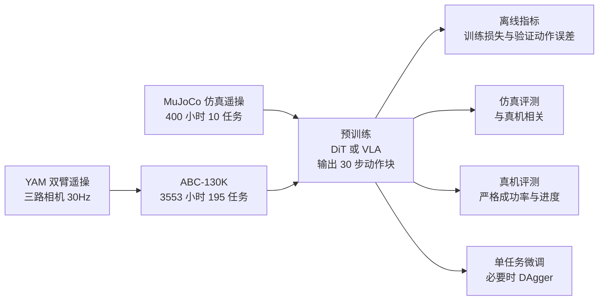

# Scalable Behavior Cloning with Open Data, Training, and Evaluation（ABC，arXiv:2606.27375）

论文 [arXiv:2606.27375](https://arxiv.org/abs/2606.27375)（v1，2026-06-25；UC Berkeley / MIT / Amazon FAR / XDOF / CMU）；项目页 <https://abc.bot>。收录自 Glen Berseth 的 CoRL 2026 阅读清单（P0，分组 Imitation Learning & Data Quality）。通读核对范围见 [来源归档](../../sources/papers/abc-scalable-behavior-cloning_arxiv_2606_27375.md)。

## 一句话定义

**ABC 是面向低成本双臂平台（I2RT YAM）的开源行为克隆全栈：约 3,500 小时的遥操数据集 ABC-130K、两类策略（DiT 与 VLA）的训练配方与真机消融、MuJoCo 仿真环境及其与真机的评测相关性。**（摘要与第 1 节）

## 英文缩写速查

| 缩写 | 英文全称 | 简要说明 |
|------|----------|----------|
| ABC | A Behavior Cloning（论文标题与摘要自称 "ABCs of Behavior Cloning"） | 整套开源栈的名字 |
| BC | Behavior Cloning | 行为克隆，用示范数据做监督学习 |
| DiT | Diffusion Transformer | 以 Transformer 作去噪骨干的扩散模型，此处作动作头 |
| VLA | Vision-Language-Action | 视觉语言动作模型，此处为 Gemma 3 加扩散动作头 |
| VLM | Vision-Language Model | 视觉语言模型（Gemma 3 4B，SigLIP 视觉编码） |
| adaLN | Adaptive LayerNorm | 用条件向量调制归一化的移位、缩放与残差门 |
| FAST | Frequency-space Action Sequence Tokenization | 动作离散化，用于给 VLM 加交叉熵监督（第 3.2 节） |
| RTC | Real-Time Chunking | 以已执行动作前缀为条件生成下一块动作，使块间平滑（第 3 节、附录 H.2） |
| DAgger | Dataset Aggregation | 策略执行中人类介入，采集恢复行为再训练 |
| YAM | I2RT YAM 机械臂 | 低成本 6 自由度机械臂，本文双臂工作站的基础 |
| GELLO | 低成本遥操作主从臂框架 | 本文遥操作所用的主臂（第 4 节） |
| SOP | Standard Operating Procedure | 更严格的采集规程（第 5.3 节「collapsed data」） |

## 为什么重要

- 作者自述的动机（第 1 节）：前沿机器人操作多由工业界在私有数据上完成，训练配方少有足够细节复现；真机评测昂贵。本文把数据、硬件、训练基础设施、仿真和评测一起放出，希望让研究者处于「equal footing」。
- 规模对比（第 2、6.1 节，作者自述）：DROID 350 小时单臂、AgiBot-World 约 3,000 小时（约 30,000 美元平台）、MolmoAct2 的 YAM 数据 720 小时；ABC-130K 为 3,553 小时、YAM 工作站约 8,000 美元。「largest open-source teleoperation dataset to date」是作者的断言，我未逐一核对其他数据集。
- 对从业者的可借用结论（均限于本文设置）：池化交叉注意力优于全局 adaLN 视觉条件，DINOv3 优于 CLIP（DiT，表 1）；验证动作误差可作廉价离线代理（第 3.4 节）。

## 核心原理与流程总览

整套栈由四部分组成（图 2）：ABC-130K（数据）、ABC-Models（ABC-DiT 与 ABC-VLA）、ABC-Sim（MuJoCo 加 400 小时仿真遥操）、ABC-Eval（真机评测 rollout 与评分细则，作者称超过 100 小时）。

- **模型（第 3 节）：** 输入三路 224x224 图像加 14 维关节状态；输出 30 步绝对关节位置块；z-score 归一化；30 Hz 异步执行并带动作前缀（RTC）。
  - ABC-DiT：DINOv3 ViT-B 编码三路图像，每图 12 个可学习查询做池化交叉注意力，DiT 32 层、隐层 1536、24 头，约 2B 参数（附录 B.2、B.4 表 2：骨干 85.7M、动作头 1.93B）。
  - ABC-VLA：Gemma 3 4B（SigLIP）作骨干并端到端微调，用 8 个查询对最后一层 token 做注意力池化，经 adaLN 调制小型 DiT 头（8 层、隐层 512，约 45M）；对同一次 VLM 前向复制 k=8 组噪声与时间步以降低梯度方差，每步耗时 1.346 s（k=1）对 1.366 s（k=8，H200）。
- **训练（第 3.1 节、附录 B.3）：** 最终预训练批量 9216，学习率 1e-4（预热 1000 步后恒定），AdamW，200k 步，H200；ABC-DiT 12 节点、ABC-VLA 8 节点。
- **数据加载（附录 B.1）：** 自研 abcdl；H.264 MP4 加二进制状态动作文件，GOP=30、关闭 B 帧并重建帧索引，论文图 19 报告单次解码读取量约从 9.75 MB 降到 0.14 MB（约 70 倍）。
- **评测协议：** 真机三任务（扔瓶子入桶、碗碟上架、杯子翻正）各 50 次试验；严格成功率为任务完成百分比，进度为按评分细则（附录 G 表 3）归一化的得分。

## 工程实践

- **采集：** 双 YAM 加 GELLO 主从臂；仿真侧 VR（Meta Quest 或 Apple Vision Pro）遥操，仿真 240 Hz、头显 60 Hz，并用透视（pass-through）缓解晕动（第 4 节）。
- **推理加速（附录 D，RTX 5090，10 步扩散）：** ABC-DiT 从 63 ms 降到 36.3 ms，ABC-VLA 从 47.8 ms 降到 17.5 ms；手段为 bf16、缓存视觉特征、torch.compile 整图加 CUDA graph。表 1 的延迟列为 ms/块，数值与附录 D 的优化后时延口径不同，别直接混比。
- **DAgger 流程（第 5.3 节、附录 F）：** 只用被动主臂，介入时用正运动学算主臂位姿增量，叠加到从臂末端位姿后经 IK（mink）求关节；每轮约 1 至 1.5 小时数据；训练混合比例 80:10:10（上一轮数据、本轮介入、本轮其余片段）。作者称单独只训介入数据会学到「笼内与无笼」的伪相关。
- **条件化（附录 H）：** 预训练时动作前缀长度从 0 到 7 均匀采样，操作员 ID 与子任务各以 0.2 概率作为文本条件。
- **缩放读法（第 3.3 节，作者结论）：** 批量与步数越大越好；同等 FLOPs 下 DiT 更高效，但批量 9216 时 VLA 反超（图 5）。

## 与清单说法的核对

清单原话（作者说由 LLM 据摘要起草）：「Fully open behavior-cloning stack: 3,500 hours of bimanual teleop data, hardware, training and correlated sim/real evaluation of DiT and VLA recipes.」

| 清单措辞 | 论文核对 |
|----------|----------|
| 3,500 hours of bimanual teleop data | 对得上：摘要 3,500 小时、130K 集、195 任务；第 2 节精确值为 3,553 小时、134,806 条。均为真机遥操数据；另有 400 小时仿真遥操数据单独发布（第 4 节）。 |
| Fully open | 论文用 "fully open-source stack"，但图 2 题注写「will be released」，我未访问 abc.bot，无法确认发布已完成。预训练与消融用到的 7,000 小时内部语料不在发布内（表 1 题注、第 3 节），因此表 1 的结论并非在公开数据上复现；论文最终模型则在 ABC-130K 上训练（第 5.1 节）。 |
| hardware | 论文开放的是「可得的低成本硬件配置」（YAM 双臂，三台 D405，围栏，附录 C.1）与机器人代码框架，不是自研机器人；论文称将发布。 |
| correlated sim/real evaluation | 有，但范围小：仅 3 个任务，12 个检查点（含 4 个混了内部 7K 加仿真数据的 DiT 检查点），仿真与真机严格成功率 r=0.85，进度 r=0.91（第 4 节、图 9）。仿真环境发布 10 个任务，相关性只在其中 3 个上验证。 |
| DiT and VLA recipes | 对得上：第 3 节比较 3 种 DiT 与 3 种 VLA 连接方式；但全是单一平台（YAM）、单一评测集（3 个真机任务）、每格 50 次试验，且无重复种子或置信区间。 |
| （清单未提） | 论文的另一半内容：离线指标相关性（第 3.4 节）、批量缩放（第 3.3 节）、预训练对微调的帮助（第 5.2 节）、DAgger 折盒（第 5.3 节）、策略条件化（附录 H）。清单摘要省略了这些，但不影响与论文的一致性。 |

## 局限

论文自己承认或隐含的：

- 采集在围栏内，作者自述这压窄了背景多样性，隔离了精细操作与背景泛化的混杂，但仍有策略可在围栏外「some in-the-wild settings」运行（附录 C.1）。
- 动作前缀（RTC）可能让策略忽视视觉、降低表现；作者只用缩短前缀缓解，称更系统的研究留给未来（附录 H.2）。
- 验证动作误差只有在扩散步数固定时才有意义（第 3.4 节）；离线指标「cannot reliably predict task success rates or reveal failure modes」。
- 第 8 节列出开放问题：历史条件化、BC 缩放定律、RL 微调。

我看到的未验证之处（我的判断，非作者自述）：

- 消融与相关性的样本量小：真机只有 3 个任务，表 1 每格 50 次试验；图 8 的 16 个点是同一批检查点，且 DiT 与 VLA、不同批量混在一起，点之间并不独立；图 9 的 12 点同理。r 值的显著性不代表个别设计决策能被仿真排序。
- 表 1 的 DiT 与 VLA 比较在内部 7K 数据上，而且第 3.3 节写「批量 9216 时 VLA 超过 DiT」，而图 11 在 ABC-130K 上的真机进度里 ABC-DiT 与 ABC-VLA 大致持平或 DiT 略高（读图，无数值），两者条件不同，论文没有直接调和。
- 图 13 读图：「解瓶盖」一项从头训练与 ABC-Data 预训练的进度几乎一样，论文说「Across all tasks」预训练更多数据更好，主要依据是 7K 小时预训练的曲线，公开 3.5K 小时数据对该任务的增益在图上不明显。
- 折盒 DAgger（第 5.3 节）只报告了一个任务、单一流程，进度由约 24% 升至约 0.85（读图）；没有与「多采同样小时数的整条示范」做对照，论文也承认那样做很可能也会提升。
- 附录 H 的条件化实验每条件 n=10，且操作员 ID 与子任务实验都在 t-shirt 折叠上，结论仅作定性参考。
- 发布状态、许可证、数据质量过滤细节未在论文中核实（我没有访问项目页或数据）。

## 关联页面

- [行为克隆（Behavior Cloning）](../methods/behavior-cloning.md)
- [模仿学习](../methods/imitation-learning.md)
- [Diffusion Policy](../methods/diffusion-policy.md)
- [VLA（Vision-Language-Action）](../methods/vla.md)
- [DAgger](../methods/dagger.md)
- [动作分块（Action Chunking）](../methods/action-chunking.md)
- [Diffusion Transformer](../concepts/diffusion-transformer.md)
- [Sim2Real](../concepts/sim2real.md)
- [具身缩放定律](../concepts/embodied-scaling-laws.md)
- [LBM：大行为模型的审慎检验（arXiv:2507.05331）](./paper-rcl-2507-05331-a-careful-examination-of-large-behavior-models-f.md)
- [AgiBot World 2026](./agibot-world-2026.md)
- [ALOHA](./aloha.md)

## 参考来源

- [来源归档：abc-scalable-behavior-cloning_arxiv_2606_27375.md](../../sources/papers/abc-scalable-behavior-cloning_arxiv_2606_27375.md)
- [arXiv:2606.27375](https://arxiv.org/abs/2606.27375)
- 项目页：<https://abc.bot>
- Glen Berseth，My CoRL 2026 Reading List（清单摘要出处）：<https://www.fracturedplane.com/blog/2026/11/10/CoRL2026-Reading-List.html>

## 继续阅读

- [arXiv PDF（v1）](https://arxiv.org/pdf/2606.27375v1)
- [LBM 论文页](./paper-rcl-2507-05331-a-careful-examination-of-large-behavior-models-f.md)：本文 ABC-DiT 的 CLIP-adaLN 基线所仿照的架构
- [Diffusion Policy](../methods/diffusion-policy.md)
