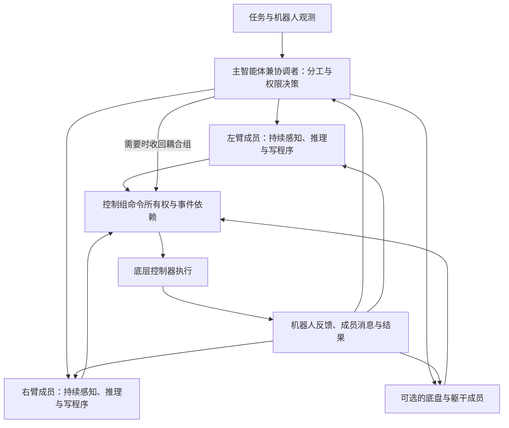

# ACAP：异步编码智能体团队控制机器人 / Asynchronous Coding Agents for Efficient Robot Control

## 一句话定义

**ACAP** 在一个机器人内部按执行器分组分配持续运行的编码智能体，再让协调者依据物理反馈管理依赖和控制权：可独立的工作一起推进，耦合动作可交回主智能体联合执行。

## 英文缩写速查

| 缩写 | 英文全称 | 本页含义 |
|---|---|---|
| ACAP | Asynchronous Coding Agents as Policy | 用异步编码智能体组成在线策略 |
| AUC | Area Under the Curve | 30 分钟内归一化物理进度曲线面积，不是成功率 |
| RGB-D | Red, Green, Blue and Depth | 彩色与深度观测，用来建模和验证环境 |

## 为什么重要

同一台机器的双臂可以同时准备，但共享瓶口、共同抓持物体或随躯干移动时不能假设物理上独立。单智能体即便能够发并发运动命令，也仍共享一条推理链；固定委派虽可并发，却可能让紧耦合动作反复通信。ACAP 把“哪些推理可并行”和“哪一组现在可以发命令或进入共享空间”分开处理。

## 核心原理

1. **控制组与持续上下文。** 一组可为手臂和夹爪或底盘和躯干。成员维护观测、交互历史和生成程序；失去命令权时仍可继续分析，切换并不重启成员。
2. **动态协调。** 协调者使用观测、成员消息和当前所有者选择委派、索取证据、修订任务、设置事件依赖或接管；并非提前给定固定任务图。论文实现将协调者与主智能体放在同一会话，成员使用更轻的推理设置。
3. **双重约束。** 消息缓冲保留更新直到收到确认；事件等待只阻塞依赖动作。例如插花时另一臂可以同时准备，但须等先入臂退出并报告净空再进入。每组只有当前所有者的命令可被接受；正在调用机器人控制器时不切权，切权时保留控制器目标。所有权不等于共享工作空间的通行许可。
4. **反馈修订。** 成员可用观测估计局部几何、产生动作请求并核验结果。附录 E 有沿同一纸箱特征验证物体是否随夹爪抬升的案例，辅助纠正仅看固定像素深度造成的误判。

## 流程总览

图据论文 §3 和附录 D 整理；不是源码时序图。公开卡片描述轨迹中包含生成程序，但目前未核验到独立公开、可直接运行的控制软件。

## 实验与评测

| 对比设置 | 论文报告 | 读数边界 |
|---|---|---|
| 覆盖实验，72 次、25 个任务/平台设置 | ACAP 对 Direct 的任务均衡耗时 19.04 → 13.67 分钟（−28.2%），进度 AUC 62.3 → 72.9 | 组内先平均、共同设置再等权；未完成按至少 30 分钟计、较长耗时不截断 |
| 其中八种协作设置 | ACAP 逐设置均低于 Fixed，平均 13.75 对 26.02 分钟；Direct 为 16.25 分钟 | 比较沿用对应 Direct/ACAP 试验，并非新增一组全覆盖重复数据 |
| 重复试验，90 次 | 六任务各三策略五次；ACAP 六项平均封顶耗时均低于 Direct，任务均衡降幅 29.4%；进度 AUC 五项更高 | 30 分钟上限和覆盖实验的 30 分钟下限不同；五次重复的方差不能忽略 |

平台是 Galaxea R1 Pro 2025 及四套 AgileX PiPER 系列双臂布置。另有 Galaxea 移动操作示范：身体组改变双臂的可达性，协调者依据反馈改放置顺序，并安排底盘重新对位。没有把这个示范计入跨平台泛化统计。

## 与其他工作对比

- **Direct Policy：** 单个编码智能体控制整机，可发并发硬件命令但推理上下文共用。ACAP 的对比同时改变推理组织和成员推理强度，不单独测量异步机制的因果贡献。
- **Fixed Delegation：** 也有多个智能体、分工及同步，组命令仅由分配到该组的成员发出；论文以同模型配置比较动态接管的作用。
- **[AgenticGenPlan](./paper-agenticgenplan-generalized-tamp-coding-agents.md)：** 在合成阶段迭代生成、测试并冻结程序，留出环境实例评估时不再调用语言模型；ACAP 在真机执行过程中持续观察、编程和修订，不是同一评估设定。

## 工程实践

- 来自[数据集](../../sources/datasets/acap-rollout-dataset.md)的 162 条轨迹，是观察、程序、消息、动作和机器人反馈的链路材料，可用于定位“时间耗在推理、等待还是执行”。许可标注 CC BY 4.0，文件人工审批，不能等同于匿名下载或系统源码已开源。
- 真机借鉴时单列共享空间、命令所有权、事件条件、过期观测、异常恢复和物理安全层。论文计时分析指出推理间、推理与执行间的重叠比纯运动并行更重要；不要为提高并发率而强行切分紧耦合动作。

## 局限

论文附录明确没有专用运动级碰撞检查；互斥命令许可和局部观察到的净空不能替代运动安全约束。研究还依赖指定编码智能体、传感器和控制分组。未独立复现作者结果，不将任务评测或剪辑速度视为部署安全保障。

## 结论

多智能体并发不是目标本身：让未耦合的推理和物理执行重叠、对共享空间按事件同步、对紧耦合控制动态切换，才是此工作值得验证的组织方式。

## 关联页面

- [智能体操作策略](../methods/agentic-manipulation-policies.md) · [双臂操作](../tasks/bimanual-manipulation.md) · [移动操作](../tasks/loco-manipulation.md)

## 参考来源

- [ACAP 论文 v1 核对](../../sources/papers/acap_arxiv_2611_31205.md) · [官方项目页核对](../../sources/sites/acap.md) · [发布数据卡核对](../../sources/datasets/acap-rollout-dataset.md)

## 推荐继续阅读

- [原文 §3.3](https://arxiv.org/html/2611.31205v1#S3.SS3)：消息缓冲、事件依赖与控制权条款。
- [原文附录 E](https://arxiv.org/html/2611.31205v1#A5)：观测、生成程序和反馈如何支撑诊断。
