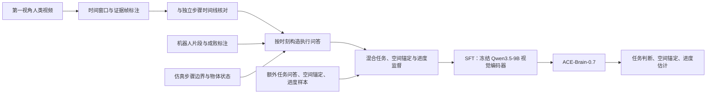

# ACE-Brain-0.7：基于执行状态的具身推理

## 一句话定义

ACE-Brain-0.7 是一个 9B 视觉语言模型，结合任务指令与按时间排列的观测，判断执行到了哪一步、哪一步失败以及下一子任务是什么，并提供空间锚定和进度估计。

## 英文缩写速查

| 缩写 | 英文全称 | 简要说明 |
| --- | --- | --- |
| VLM | Vision-Language Model | 读取视觉观测与文本并回答任务问题 |
| SFT | Supervised Fine-Tuning | 用带标注的问答和其他监督样本微调基座 |
| MAE | Mean Absolute Error | 预测进度与参考进度的平均绝对误差 |

## 核心信息

| 项目 | 内容 |
| --- | --- |
| 论文 | [arXiv:2611.26519v1](https://arxiv.org/abs/2611.26519v1)，2026-11-19 首次提交 |
| 机构 | 大晓机器人（ACE Robotics）、南洋理工大学、浙江大学 |
| 基座与训练 | Qwen3.5-9B，冻结视觉编码器做 SFT |
| 输入与输出 | 根据问题接收指令及图像或视频片段，输出任务判断、空间锚定结果或进度值 |

## 为什么重要

长程操作中的同一条任务指令可以对应多种执行状态。例如，机械臂已经打开微波炉门，却没能伸到碗所在的位置，此时应继续处理取碗步骤。下一步判断依赖实际观测到的完成条件。论文用同一任务在不同时间点的问答测量模型能否跟随这种状态变化。

## 核心原理

论文 §3 用任务结构 $G$ 表示子目标、依赖关系及完成条件，用执行状态 $S_t$ 表示时刻 $t$ 各子目标的未开始、进行中、完成或失败状态，以及支持判断的观测索引。这套形式化用于构造监督与划分评测题型。

| 查询 | 所需证据 |
| --- | --- |
| 规划（Plan） | 子目标集合及其先后依赖 |
| 监测（Monitor） | 当前步骤的完成条件、物体状态和证据帧 |
| 下一步预测（Anticipate） | 依赖已满足且仍未完成的子目标，以及当前观测 |
| 诊断（Diagnose） | 失败发生在哪一步、何时发生及其类型 |
| 解释（Interpret） | 从观察到的执行及场景反推任务或已发生事件 |

### 流程总览

按论文图 1、图 2 和 §4 整理。约 370 万组是执行推理问答集合（含少量通用回放）。加入额外任务数据后，最终训练混合约 380 万组任务问答、350 万空间锚定样本和 20 万进度样本。下一步选择题使用当前任务的其他步骤作干扰项，失败记录和仿真为监督补充负状态。

## 工程实践

- 为子目标记录时间戳、完成条件和证据帧，同一段执行可在多个时刻生成状态问答。
- 评估历史利用时，可对同一段视频使用相同任务和选项，选择正确答案发生变化的两个截点，以两题均答对计分。再用无图、首帧、末帧和帧序打乱对照定位模型依赖的线索。
- 在分层机器人系统中，可把模型的下一子任务和失败判断作为技能调度候选信号。上线前需独立验证技能接口、完成判据、失败恢复与真机闭环成功率。
- 源码运行时序图不适用。截至 2026-11-24，尚未核实 0.7 的官方可运行实现、权重或完整训练数据下载入口，核查入口见[原文归档](../../sources/papers/ace_brain_0_7_arxiv_2611_26519.md)。

## 实验与评测

| 指标 | 结果 | 口径 |
| --- | ---: | --- |
| 任务推理 Avg6 | 76.5 | EgoPlan-Bench、Cosmos-Reason1、RoboBench、LADDER、RoboFAC、ERIQ 的非加权均值 |
| 空间锚定 Avg7 | 75.90 | 七项公开空间锚定基准的非加权均值，沿用论文所述 0.6 协议 |
| RefCOCOg Acc@0.5 | 91.25 | 单列指标，未计入 Avg7 |
| 进度估计 MAE | 0.087 | 200 条执行记录各取一题，预测区间为 0–1，与分阶段插值的参考进度比较 |
| 时序配对准确率 | 54.4% | 114 组 EgoPlan-Bench 配对，仅任务数据微调版本，基座为 15.8% |

RoboBench Q1 任务分解得分 67.7，Q2 下一子任务得分 52.1。GPT-6 Astra 对应为 74.5、34.7，Claude Opus 5.5 为 77.8、39.0。论文把 Q1/Q2 从技能函数调用改成自然语言并用模型裁判打分，横向比较限于这一协议。[论文 §5 与附录 A.2](https://arxiv.org/html/2611.26519v1#S5)

## 结论

这篇论文的主要贡献是用可追溯的执行状态监督改善下一子任务、进度和失败判断。

- 数据构造可优先覆盖同一任务的多个执行截点及失败状态，保留支持标签的观测。
- 任务分解与下一子任务预测应分别汇报。RoboBench 两项的模型排序发生了反转。
- 用时序配对与帧顺序对照评估模型是否读到了历史变化，并注明消融使用的模型版本。
- 评估系统整合时，应单测失败定位、动作技能调用及真实闭环结果。

## 与其他工作对比

- **对比通用闭源/推理 VLM（RoboBench Q1/Q2）：** 在论文重构为自然语言+模型裁判的 RoboBench 口径下，GPT-6 Astra 与 Claude Opus 5.5 在静态任务分解（Q1）分别取得 74.5 与 77.8，高于 ACE-Brain-0.7 的 67.7；但在依赖历史执行观测的下一子任务预测（Q2）上，ACE-Brain-0.7 达到 52.1，反超前两者的 34.7 与 39.0，说明单纯静态规划能力不能自动迁移到执行状态追踪。
- **对比同系列前作与具身推理模型：** 相比 [ACE-Brain-0.5](./paper-ace-brain-0-5.md)，0.7 将监督重心转向带时间戳和证据帧的执行状态问答与进度估计；相比 [X-Planner](./paper-x-planner-event-structured-task-planning.md)（事件驱动符号/图结构规划）与 [VESTA](./paper-vesta-generalist-embodied-reasoning.md)（通用具身推理能力划分），ACE-Brain-0.7 直接在 9B VLM 内联合训练任务状态问答、空间锚定（[VGE](./paper-vge-2611-22625.md) 侧重指代定位）与连续进度预测，但尚未输出直接底层控制动作（与 [VLA](../methods/vla.md) 分层衔接）。

## 局限与风险

- 在附录 A.4 的失败样例中，模型会提前跳步、重复已完成的子目标，或将拿错物体判为成功。双臂协调及长计划也存在明显短板。
- 第一视角数据消融所用两组训练样本数和优化步数不同。加入第一视角数据时，EgoPlan-Bench 提升 14.0 分，但进度 MAE 从 0.156 升到 0.180。
- 文中指标来自认知问答、锚定和进度估计评测。低层动作执行、干预后的恢复成功率和部署时延还需系统级验证。

## 关联页面

- [VLA](../methods/vla.md) — 对照高层任务判断与低层动作接口。
- [机器人操作](../tasks/manipulation.md) — 为抓取、放置等技能定义可验证的完成条件。
- [ACE-Brain-0.5](./paper-ace-brain-0-5.md) — 对照该系列前作的感知、规划和动作建模。
- [X-Planner](./paper-x-planner-event-structured-task-planning.md) — 对照事件驱动规划的任务与状态表示。
- [VESTA](./paper-vesta-generalist-embodied-reasoning.md) — 对照通用具身推理与基于执行状态的能力划分。
- [VGE](./paper-vge-2611-22625.md) — 对照视觉指代与多目标空间定位。
- [具身测评纵深路线](../../roadmap/depth-embodied-eval.md) — 在认知评测阶段比较状态敏感性与任务规划。

## 参考来源

- [ACE-Brain-0.7 论文通读与发布来源归档](../../sources/papers/ace_brain_0_7_arxiv_2611_26519.md)

## 推荐继续阅读

- [Hi Robot：用分层视觉语言动作模型处理开放式指令](https://arxiv.org/abs/2502.19417)
