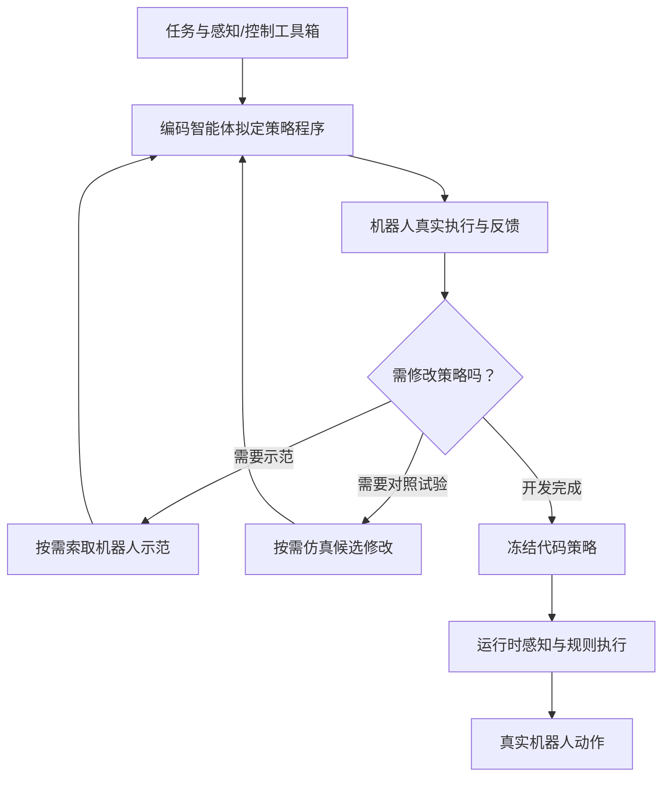

# ACE-CaP-0：将真机经验固化为可复用的代码策略
*ACE-CaP-0: Real-World Code-as-Policies in the Era of Experience*

## 一句话定义

**ACE-CaP-0**：在策略开发期让编码智能体按需索取真机演示、按需构建仿真试验，迭代机器人程序，完成后冻结代码并独立执行。

## 英文缩写速查

| 缩写 | 英文全称 | 简要说明 |
|---|---|---|
| ACE-CaP | ACE Code-as-Policies | 经验驱动代码策略开发 |
| CaP | Code as Policies | 可执行程序表达控制策略 |
| API | Application Programming Interface | 感知与控制接口 |
| Sim | Simulation | 按需建立的模拟实验环境 |

## 为什么重要

每个执行周期反复调用大模型成本高且会阻塞机器人；把开发期推理投入固化到可检查、可复现的程序可改善运行时延。

## 核心信息

| 维度 | 核对信息 |
|---|---|
| 原始论文 | [arXiv:2611.16872v1](https://arxiv.org/html/2611.16872v1) |
| 机构 | ACE Robotics（ACE-CaP Team） |
| 论文作者 | ACE-CaP Team、Changxu Wei、Yunpeng Qing 等 |
| 官方项目 | [项目页](https://acerobotics2025.github.io/ACE-CaP/) |
| 开源状态（2026-11-16） | 官方项目页有示例程序片段，未见独立的完整可运行仓库，源码时序图不适用。 |

## 核心原理

从任务指令与机器人感知/控制接口出发，由编码智能体编写程序；根据真机试验反馈选择修改代码、请求手把手的机器人演示（Demonstrations on Request）或在数字孪生中检验特定代码修改（Simulation on Demand）。开发结束冻结几何计算、动作顺序、抓持参数等程序规则；部署期仅感知输入动态变化，不再调用编程智能体改写规则。

### 流程总览

> 图示基于论文的方法和监督流向；训练与部署路径应区分，图中模块不代表源码调用关系。

## 实验与评测

8 项真机操作任务，每项最终冻结程序做 30 次试验，合计成功 221/240=92.1%；单任务平均执行用时范围 0.97–2.27 分钟。开发条件对照仅一次独立开发过程，冻结代码评测的 30 次并不代表智能体从零开发的稳定成功率。

## 与其他工作对比

| 工作 | 关键接口与训练阶段 | 边界与取舍 |
|---|---|---|
| 本文 | 在策略开发期让编码智能体按需索取真机演示、按需构建仿真试验，迭代机器人程序，完成后冻结代码并独立执行。 | 对机器人 API、可操作示范和可选模拟器的质量高度依赖；代码策略对环境变化的泛化需复测。 |
| [Reins](./paper-reins-robot-harness.md) | 同领域相关研究，侧重不同的学习或动作接口 | 不能把不同基准、度量或硬件结果直接横比 |
| [JustRUA](./paper-justrua-robot-use-agents.md) | 从另一维度处理学习、记忆或控制问题 | 验收须按论文各自协议建立独立基线 |

## 结论

**在策略开发期让编码智能体按需索取真机演示、按需构建仿真试验，迭代机器人程序，完成后冻结代码并独立执行。 但必须按论文的实验协议和开源边界解读其效果。**

1. 严格区分**开发时 agent 在环**和**运行时冻结程序**。
2. 按需仿真以验证当前真实故障为目的，不要求先造完美数字孪生。
3. 92.1% 是冻结代码执行结果，不能表示自动开发过程可重复达到该数字。

## 源码运行时序图

**不适用。** 官方项目页有示例程序片段，未见独立的完整可运行仓库，源码时序图不适用。 目前只有原论文方法流程可核验，不能把未开放的代码调用关系画成运行时序图。

## 工程实践

| 项目 | 实施与检查点 |
|---|---|
| 接入输入 | 核实论文定义的观察模态、坐标系、动作/控制接口，不能照搬其他本体 |
| 基线与指标 | 复用论文评测协议；另外记录成功率、任务进度、执行耗时和失败分布各自口径 |
| 训练/执行成本 | 区分模型预训练成本、开发期调用次数、在线决策延迟及实际通信开销 |
| 代码可得性 | 官方项目页有示例程序片段，未见独立的完整可运行仓库，源码时序图不适用。 |
| 复现路径 | 以[官方论文](https://arxiv.org/html/2611.16872v1)与[项目页](https://acerobotics2025.github.io/ACE-CaP/)为准，缺失的数据/权重/控制接口需要单列阻塞 |

## 局限与风险

对机器人 API、可操作示范和可选模拟器的质量高度依赖；代码策略对环境变化的泛化需复测。官方项目页展示代码示例，但未提供可核验的完整开发/执行仓库或安装入口。

- **跨实验不可直接排名：** 论文分别使用跨本体进度、VLA 成功率、真机 episode 成功率或 RoboDojo 子集得分，不具备共同分母。
- **工程安全边界：** 真机动作链需另行评估碰撞、限位、通信中断与异常恢复；论文实验成绩不构成部署安全保证。

## 关联页面

- [Reins](./paper-reins-robot-harness.md)
- [JustRUA](./paper-justrua-robot-use-agents.md)
- [VLA 学习纵深路线](../../roadmap/depth-vla.md)
- [跨本体迁移纵深路线](../../roadmap/depth-cross-embodiment.md)
- [Agentic Manipulation Policies：可编程的智能体机器人操作策略](../methods/agentic-manipulation-policies.md)：ACE-CaP-0 在策略开发期让编码智能体结合真机演示与仿真试验迭代程序并冻结部署，属于可编程的智能体机器人操作策略路线。
- [Robot Agent Harness · 机器人智能体执行框架](../methods/robot-agent-harness.md)：ACE-CaP-0 通过感知与控制 API 契约、按需演示采样与仿真验证循环规范智能体生成策略的执行边界。

## 参考来源

- [论文原文与核对归档](../../sources/papers/ace-arxiv-2611-16872.md)
- [官方项目页核对](../../sources/sites/ace-project-20261116.md)
- [arXiv HTML v1（包含实验与局限）](https://arxiv.org/html/2611.16872v1)

## 推荐继续阅读

- [官方项目页](https://acerobotics2025.github.io/ACE-CaP/)
- [论文 PDF](https://arxiv.org/pdf/2611.16872)
