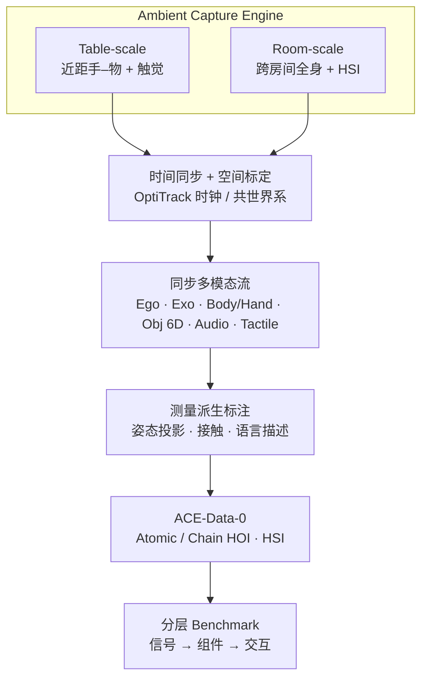

# ACE-Data-0：以人为中心的 Ambient Capture 具身数据引擎

**ACE-Data-0**（*Human-Centric Ambient Capture as Embodied Data Engine*，[arXiv:2607.28625](https://arxiv.org/abs/2607.28625)，[项目页](https://ace-data-engine.github.io/ACE-Data-0/)，**南洋理工大学 S-Lab × 大晓机器人（Ace Robotics）**）提出 **Ambient Capture Engine（ACE）**：把真实家居变成时空校准、多模态同步的录制工作室，并发布同名大规模家居活动数据集与分层感知基准。它瞄准的是现有语料的系统性缺口——视角、模态与空间尺度被拆碎，完整感知–动作闭环从未被同步观测。

## 一句话定义

**用 table-scale + room-scale 两套互补配置，在真实家居里同步记录 ego/exo 视频、全身与手部运动、物体 6-DoF、音频与全掌触觉，并以目标级指令采集自然长程家务，得到可度量对齐的人类演示语料与「信号→场景→交互」诊断基准。**

## 英文缩写速查

| 缩写 | 英文全称 | 简要说明 |
|------|----------|----------|
| ACE | Ambient Capture Engine | 本文提出的双尺度环境化采集系统 |
| HOI | Hand–Object Interaction | 手–物交互；Atomic / Chain of HOI 两类活动 |
| HSI | Human–Scene Interaction | 人–场景交互（坐、导航、家具接触等） |
| Ego / Exo | Egocentric / Exocentric | 第一人称可穿戴视角 / 第三人称固定外视 |
| DoF | Degrees of Freedom | 物体与末端位姿自由度；本集跟踪物体 6-DoF |
| MANO | Hand Model with Articulated and Non-rigid defOrmations | 手部参数化模型；手运动评测表示 |
| SMPL-X | Skinned Multi-Person Linear model eXpressive | 全身姿态表示；人体运动评测常用 |
| MPJPE | Mean Per Joint Position Error | 关节位置误差；PA- / WA- 变体区分对齐方式 |
| VLA | Vision-Language-Action | 视觉–语言–动作模型；本集可作人类演示监督层 |
| IL | Imitation Learning | 模仿学习；同步运动与接触监督的直接消费者 |

## 为什么重要

- **补齐「同步完备」而非只拼规模：** [Ego4D](paper-ego4d.md) / [RekaDaily-10k](rekadaily-10k-dataset.md) / [EgoScale](../methods/egoscale.md) 在小时数上更大，但很少同时给出度量级身体·手·物体状态 + 触觉 + 多外视；本集用 **测量对齐** 换完备监督。
- **真实家居 × 长程目标：** 相对 ARCTIC / GRAB / BEHAVE 等实验室 MoCap，ACE 在家具遮挡、跨房间 locomotion 与分钟级任务链上评测——更接近部署分布。
- **诊断式 benchmark：** 三层任务把失败定位到「接触估计 / 场景状态 / 手轨迹」而不是只报任务成功率，便于选型与改管线。
- **同品牌数据层锚点：** 与 [ACE-Brain-0.5](paper-ace-brain-0-5.md)、[Kairos](paper-kairos-native-world-model-stack.md) 同属 Ace Robotics 生态；本页是 **人类家居活动数据引擎**，勿与具身脑 / WAM 产品线混淆。

## 核心信息

| 项 | 内容 |
|----|------|
| **机构** | 南洋理工大学（NTU）S-Lab；大晓机器人（Ace Robotics） |
| **类型** | 采集系统 + 多模态数据集 + 分层感知 benchmark |
| **arXiv** | [2607.28625](https://arxiv.org/abs/2607.28625) |
| **规模** | **150+** h · **17M+** 帧 · **75,000+** episodes · **200+** 任务类 · **50+** 3D 扫描物体 · **50** 人 · **2** 环境 |
| **模态** | Ego（4 鱼眼 1088×1280 @ 20 FPS + IMU）· Exo（8 RGB）· 身体/手/物体 60 Hz · 音频 · 全掌触觉 |
| **活动类型** | Atomic HOI（54 h / 36.5%）· Chain of HOI（64 h / 42.9%）· HSI（30 h / 20.6%） |
| **开源（截至 2026-11-14）** | **部分开源**：HF 已上传约 **22.18 TB**（API `gated: false`，研究许可）；训练/评测代码 **未发布** |

## 开源状态

核查日：**2026-11-14**（项目页 HTML / Hugging Face API JSON + README / arXiv 全文）。

| 产物 | 状态 |
|------|------|
| 数据集 [`ACERobotics/ACE-Data-0`](https://huggingface.co/datasets/ACERobotics/ACE-Data-0) | **已上传（`~22.18 TB`，API `gated: false`）** — `ace-data-0-research-license`（非商业学术研究）；HF API 截至 2026-10-14 实测 `gated: false` 且 `siblings` 列出 `Room-scale/` ≥100k 文件，但 `README.md` 仍残留 `extra_gated_*`、`Data_Files-Coming_Soon` 与「尚未发布」过期文本（`Table-scale/` 因 API 100k 上限未独立枚举；归档见 [sources/datasets/ace-data-0.md](../../sources/datasets/ace-data-0.md)） |
| 项目页 | **已开放**（归档见 [sources/sites/ace-data-0-github-io.md](../../sources/sites/ace-data-0-github-io.md)） |
| 训练 / 统一 benchmark 代码 | **未见** — 项目页与论文未列 GitHub；仅 HF 仓 `Room-scale/calibration/` 说明含标定脚本 |
| 模型权重 | **不适用** |

## 数据集速查

| 维度 | 内容 |
|------|------|
| 适配形态 | **人类演示**（非真机遥操作轨迹）；可作 IL / VLA / WAM 的人侧监督或评测 GT |
| 重定向就绪度 | 提供度量身体与手轨迹 + 物体 6-DoF，利于 retarget；画面含动捕服/手套/头显，视觉域有偏移 |
| 许可证 | ACE-Data-0 Research License（非商业学术；禁止再分发与再识别） |
| 与金字塔位置 | [Data Pyramid](paper-data-pyramid-embodied-manipulation.md) **第 ③ 层 Ego/Exo**：物理保真与接触监督强，规模中等 |

## 流程总览

## 核心原理

### 双尺度采集

细粒度接触与房间级运动对传感器密度的要求互相冲突。ACE **不做单套折中**，而用两套配置共享同一表示与管线（共 28 台 OptiTrack PrimeX 22，原始采集约 **1 TB/h**）：**Table-scale（~30 m²）** 部署 16 台 OptiTrack + 8× GoPro（0.3–0.5 m 近距）+ 8 视角 RANSAC 2D 三角化手姿精修；**Room-scale（~200 m² 公寓）** 部署 12 台 OptiTrack + 8× ZED One（GMSL2 + Jetson Orin）+ 60 Hz Manus 动捕手套。双方均穿戴 `ACE-Ego-Head-V02 Lite`（4 路 1088×1280 鱼眼 @ 20 FPS + IMU + 5 markers）、41 关节 SMPL-X 标记与 `ACE-Sense-Glove Lite` 全掌压力手套。

### 目标级协议与三类活动

参与者（共 50 名，2 天采集）收到**家居目标**而非逐步脚本，同一目标可走不同路线、物体选择与恢复策略。活动分成：

1. **Atomic HOI** — 30k+ episodes / **54 h**（6.2M+ 帧 = 36.5%，约 3 min，1–3 个日常操作）；
2. **Chain of HOI** — 40k+ episodes / **64 h**（7.3M+ 帧 = 42.9%，约 20–30 min，连续家务例程与状态跟踪）；
3. **HSI** — **30 h**（3.5M+ 帧 = 20.6%，约 5 min，坐下、穿行、姿态转换与家具接触）。

### 同步与标注哲学

多模态价值取决于「同一物理瞬间」是否对齐。ACE 通过拍摄动捕主机上的纳秒级 QR 光时钟将相机对准 OptiTrack 60 Hz 主时钟（ZED One 残差 <4 ms，头显 4 路鱼眼 <2 ms）；利用反光 ArUco 板桥接无公共视野外视（重投影 <3 px，~1 cm 3D），手眼标定头显（~2 px）；触觉手套以 IMU 运动模板与头显对齐。全部几何/位姿/接触标签均直接由测量动捕、标定与触觉读数**导出**，仅自然语言描述由 `Gemini-3.1-pro-preview` 生成并经人工校验修正，避免「用待评视觉方法给自己标伪 GT」的循环误差。

## 源码运行时序图

**不适用。** 截至 **2026-11-14**，官方仅在 Hugging Face 发布数据集 `ACERobotics/ACE-Data-0` 与项目页说明，论文与项目页均未提供可运行的模型训练或统一 benchmark 评测代码仓（`Room-scale/calibration/` 仅包含标定脚本说明，无端到端训练/推理入口）；复现入口以 [Hugging Face 仓库](https://huggingface.co/datasets/ACERobotics/ACE-Data-0)（含 `Table-scale/HOI` LeRobot 兼容 parquet 规范说明）与论文 §5 评测协议为准。

## 工程实践

| 场景 | 读法 |
|------|------|
| 做人→机 IL / retarget | 优先用 **度量手/身体轨迹 + 物体 6-DoF**；视觉策略需处理动捕装备外观域差 |
| 做 VLA / WAM 人侧预训练 | 本集是 **高保真、中规模** 锚点；小时数不够时与 Ego4D / RekaDaily / EgoScale **分层混用**（完备监督 vs 规模） |
| 做接触 / 视触研究 | 用触觉轨 + ego 遮挡设定；别只信视觉伪接触标签 |
| 做姿态估计选型 | 同时看 PA-MPJPE（局部）与 WA-MPJPE / Traj.err（全局）；家居场景里后者才是痛点 |
| 申请数据 | 走 HF gated 表单；**每人单独申请**；商用另开 Community 线程 |

## 实验与评测（论文报告摘要）

评测 **30+** 个既有方法（在 10 h 留出测试集上直接测预训练权重），暴露接触遮挡、egomotion 与长时漂移缺口。

| 轨道 | 关键数字 / 现象（论文 Tables 3–6） |
|------|-----------------------------------|
| **触觉 from ego video（Table 3）** | TouchAnything Temp Acc **0.7095**、C-IoU **0.1646**、V-IoU **0.1357**、CoP **6.5846** 为表内最强，仍远未饱和；PressureVision 近乎失效 |
| **人体运动（room-scale，Table 4，22 方法）** | 局部 PA-MPJPE 可到约 **55.7 mm**（SMPLest-X）/ **60.1 mm**（Human3R）；世界系 WA-MPJPE：Human3R **75.4 mm**，多数时序/场景方法常更差（EgoAllo **220.3 mm**） |
| **手运动 ego（Table 5）** | WildHands 局部最好（PA-MPJPE **11.2 mm**）；世界系轨迹误差 Dyn-HaMR **98.2 mm** / HaWoR **102.1 mm** |
| **手运动 exo（Table 6）** | WiLoR PA-MPJPE **9.1 mm**；HaPTIC **10.0 mm** PA-MPJPE / **63.0 mm** 轨迹误差（明显优于 ego 世界系） |
| **跨视角** | 固定外视更利全局轨迹；ego 近距细节互补；联合双视角是明确开放方向 |

## 结论

**一句话总判：ACE-Data-0 的真价值是「真实家居里、度量对齐的完整感知–动作记录」——用中等规模换同步完备，适合当接触/姿态/手轨迹的诊断基准与人侧高保真监督，而不是靠小时数碾压的大规模预训练主粮。**

1. **选型先问「要完备还是要规模」** — 缺接触与度量轨迹时优先本集；缺多样性小时数时叠加 Ego4D / RekaDaily / EgoScale。
2. **评测必看全局指标** — 只报 PA-MPJPE 会掩盖家居部署中的轨迹漂移；WA-MPJPE / Traj.err 才是 room-scale 痛点。
3. **触觉轨是稀缺监督** — 视觉估压仍难；做视触融合或接触感知策略时把本集当硬评测而非只当预训练边角。
4. **目标级协议保留自然变异** — 犹豫、重试、路线差异是资产；清洗时勿按「原子脚本」过度过滤。
5. **许可与外观域要进计划** — gated 非商业许可 + 动捕装备可见；工业配方与视觉闭环部署需另寻授权与域适应。
6. **代码未随数据发布** — 基准对比需自接论文协议与第三方方法权重；勿假设有一键评测仓。

## 局限与风险

- **站点少（2 套家居）** — 布局/光照/物体多样性有限，跨住宅泛化未证明。
- **GT 覆盖边界** — 关节家具、流体、可变形物状态变化未标注；物体需预扫描贴标。
- **采集装备可见** — 服/手套/头显/marker 可能成为捷径特征。
- **非真机动作标签** — 到机器人执行仍需 retarget / 对齐；与 [Humanoid Everyday](humanoid-everyday-dataset.md) 等真机集互补而非替代。
- **访问摩擦与仓状态差异** — 许可严格限非商业学术研究（不可转让、禁止商用与再识别）；虽然 HF API 截至 2026-10-14 实测 `gated: false`，但仓内 README 仍要求学术登记与合规声明，协作团队使用前须核实 `LICENSE` 条款。

## 与其他工作对比

| 维度 | ACE-Data-0 | [Ego4D](paper-ego4d.md) / [RekaDaily](rekadaily-10k-dataset.md) | 实验室 HOI（ARCTIC 等） | 真机操作集（Everyday / AgiBot） |
|------|------------|----------------------------------------------------------------|------------------------|--------------------------------|
| 主监督 | 度量运动 + 接触 + 多视角视频 | 大规模 ego 视频（少/无度量 HOI GT） | 高精度姿态，环境稀疏 | 可执行机器人动作 |
| 环境 | 真实家具家居 | 野外 / 住宅（弱物理 GT） | MoCap 实验室 | 机器人现场 |
| 时长尺度 | 分钟级目标链（150 h 总量） | 千–万小时级 | 秒–分钟短 clip | 轨迹条数导向 |
| 许可 | 研究 gated | 各异（Ego4D license / Apache 等） | 各异 | 各异 |

## 关联页面

- [具身数据金字塔综述](paper-data-pyramid-embodied-manipulation.md) — 第 ③ 层 Ego/Exo 选型坐标系
- [Ego4D](paper-ego4d.md) — 大规模 egocentric 日常视频对照
- [RekaDaily-10k](rekadaily-10k-dataset.md) — 开放许可家务 ego 视频对照
- [EgoScale](../methods/egoscale.md) — 带手部标签的大规模人视频缩放证据
- [ACE-Brain-0.5](paper-ace-brain-0-5.md) — 同品牌具身脑（不同产品线）
- [Kairos](paper-kairos-native-world-model-stack.md) — 同品牌 WAM 栈
- [VLA](../methods/vla.md) / [Imitation Learning](../methods/imitation-learning.md) — 下游消费者
- [视触融合](../concepts/visuo-tactile-fusion.md) — 触觉轨使用语境
- [Manipulation](../tasks/manipulation.md) — 操作任务域
- [具身大模型评测基准选型闭环](../queries/embodied-eval-benchmark-selection-loop.md) — 本集三层感知诊断基准可归入交互/状态恢复评测层，与策略成功率评测互补

## 参考来源

- [ACE-Data-0 论文归档](../../sources/papers/ace_data_0_arxiv_2607_28625.md)（[arXiv:2607.28625](https://arxiv.org/abs/2607.28625)）
- [ACE-Data-0 项目页归档](../../sources/sites/ace-data-0-github-io.md)
- [ACE-Data-0 数据集归档](../../sources/datasets/ace-data-0.md)

## 推荐继续阅读

- 项目页（Demo 与模态示例）：<https://ace-data-engine.github.io/ACE-Data-0/>
- Hugging Face 数据集（申请入口）：<https://huggingface.co/datasets/ACERobotics/ACE-Data-0>
- 论文 PDF：<https://arxiv.org/pdf/2607.28625>
- 数据金字塔综述（类目级选型）：[arXiv:2607.24744](https://arxiv.org/abs/2607.24744)
