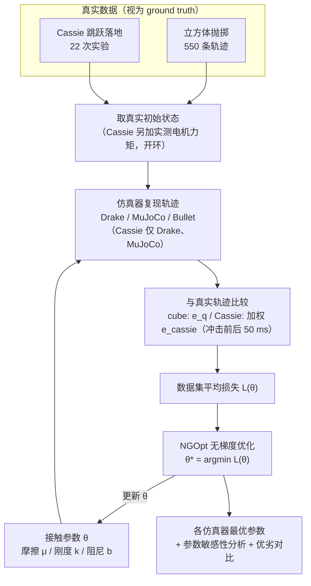

# Validating robotics simulators on real-world impacts

**Validating robotics simulators on real-world impacts**（[arXiv:2110.00541](https://arxiv.org/abs/2110.00541)）收录于 [自由度FreeDof · Sim2Real 四条路线梳理](../../sources/blogs/wechat_freedof_sim2real_four_routes_dr_to_residual_2026-08-23.md) 参考文献 **[21/44]**，归类 **域随机化**。

## 一句话定义

用方块抛落与 Cassie 跳跃落地真机冲击数据检验 Drake/MuJoCo/Bullet。

## 英文缩写速查

| 缩写 | 英文全称 | 简要说明 |
|------|----------|----------|
| RA-L | Robotics and Automation Letters | IEEE 机器人快报 |
| Sim2Real | Simulation to Real | 仿真到真机 |
| MuJoCo | Multi-Joint dynamics with Contact | 接触动力学仿真器 |

## 为什么重要

- 文内说明接触刚度可辨识性随任务变化——方块 vs 人形落地敏感性不同。
- 在 [44 篇技术地图](../overview/freedof-sim2real-44-papers-technology-map.md) 与 [四条路线对比](../comparisons/sim2real-four-routes-identifiability.md) 中作为 **域随机化** 节点。
- 开源结论：**待核实**（步骤 2.5，2026-09-20）。

## 流程总览

图依据：论文 §III 实验设置、§IV 参数辨识（Eq. 3–7，NGOpt 优化）、§V 结果；「NGOpt 更新 θ」的迭代回路为优化过程的通用表示，非论文单独画出的流程图。

## 核心机制

| 项 | 内容 |
|----|------|
| **出处** | RA-L 2022 |
| **文内章节** | 域随机化 |
| **要点** | 对比三引擎在冲击阶段的轨迹与接触力复现。 |
| **开源** | **待核实** |

## 源码运行时序图

**不适用（待核实）** — 截至 2026-09-20 以项目页/论文 Code availability 为准；入库未核验可运行入口。

## 实验与评测

- **本页为索引级节点**（FreeDof 44 篇梳理 [21/44]）：正文固化文内角色与机制要点，**未转存原文实验表**。
- **回原文须核对的证据**：本页要点是「对比三引擎在冲击阶段的轨迹与接触力复现」，对应证据是真机冲击实验与三引擎仿真的轨迹 / 接触力逐项比对曲线——关键看**冲击瞬态段**而非稳态段的误差。
- **读法：** 先对齐平台、任务、指标定义与成功阈值，再读任何数字；勿从公众号摘录外推。

## 与其他工作对比

| 维度 | 读法 |
|------|------|
| **文内路线** | 归类 **域随机化**；同路线其他节点见 [44 篇技术地图](../overview/freedof-sim2real-44-papers-technology-map.md) 与 [四条路线对比](../comparisons/sim2real-four-routes-identifiability.md) |
| **横比口径** | 三引擎的接触求解器、步长与求解迭代数设置不同；未对齐这些设置时，引擎优劣排名不可搬用。 |
| **开源状态** | **待核实** — 部署 / 复现前以项目页或原文 Code availability 为准 |

## 结论

**接触参数是否可辨取决于实验条件；不能脱离任务谈参数敏感性。**

1. 文内角色：域随机化 路线上的参考节点，非重复 arXiv 页面。
2. 机制要点：对比三引擎在冲击阶段的轨迹与接触力复现。…
3. 部署/复现前请对照原文与项目页，勿直接外推公众号数字。

## 关联页面

- [Sim2Real 四条路线（可辨识性）](../comparisons/sim2real-four-routes-identifiability.md)
- [44 篇技术地图](../overview/freedof-sim2real-44-papers-technology-map.md)
- [Sim2Real](../concepts/sim2real.md)

## 参考来源

- [freedof_sim2real_21_acosta-validating-simulators-real-world-impacts.md](../../sources/papers/freedof_sim2real_21_acosta-validating-simulators-real-world-impacts.md)
- [wechat_freedof_sim2real_four_routes_dr_to_residual_2026-08-23.md](../../sources/blogs/wechat_freedof_sim2real_four_routes_dr_to_residual_2026-08-23.md)
- [freedof_sim2real_44_catalog.md](../../sources/papers/freedof_sim2real_44_catalog.md)
- [arXiv PDF](https://arxiv.org/pdf/2110.00541)：已通读方法部分（实验与附录以略读为准）：摘要、§I 引言、§II 背景、§III 实验设置、§IV 参数辨识、§V 结果开头

## 推荐继续阅读

- [arXiv PDF](https://arxiv.org/pdf/2110.00541)
- [44 篇 Sim2Real 技术地图](../overview/freedof-sim2real-44-papers-technology-map.md)
