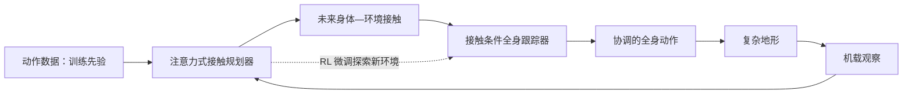

# ACP：注意力式接触规划人形移动（arXiv:2610.31608）

**ACP**（项目页名称；论文题名为 *Humanoid Mobility via Attention-based Contacts*）通过预测机器人身体与环境的接触，将动作先验、环境观察和全身控制连接起来。

## 英文缩写速查

| 缩写 | 英文全称 | 简要说明 |
|------|----------|----------|
| ACP | Attention-based Contacts | 项目页采用的简称；可读取论文题名未给出更长的正式展开 |
| RL | Reinforcement Learning | 微调阶段探索动作数据未覆盖的环境变化 |
| RSL | Robotic Systems Lab | leggedrobotics 项目域名所对应的研究团队简称；此处仅作来源定位 |

## 为什么重要

单纯通过奖励和探索来获得复杂的全身协调很困难；直接跟踪参考轨迹又会限制机器人适应训练数据之外的地形。ACP 把“下一步身体要在哪里接触环境”作为显式中间表示，尝试保留动作先验提供的协调性，同时让强化学习继续适应新环境。

## 核心原理

系统包含两个相连模块：

1. **接触规划器：** 自监督、注意力式模型预测未来身体—环境接触。
2. **接触条件跟踪器：** 根据接触计划生成协调的全身运动。

动作数据仅在训练时提供协调先验。随后策略通过强化学习微调，探索动作数据未覆盖的环境变化。部署时，系统从机载观察直接运行，不接收动作参考输入。

### 流程总览

## 工程实践

复现时应分别核对接触规划与条件跟踪两部分，并区分训练期输入和部署期输入：动作数据只用于训练先验，部署依赖机载观察。**项目页源码与数据开放状态截至 2026-10-23 尚未核实**：本次抓取工具无法读取项目页，且未确认对应公开仓库；这不是“确认未开源”的结论。详见[核查记录](../../sources/repos/acp-code-availability.md)。

### 源码运行时序图

**不适用（暂无法核实作者公开了可运行代码）**。项目页尚不可读取，因此不能确认官方训练、推理或部署入口；取得官方仓库后再补充运行时序。

## 实验与评测

论文摘要称该框架面向复杂地形人形移动，并采用“接触规划器 + 条件跟踪器 + RL 微调”的组合。当前可读取的摘要未提供数值对比、机器人型号或消融结果；定量评测需以论文全文及项目页为准。

## 与其他工作对比

| 路线 | 先验与适应方式 | 主要边界 |
|------|----------------|----------|
| 参考轨迹跟踪 | 直接跟踪预先定义的动作轨迹 | 运动自然，但适应范围受训练轨迹覆盖限制 |
| 无参考 RL | 从奖励与探索中学习协调行为 | 复杂全身协调的探索和奖励设计较难 |
| ACP | 训练期动作先验 + 接触计划 + RL 微调 | 将接触设为中间接口；公开代码状态尚待核实 |

## 结论

**ACP 的核心设计是用未来身体—环境接触作为中间接口，在训练期借助动作先验、再用强化学习提升对新环境的适应能力。**

1. 复现时分别验证接触规划器和接触条件跟踪器，避免只看最终动作成功率。
2. 把训练和部署输入分开记录：动作数据提供训练先验，部署不需要参考输入。
3. 目前可读取的摘要不足以支持定量优越性结论；比较数值前先核对论文全文。
4. 项目页与代码开放状态待复核；在确认作者发布入口前，不应假定实现可直接运行。

## 局限与风险

- **接触计划质量是关键依赖：** 规划器预测偏差会传给条件跟踪器；可读取摘要未展示其误差边界或失效案例。
- **证据粒度有限：** 当前摘要没有可引用的指标、硬件型号或消融数字，本文不外推具体性能。
- **源码状态未知：** 项目页无法读取，GitHub 检索也未确认代码仓库；不能把未核实等同于未开源。

## 关联页面

- [Humanoid Locomotion](../tasks/humanoid-locomotion.md)
- [楼梯与障碍感知移动](../tasks/stair-obstacle-perceptive-locomotion.md)
- [Contact Dynamics](../concepts/contact-dynamics.md)
- [Terrain Adaptation](../concepts/terrain-adaptation.md)

## 参考来源

- [论文摘录：Humanoid Mobility via Attention-based Contacts](../../sources/papers/acp_arxiv_2610_31608.md)
- [ACP 项目页归档](../../sources/sites/acp-attention-based-contacts.md)
- [代码与数据开放状态核查](../../sources/repos/acp-code-availability.md)

## 推荐继续阅读

- [arXiv:2610.31608](https://arxiv.org/abs/2610.31608)
- [ACP 项目页](https://leggedrobotics.github.io/ACP/)
