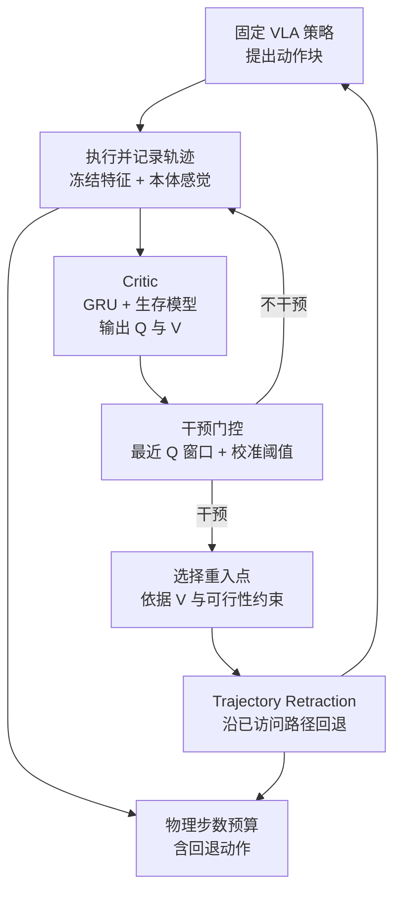
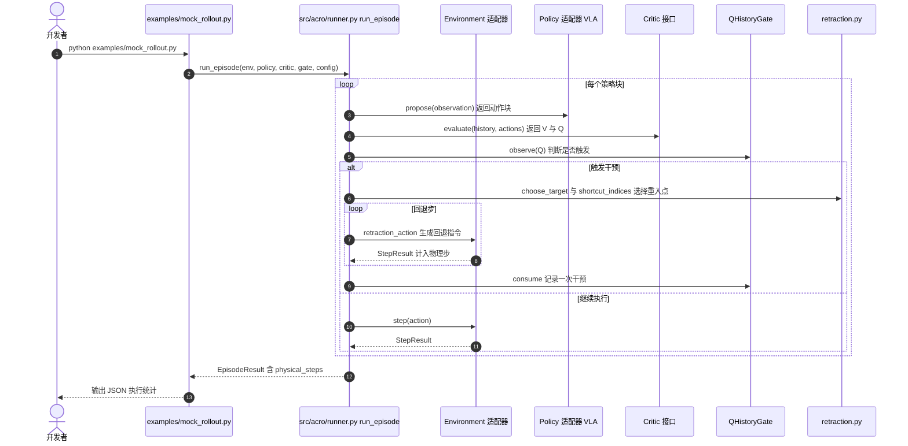

# ACRO：让固定 VLA 从更有希望的状态重试

**ACRO 在固定 VLA 外加一层执行编排：用从策略 rollout 学到的 Critic 判断何时中止、回退到哪个已访问状态（Trajectory Retraction），再让同一 VLA 从新观测继续，并把回退动作计入物理执行预算。**

论文 *ACRO: Actor-Critic Rollout Orchestration*（[arXiv:2610.19677](https://arxiv.org/abs/2610.19677)，[代码](https://github.com/JunHoo-Lee/ACRO)，[项目页](https://junhoo.me/acro)）。

## 英文缩写速查

| 缩写 | 英文全称 | 简要说明 |
|------|----------|----------|
| VLA | Vision-Language-Action | 被恢复的固定策略，ACRO 不改其参数 |
| Q | Action-value estimate | Critic 对当前状态与动作块成功概率的估计，超过门控规则即触发干预 |
| V | Value estimate | Critic 沿已执行轨迹的价值，用于挑选重入点 |
| GRU | Gated Recurrent Unit | Critic 编码历史特征的循环单元（冻结 VLA 特征与本体感觉作为输入） |

## 为什么重要

- 失败后继续执行原策略，常在错误状态中打转；ACRO 把「何时退、退到哪」变成可学习的恢复决策。
- 与「多试几次」不同，回退动作计入同一物理预算，结果更接近真实部署代价。
- 不改写 VLA 本身，理论上可套在不同骨干（论文用 GR00T N1.7 与 π0.5）之上。

## 核心信息

| 项 | 内容 |
|----|------|
| **机构** | KAIST（一作）；Seoul National University（其余作者），依据仓库 README |
| **平台** | SimplerEnv Bridge（GR00T N1.7）；RoboCasa（π0.5）；Franka Panda 真机（π0.5） |
| **数据** | Critic 由部署策略的未中断 rollout 训练；仓库未附数据或检查点 |
| **开源** | **部分开源**（2026-10-15 核查）：仓库 [JunHoo-Lee/ACRO](https://github.com/JunHoo-Lee/ACRO) 公开 Critic、干预门控、回退规划与编排循环，附 mock 示例；学习到的检查点与 benchmark 集成由部署方提供，未随附 |

## 核心原理

### 流程总览

每个策略动作块执行前后，Critic 基于冻结的 VLA 特征与本体感觉估计 Q 与 V。门控对最近的 Q 值做校准判断；触发时，系统在已访问路径周围的管状区域内选择重入点，沿路径回退，再由同一 VLA 继续。回退步数计入物理预算。

- 各模块对应仓库 `src/acro/`：`critic.py`（SurvivalQVHead）、`gate.py`（QHistoryGate、calibrate_threshold、fit_gate）、`retraction.py`（pose_delta、shortcut_indices）、`runner.py`（choose_target、run_episode）。

## 源码运行时序图

仓库可运行入口为几何 mock 示例（不对应机器人基准结果）。时序对齐 `examples/mock_rollout.py` 与 `src/acro/runner.py` 的 `run_episode` 循环。

- **复现路径（README）：** `python -m pip install -e '.[dev,critic]'` → `python examples/mock_rollout.py` → `python -m pytest`。
- **接入真实 VLA：** 按仓库 `CODE.md` 实现 Environment（reset / step / features / pose / retraction_action）与 Policy（propose / reset）适配器。

## 工程实践

| 项 | 建议 |
|----|------|
| 先跑通 | 用 mock 示例验证编排循环与预算统计，再接真实环境 |
| 接入 | 实现环境与策略适配器；Critic 需在部署策略自身的 rollout 上训练 |
| 预算口径 | 比较时统一计入回退步（论文的「同一物理执行预算」） |
| 关键参数 | `max_steps`、`max_interventions`、`max_retraction_steps`、`lookback_steps`、`min_target_gap`；门控阈值由标定集确定 |
| 调试指标 | 干预次数、回退步数、Q 误报率；论文 RoboCasa：ACRO 平均 46.3 回退步 / 试验，周期性回退 92.7 步 |
| 真机 | 论文 Franka Panda 上 π0.5 基线 43.3% → 65.0% |

## 实验与评测

- **SimplerEnv Bridge（GR00T N1.7）：** 49.6% → 60.0%（+10.4 pp）。
- **RoboCasa（π0.5）：** 60.7% → 68.0%（+7.3 pp）；周期性回退 59.5%。
- **Franka Panda 真机（π0.5）：** 43.3% → 65.0%（+21.7 pp）；文章转述三项真机任务合计 60 次，26/60 → 39/60。
- **执行效率：** SimplerEnv 最后 200 步内，ACRO 完成 43 次试验，基础策略 25 次（项目页）。
- **口径：** 所有比较含回退动作在同一物理步数预算之内。

## 结论

**ACRO 的增益来自可学习的「何时退、退到哪」决策，并且必须按含回退的物理预算来读。**

1. **回退要计入预算** — 不计回退会高估收益，论文以同一物理步数比较。
2. **周期性回退不是最优** — RoboCasa 上周期性回退 59.5%，低于 ACRO 的 68.0%，且回退步数约为其两倍（92.7 对 46.3）。
3. **收益随设定变化** — 三组分别 +10.4、+7.3、+21.7 pp；真机增益最大，但样本量小（文章转述合计 60 次）。
4. **Critic 依赖部署轨迹** — 需要策略自身的 rollout 训练，不是零数据外挂（文章转述）。
5. **公开范围有限** — 仓库公开核心包与几何 mock，检查点与基准集成不随附，复现主结果需自建适配。

## 与其他工作对比

| 对照 | 差异读法 |
|------|----------|
| [VLA](../methods/vla.md) | 被恢复的对象；ACRO 不改策略参数，只决定中止与回退 |
| [Receding horizon 执行](../concepts/receding-horizon-policy-execution.md) | 同为执行时机决策；ACRO 的动作是中止并沿已访问路径回退，而非仅重规划 |
| [Safe real-world RL fine-tuning](../concepts/safe-real-world-rl-fine-tuning.md) | 同样依赖真实 rollout；ACRO 不更新 VLA，只训练 Critic 做编排 |

## 局限与风险

- **Critic 校准风险：** Q / V 估计误差会导致误触发或选错重入点；论文未给出跨环境的校准稳定性细节（未核实）。
- **数据依赖：** 需要部署策略的 rollout 训练 Critic，新环境要重新收集。
- **回退假设：** 依赖已访问路径可达、管状区域内无障碍；动态环境与不可逆操作未在论文中评估（未核实）。
- **公开代码边界：** mock 示例为几何模拟，不代表机器人基准结果。
- **真机样本小：** 文章转述合计 60 次测试，结论需更多重复。

## 关联页面

- [VLA](../methods/vla.md) — 被恢复的策略族
- [Receding horizon 执行](../concepts/receding-horizon-policy-execution.md) — 执行时机与重规划的相关讨论
- [Safe real-world RL fine-tuning](../concepts/safe-real-world-rl-fine-tuning.md) — 真实 rollout 数据利用的对照
- [机器人安全状态机](../concepts/robot-safety-state-machine.md) — 中止与恢复的工程语境

## 参考来源

- [acro_arxiv_2610_19677.md](../../sources/papers/acro_arxiv_2610_19677.md) — 论文摘录与开源核查
- [arXiv:2610.19677](https://arxiv.org/abs/2610.19677) — 原文
- [JunHoo-Lee/ACRO](https://github.com/JunHoo-Lee/ACRO) — 官方代码仓库（核心包与 mock 示例）

## 推荐继续阅读

- [ACRO 项目页](https://junhoo.me/acro)
- [ACRO 论文 PDF](https://arxiv.org/pdf/2610.19677)
