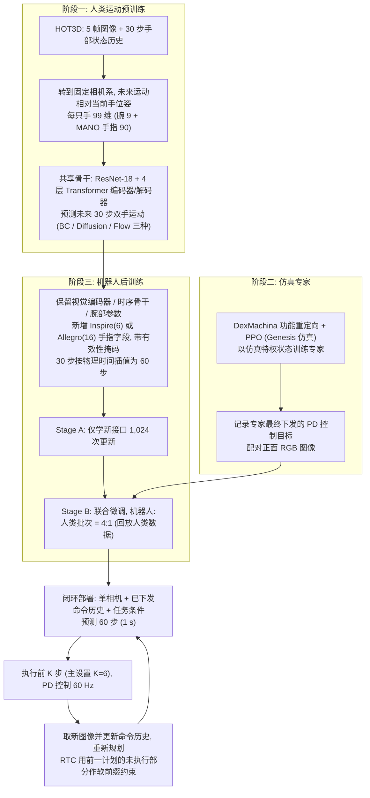

# AcrossDEX 1.0：从人类运动预训练到跨灵巧手本体的双臂操作

**AcrossDEX 1.0**（*AcrossDEX 1.0: From Human Motion Pretraining to Bimanual Dexterous Manipulation across Hand Embodiments*，[arXiv:2610.40210](https://arxiv.org/abs/2610.40210)）收录于 senlanke「具身运控lab」10-26–10-30 前沿论文动态（Manipulation）。本页依据**周报条目 + arXiv 摘要页**整理，未逐页核对正文 PDF；指标与结论以论文为准。

## 一句话定义

**AcrossDEX 1.0：从人类运动预训练到跨灵巧手本体的双臂操作——将人类双手运动预训练、仿真专家学习和机器人闭环执行连接起来，使用共享手腕表示、独立手指特征和有效性掩码，同时适配 Inspire Hand 和 Allegro Hand。研究还比较直接回归、Diffusion 和 Flow Matching，并分析动作块连续性对双臂协同执行的影响。**

## 英文缩写速查

| 缩写 | 英文全称 | 简要说明 |
|------|----------|----------|
| VLA | Vision-Language-Action | 视觉–语言–动作模型 |
| IL | Imitation Learning | 模仿学习 |

## 为什么重要

- 周报所述待解决的问题：不同灵巧手的手指自由度和动作空间不同，难以直接复用从人类视频学习的双手协调能力。

## 流程总览

图依据：论文 §II Method (A-F) / Fig.1

## 核心机制

| 项 | 内容 |
|----|------|
| **arXiv** | [2610.40210](https://arxiv.org/abs/2610.40210) · [PDF](https://arxiv.org/pdf/2610.40210) |
| **作者（arXiv）** | Yang, Xiaoyu, Wu, Nan |
| **机构（周报所述，未逐条核实）** | 待核实（作者：Xiaoyu Yang、Nan Wu）。 |
| **arXiv 评论栏** | （无） |
| **开源** | arXiv 摘要页与评论未见代码或项目页链接（仅核对 arXiv 摘要页，不代表未发布）（2026-11-02） |
| **周报所述创新点** | 将人类双手运动预训练、仿真专家学习和机器人闭环执行连接起来，使用共享手腕表示、独立手指特征和有效性掩码，同时适配 Inspire Hand 和 Allegro Hand。研究还比较直接回归、Diffusion 和 Flow Matching，并分析动作块连续性对双臂协同执行的影响。 |

### arXiv 摘要节选（英文原文）

> Bimanual dexterous manipulation requires continuous coordination of wrist motion, finger contact, and object motion. Human videos provide rich manipulation experience.

## 源码运行时序图

**不适用**：arXiv 摘要页与评论未见代码或项目页链接（仅核对 arXiv 摘要页，不代表未发布），无可对齐的官方代码流程。

## 实验与评测

- 周报与摘要给出的数字/场景已写入上表「创新点」与摘要节选；其余实验细节、基线与成功率定义请回到论文正文。
- 读法：先对齐任务设定、传感器与成功定义（仿真/真机），再解读 headline 数字，勿跨论文直接比较。

## 与其他工作对比

| 维度 | 读法 |
|------|------|
| **同周对照** | 见 [Manipulation周报技术地图](../overview/senlanke-weekly-2026-10-26-30-manipulation-technology-map.md)，按方向浏览同期论文 |
| **开源状态** | arXiv 摘要页与评论未见代码或项目页链接（仅核对 arXiv 摘要页，不代表未发布） |

## 结论

**AcrossDEX 1.0：从人类运动预训练到跨灵巧手本体的双臂操作。**

1. 本页是入库级摘要，复现前请核对论文正文、附录与代码仓库。
2. 指标须连同实验条件解读。
3. 关注 arXiv 版本更新与代码发布。

## 关联页面

- [senlanke-weekly-2026-10-26-30-manipulation-technology-map](../overview/senlanke-weekly-2026-10-26-30-manipulation-technology-map.md)
- [manipulation](../tasks/manipulation.md)
- [vla](../methods/vla.md)

## 参考来源

- [acrossdex-bimanual-dexterous-human-motion-pretraining_arxiv_2610_40210.md](../../sources/papers/acrossdex-bimanual-dexterous-human-motion-pretraining_arxiv_2610_40210.md)
- [wechat_senlanke_weekly_manipulation_2026-10-26_30.md](../../sources/blogs/wechat_senlanke_weekly_manipulation_2026-10-26_30.md)
- [arXiv:2610.40210](https://arxiv.org/abs/2610.40210)
- [arXiv PDF](https://arxiv.org/pdf/2610.40210)：已通读全文：§II 方法 A-F（预训练、专家数据、嵌入字段与参数迁移、RTC 连续性），§III 实验设置与训练细节

## 推荐继续阅读

- [arXiv PDF](https://arxiv.org/pdf/2610.40210)
