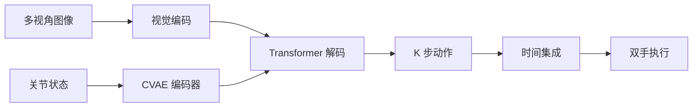
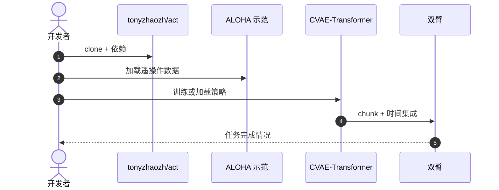
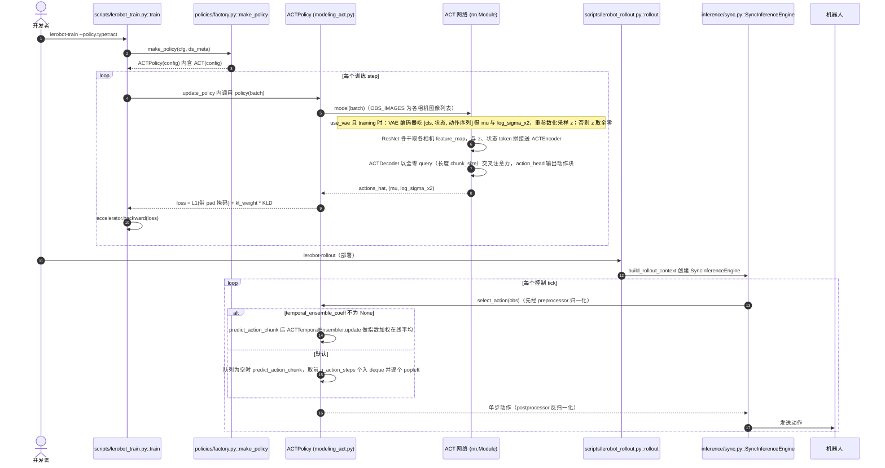

# ACT：低成本硬件上的动作块 Transformer

**ACT**（*Learning Fine-Grained Bimanual Manipulation with Low-Cost Hardware*，[arXiv:2304.13705](https://arxiv.org/abs/2304.13705)，[代码](https://github.com/tonyzhaozh/act)）由 **斯坦福大学** 提出：用 **CVAE + Transformer** 一次预测未来 **K** 步动作，在整套成本 **低于 $20k** 的 ALOHA 双臂上做精细操作。机制页见 [action-chunking](../methods/action-chunking.md)。

## 一句话定义

**一次输出一短段动作，用时间集成抹平抖动，让低频策略驱动高频双手。**

## 英文缩写速查

| 缩写 | 英文全称 | 简要说明 |
|------|----------|----------|
| ACT | Action Chunking with Transformers | 本方法 |
| CVAE | Conditional Variational Autoencoder | 多样化 chunk 生成 |
| ALOHA | 低成本双臂遥操作平台 | 论文配套硬件 |
| TE | Temporal Ensemble | 重叠 chunk 平均 |

## 为什么重要

- 纳入 [VLA/WM 阅读路线](../../sources/blogs/wechat_embodied_ai_lab_vla_wm_reading_roadmap_2026-09-02.md) 的动手入门。
- Action chunking 后来成为 VLA 标配，机制解释见 [why action chunking](./paper-why-action-chunking-improves-bc.md)。
- 证明低成本遥操作 + 简单算法也能做精细双手。
- **已开源** `tonyzhaozh/act`。

## 核心信息

| 项 | 内容 |
|----|------|
| **机构** | 斯坦福大学 |
| **硬件** | ALOHA 低成本双臂 |
| **结构** | 多视角视觉编码 + CVAE + Transformer 解码 |
| **控制** | chunk 预测 + 时间集成 |
| **开源** | **已开源** [tonyzhaozh/act](https://github.com/tonyzhaozh/act) |

### 流程总览

## 工程实践

原论文的 ALOHA 使用四个相机和两条随动臂，训练时记录 50 Hz 遥操作数据；ACT 学习未来动作块，推理用 z=0 并在同一控制时刻重叠多个 chunk 做指数加权平均。不要把 temporal ensembling 简化为固定 5 Hz 推理，也不要将图 1 的整套硬件成本误写为 $2k。

## 评测

- 原论文包含两项模拟任务、六项 ALOHA 真机任务；真实 Slide Ziploc / Slot Battery 的成功率分别为 88% / 96%，其他真机任务的局部成功率应按 Table II 分步阅读。
- 精细双臂任务上相对逐步 BC 更稳。
- chunk 长度与时间集成是主超参。
- 表以 [原文](https://arxiv.org/abs/2304.13705) 为准。

## 结论

**入门模仿学习优先 ACT + ALOHA 路线：先跑通 chunk，再换扩散或 VLA 头。**

- 推理频率可以从控制频率里解耦
- 双手必须联合建模，不要两只胳膊各训一个策略
- 时间集成减抖，但 **TE ≠ Diffusion Policy 式 receding horizon**（见 [滚动预测执行](../concepts/receding-horizon-policy-execution.md)）
- 后续 VLA 的 chunk 多从此处工程化
- 机制深挖读 [action-chunking](../methods/action-chunking.md)

## 源码运行时序图

> 下图是官方仓库 `tonyzhaozh/act` 的**粗粒度示意**（未逐函数对照官方源码，仅表示使用顺序）；LeRobot 版的函数级时序图见下一小节。

### LeRobot 版（固定提交 9e5ee98）函数级时序图

以下节点均来自 LeRobot 源码（路径相对 `src/lerobot/`），已对照阅读：`policies/act/modeling_act.py`、`configuration_act.py`、`processor_act.py`、`scripts/lerobot_train.py`、`scripts/lerobot_rollout.py`、`inference/sync.py`。

## LeRobot 实现要点

- **身份核对：** LeRobot 文档 `docs/source/policy_act_README.md` 的论文链接指向 ALOHA 项目页，引用为 arXiv:2304.13705；`ACTPolicy` 类 docstring 也指向同一论文与 `tonyzhaozh/act`。与本页论文身份一致。
- **默认配置（`configuration_act.py` 读到的值）：** `chunk_size=100`、`n_action_steps=100`、ResNet-18（ImageNet 预训练）、`dim_model=512`、`n_heads=8`、编码器 4 层、解码器 **1 层**、`use_vae=True`、`latent_dim=32`、`kl_weight=10.0`、`optimizer_lr=1e-5`。
- **与原版的差异说明（源码注释）：** 原版 ACT 配置写的是 7 层解码器，但 LeRobot 注释称原版代码存在 bug 使只有第 1 层被用到（引用 `tonyzhaozh/act` issue #25），因此 LeRobot 把 `n_decoder_layers` 设为 1 以匹配实际行为。
- **时间集成默认关闭：** `temporal_ensemble_coeff=None`，默认走「整块执行」的动作队列；开启时必须 `n_action_steps=1`（否则 `__post_init__` 抛 `NotImplementedError`），每步都要重新推理。注释写明原版 ACT 开启时系数为 0.01；LeRobot 的权重 `w_i=exp(-coeff*i)`，`w_0` 对应最旧动作。
- **限制：** `n_obs_steps` 只能为 1（`__post_init__` 校验）；`vision_backbone` 必须是 torchvision ResNet 变体。
- **文档（`docs/source/act.mdx`）称：** 约 80M 参数、单 GPU 数小时可训、常见 50 条示范起步；这些为文档表述，未在本仓库复现核实。

## 局限与风险

- **无语言：** 不是 VLA；指令跟随要另接。
- **开环 chunk：** 过长会在扰动下崩。
- **专家类型：** 脚本/遥操作分布不同，见 ParcelStow 时间鲁棒性讨论。

## 与其他工作对比

| 工作 | 相对本页 |
|------|----------|
| [Diffusion Policy](./paper-diffusion-policy.md) | 去噪生成 chunk |
| [OpenVLA](./paper-openvla.md) | 语言条件 + 大模型 |
| [why-AC 论文](./paper-why-action-chunking-improves-bc.md) | 解释 chunk 为何有效 |

## 关联页面

- [Action Chunking](../methods/action-chunking.md)
- [滚动预测执行](../concepts/receding-horizon-policy-execution.md) — ACT TE 与 DP RH 对照
- [Diffusion Policy](./paper-diffusion-policy.md)
- [Why Action Chunking Improves BC](./paper-why-action-chunking-improves-bc.md)
- [ParcelStow](./paper-parcelstow.md) — ACT 在 G1 包裹插入上的速度扫频：标称 100%，\(r=2\) 53%
- [VLA/WM 14 篇路线](../overview/vla-wm-reading-roadmap-14-papers-technology-map.md)
- [LeRobot](./lerobot.md) — 本页的 LeRobot 实现所在框架

## 推荐继续阅读

- [arXiv:2304.13705](https://arxiv.org/abs/2304.13705)
- [tonyzhaozh/act](https://github.com/tonyzhaozh/act)

## 参考来源

- [act_arxiv_2304_13705](../../sources/papers/act_arxiv_2304_13705.md)
- [具身智能研究室 VLA/WM 阅读路线](../../sources/blogs/wechat_embodied_ai_lab_vla_wm_reading_roadmap_2026-09-02.md)
- [act-aloha](../../sources/repos/act-aloha.md)
- [lerobot](../../sources/repos/lerobot.md) — 固定提交 9e5ee98 的 ACT 实现与文档
- [LeRobot ACT 文档](https://github.com/huggingface/lerobot/blob/9e5ee9859480e425a97a6836bb3fee479539beb5/docs/source/act.mdx)
