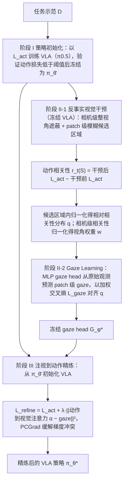

# ActGaze

**ActGaze: Learning Action-Grounded Gaze through Counterfactual Visual Interventions for High-Precision Manipulation**（[arXiv:2609.28955](https://arxiv.org/abs/2609.28955)，[项目页](https://anonymous.4open.science/w/ActGaze/)）收录自 [具身智能小站 12 篇盘点（恢复/WAM 专题）](../../sources/blogs/wechat_embodied_station_12_papers_recover_wam_2026-09-27.md)。

## 一句话定义

**无需外部注视标签，用 counterfactual 干预学习 action-grounded 视觉注意力以提升精密操作。**

## 英文缩写速查

| 缩写 | 英文全称 | 简要说明 |
|------|----------|----------|
| SR | Success Rate | 任务成功率 |
| WAM | World Action Model | 联合预测未来观测与动作 |
| VLA | Vision-Language-Action | 视觉-语言-动作策略 |
| RL | Reinforcement Learning | 强化学习 |

## 为什么重要

- 纳入 [12 篇技术地图](../overview/embodied-research-12-papers-recover-wam-technology-map.md) 与同期失败恢复、异步 WAM、接触感知、持续学习、安全 RL 条目横向对照。
- 步骤 2.5 开源结论：**待发布**。

## 流程总览

图依据：论文 §III、§IV-A~C、Algorithm 1 / Fig.2

## 核心信息

| 项 | 内容 |
|----|------|
| **arXiv** | [2609.28955](https://arxiv.org/abs/2609.28955) |
| **项目页** | https://anonymous.4open.science/w/ActGaze/ |
| **代码** | — |
| **开源** | **待发布** |

## 实验与评测（公众号口径）

- 指标与数字以 [公众号盘点](../../sources/blogs/wechat_embodied_station_12_papers_recover_wam_2026-09-27.md) 与 **原文 PDF** 为准；读复现前核对仿真/真机与 attempt 定义。

## 源码运行时序图

**不适用**（无统一官方入口或未开源）。

## 与其他工作对比

| 对照 | 差异读法 |
|------|----------|
| [Gaze2Act](./paper-ego-05-gaze2act.md) | 把 **人类第一视角 gaze** 映射到机器人视角作 VLA 条件输入，gaze 是外部意图信号；ActGaze **无需外部注视标签**，gaze 由反事实视觉干预从策略自身动作预测中得出 |
| [Gaze-Regularized VLMs](./paper-sa-2603-23190-gaze-regularized-vlms-for-ego-centric-behavior-u.md) | 用 **眼动数据** 正则 VLM 注意力，面向第一视角行为理解；ActGaze 的注意力监督是 **action-grounded**，面向精密操作动作输出 |
| [CoPRE](./paper-copre-proprioceptive-contact.md) · [TactileStep](./paper-tactilestep.md) | 同期「改 sensing」条目：CoPRE 补 **本体接触检测**、TactileStep 补 **足底触觉**；ActGaze 不加传感器，改的是 **视觉注意力分配** |
| [KeyGen](./paper-keygen.md) | 同为给策略注入 **空间先验**：KeyGen 从点云学 **显式物体关键点** 作条件；ActGaze 找出影响动作的 **图像区域** 并作为空间监督回传 |

## 结论

**总判：ActGaze 适合作为「无需外部注视标签，用 counterfactual 干预学习 action-grounded 视觉注意力以提升精密操作。…」方向的入口页；机制细节以 arXiv 与项目页为准。**

1. 与 [12 篇技术地图](../overview/embodied-research-12-papers-recover-wam-technology-map.md) 对照，避免与其它 arXiv 混淆。
2. 开源为 **待发布** 时从项目页/GitHub 再核实一次再写复现计划。
3. 涉及异步 WAM 或恢复评测时，同时记录 **正常起点 SR** 与 **偏差后恢复率**（若适用）。

## 关联页面

- [具身研究 12 篇（恢复/WAM）技术地图](../overview/embodied-research-12-papers-recover-wam-technology-map.md)
- [Manipulation](../tasks/manipulation.md)

## 参考来源

- [论文归档](../../sources/papers/actgaze_arxiv_2609_28955.md)
- [公众号 12 篇清单](../../sources/blogs/wechat_embodied_station_12_papers_recover_wam_2026-09-27.md)
- [arXiv PDF](https://arxiv.org/pdf/2609.28955)：已通读方法部分（实验与附录以略读为准）：§III 问题表述、§IV 方法（A 至 C）、§V-A 实现细节

## 推荐继续阅读

- [arXiv:2609.28955](https://arxiv.org/abs/2609.28955)
- [项目页](https://anonymous.4open.science/w/ActGaze/)

