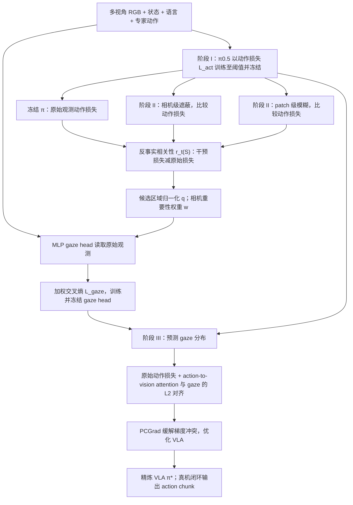

# ActGaze：让动作目标指导视觉注视的精密操作方法 / Learning Action-Grounded Gaze through Counterfactual Visual Interventions

**论文：** [ActGaze: Learning Action-Grounded Gaze through Counterfactual Visual Interventions for High-Precision Manipulation](https://arxiv.org/html/2609.28955v1)（2026-09-24，v1）｜**机构：** 三星机器人体验团队 Samsung Robotics eXperience（RX）与新加坡国立大学 National University of Singapore（NUS）｜[作者项目页](https://anonymous.4open.science/w/ActGaze/)。

## 一句话定义

**ActGaze 在已经会做动作的 VLA 上局部遮挡/模糊视觉输入，以动作预测损失增量给区域打分，训练多视角注视头，再让 VLA 的动作视觉注意力学习“该看哪里”——不需要额外的训练用空间框标注。**

## 英文缩写速查

| 缩写 | 英文全称 | 简要说明 |
|---|---|---|
| VLA | Vision-Language-Action | 由图像、状态、语言生成 action chunk 的机器人策略 |
| RX | Robotics eXperience | Samsung 参与研究的机器人团队 |
| NUS | National University of Singapore | 联合研究机构 |
| CF | Counterfactual | 对视觉区域遮蔽/模糊，检查动作损失变化 |
| GT | Ground Truth | 仅用于评估注视空间对齐的人工参考框 |
| PCGrad | Projecting Conflicting Gradients | 平衡动作目标与 gaze 对齐的梯度冲突 |
| SR | Success Rate | 真机任务成功次数/试验次数 |

## 为什么重要

- **关注接口而非背景：** 插入、接插件的关键区域很小，动作注意力会被金属反射或附近杂物分散；单靠端到端动作损失没有显式监督注意力的位置。
- **不依赖训练用的外部 gaze / bbox 标注：** 用原有的示范动作与策略损失得到区域相关性，区别于人眼注视蒸馏或 Grounding-DINO 的语义框。
- **注意任务阶段：** 抓取时看物体/抓取区，插入时转向孔口与接触界面；不是为全程固定画一个 ROI。
- 与 [具身研究 12 篇技术地图](../overview/embodied-research-12-papers-recover-wam-technology-map.md) 及 [Manipulation](../tasks/manipulation.md) 互链。主结果是**真机任务成功率**，不是实测机械臂位姿误差下降至亚毫米。

## 核心信息

| 项目 | 原文口径 |
|---|---|
| 论文 | [arXiv:2609.28955v1](https://arxiv.org/html/2609.28955v1)（作者论文 + 附录已复核） |
| 研究机构 | Samsung Robotics eXperience（RX）；National University of Singapore（NUS） |
| 基座策略 | π0.5 VLA，flow-matching action head |
| 机器人 / 摄像头 | Rainbow RB-Y1；双腕部 RealSense D405 + 头部 ZED X Mini |
| 示范 / 训练 | 每项任务 200 例专家示范，8×NVIDIA RTX 5880；相同训练步数口径进行对照 |
| 代码开放状态 | **实现未公开**：截至 2026-11-09，作者[项目页](https://anonymous.4open.science/w/ActGaze/)只列展示视频和附录，没有可执行训练/推理仓库、权重或数据下载入口 |
| 评估尺度 | 4 项任务各 50 次真机尝试；对比基座 π0.5 |

## 核心原理

策略输入：多视角 RGB `I_t={I_t^v}`、机器人状态 `s_t`、指令 `l`；输出长度 H 的动作块 `A_t`。gaze head `G_φ` 输出对全部视角/patch 联合归一化的空间概率分布 `g_hat_t`（原文 Eq.1）。

### 流程总览（根据论文 §III–IV、Algorithm 1、Fig.2）



**动作相关性（原文 Eq.2）：**

```text
r_t(S) = L_act( I(I_t; S) ) - L_act( I_t )
```

对比 clean/intervened 时**保持状态、指令、示范动作、flow time、noise、noisy action、target velocity 不变**。相机级对整路视图 mask；patch 级对局部候选区域 blur。像素网格 16×16，每个候选区域 2×2 patches，每视角每步仅采样 K=2 个区域，避免全量干预遍历。

**注视监督（Eq.3）：** 将候选区域干预反应归一化成 `q`，相机级反应给权重 `w`；从原图预测的 `q_hat` 用相机加权交叉熵 `L_gaze = -Σ_v w_v Σ_k q_v,k log(q_hat_v,k)` 监督 MLP gaze head。

**策略精炼（Eq.4）：** 冻结 gaze head，使用 `L_refine = L_act + λ_align ||α_θ,t - g_hat_t||²` 更新 VLA；原动作目标保留行为学习能力，PCGrad 缓解两个损失梯度冲突。三阶段顺序分别承担**先学动作、再学相关区域、最后矫正动作注意力**。

## 工程实践

| 步骤 / 参数 | 原文实现 |
|---|---|
| Stage I | 以标准 π0.5 动作预测损失训练，验证动作损失阈值 ε_act=0.002 |
| Stage II | 冻结 π0.5，比较 clean 与整相机 mask / patch blur 的动作损失，训练多视角 MLP gaze head |
| Stage III | 冻结 gaze head，VLA 用动作 + 注意力对齐损失优化，PCGrad 处理梯度冲突 |
| 观测 | 2×腕部 D405 局部相机 + 1×ZED X Mini 头部全局相机 |
| 控制评测 | Rainbow RB-Y1 真机四项插入/装配任务；本文没有提供可直接执行的训练/部署入口 |
| 训练数据 | 每任务 200 例专家示范，空间人工框**不用于训练**（仅用于 GT 评测） |
| 精密尺度 | 软管 4.6 mm 对 5.0 mm 孔；24-pin ATX 插头与插座间隙小于等于 0.4 mm，属于几何公差，不等价于系统测得位置误差 |

## 实验与评测

### 四任务真机（Table II，各 50 回合）

| 任务 | π0.5 | ActGaze | 绝对增益 |
|---|---:|---:|---:|
| 吸管插入 Straw | 37/50（74%） | 44/50（88%） | +14 pp |
| 软管插入 Hose | 34/50（68%） | 46/50（92%） | **+24 pp** |
| LEGO 装配 | 44/50（88%） | 48/50（96%） | +8 pp |
| 连接器插接 Connector | 39/50（78%） | 45/50（90%） | +12 pp |
| **合计** | **154/200（77.0%）** | **183/200（91.5%）** | **+14.5 pp** |

注意：**91.5% 是 200 次成功率，不是亚毫米位置误差的量化指标。**

### 注视学习和空间对齐（Table I）

原 π0.5 action attention 的 GT alignment 均值 **16.3%**，ActGaze gaze head 达 **40.3%**，精炼后的 action attention 达 **35.7%**。每视角每任务 200 帧的人工 bbox **仅用于评价**，不进入训练。

### 空间 grounding 对照（Table III；只有 Hose + Connector）

| 方法 | Hose | Connector | 两任务平均 |
|---|---:|---:|---:|
| CoT Grounding | 10/20 | 12/20 | 55.0% |
| Implicit Grounding | 13/20 | 12/20 | 62.5% |
| **ActGaze** | **18/20** | **17/20** | **87.5%** |

两条基线用 Grounding-DINO 产生外部 bbox；**此处 20 次/任务，与主实验 50 次/任务不同**。

### 消融（Table IV；只有 Straw + LEGO）

| 变体 | Straw | LEGO | 平均 |
|---|---:|---:|---:|
| 不用反事实监督 | 8/20 | 7/20 | 37.5% |
| 不分阶段训练 | 13/20 | 12/20 | 62.5% |
| 完整 ActGaze | 19/20 | 18/20 | **92.5%** |

不用反事实监督时 gaze 接近均匀分布；不分阶段训练时策略早期动作预测不稳定、gaze 目标漂移。LEGO 迭代精炼成功率 Round 0/1/2/3/4 为 78/90/90/92/92%，论文选 **1 轮**平衡收益和训练成本。

### 附录 D：局部杂物与强光

在 LEGO 上（每条件 20 次），Clean：18/20→19/20，**Clutter：13/20→15/20**，**Strong lighting：11/20→11/20**。仅支持改善**部分局部空间干扰**，并未证明可以对抗全局光照变化。

## 结论

**ActGaze 的价值是把动作预测对视觉证据的依赖转成空间监督，提升精密操作成功率；不是额外开发高精度定位硬件或证明一般物理因果关系。**

1. **选型：** 已有 π0.5 类 VLA 且任务关键区域很小时，可以参考“动作损失反事实干预 → gaze head → policy alignment”的额外训练路线。
2. **实验口径：** 主指标 **77.0→91.5%（+14.5 pp）**；另两项 20 次/任务的 grounding 和消融不要误写成四任务主结果。
3. **训练顺序：** 先建立可靠动作预测，再构建 gaze target；消融 **92.5 vs 62.5/37.5%** 支持分阶段与反事实信号都重要。
4. **标注边界：** 无额外**训练空间标签**，并非完全没有标注：GT alignment 使用人工评价框。
5. **真实场景：** 阴影/强光、训练底座的注意力偏差仍是风险；复现需等实际源码入口。
6. **优化成本：** 冻结策略做多次 clean/intervened 损失查询，增加训练代价；论文没有给出完整推理时延对照，不能断言推理零开销。

## 局限与风险

- **干预不是物理因果实验：** Appendix A 的理想平方损失命题给出 `V(S) ≥ 0`，但 mask/blur 可能造成输入分布偏移；实际 `r_t(S)` 只是**策略级的相对预测相关性估计**。
- **继承初始化策略的偏差：** 若底座策略学会用错误相关特征，gaze 蒸馏和迭代精炼未必消除偏差。
- **对光照鲁棒性有限：** 全局强光变化实验两者同为 11/20；局部杂物仅提高 2/20。
- **复现与资源代价：** 论文 8×RTX 5880 训练，涉及三阶段和多次视觉干预；截至 2026-11-09 [项目页](https://anonymous.4open.science/w/ActGaze/)无代码/权重/数据集下载入口，无法核验具体训练脚本。
- **任务边界：** 仅四项指定平台的真机操作；“亚毫米”来自对接间隙等几何条件，不是末端轨迹误差的统计验证。

## 源码运行时序图

**不适用（实现未公开）。** 已核查[项目站点归档](../../sources/sites/actgaze-4open-science.md)：只有演示视频/附录，没有可运行 README、训练或推理入口。上面的 Mermaid 是**论文方法流程图**，不是伪造的源码调用时序；代码开放后需读实际入口再补 `sequenceDiagram`。

## 与其他工作对比

| 对照 | 差异 |
|---|---|
| [Gaze2Act](./paper-ego-05-gaze2act.md) | 利用人类第一视角 gaze 信号指导 VLA；ActGaze 以**策略自身动作损失反事实变化**导出注视目标 |
| [Gaze-Regularized VLMs](./paper-sa-2603-23190-gaze-regularized-vlms-for-ego-centric-behavior-u.md) | 用眼动数据正则视觉模型；ActGaze 不需要训练期间的眼动数据 |
| CoT Grounding / ReconVLA 式 Implicit Grounding | 依赖额外目标框/重建监督（本文基线用 Grounding-DINO）；ActGaze 利用动作目标产生阶段条件空间监督 |
| [CoPRE](./paper-copre-proprioceptive-contact.md) / [TactileStep](./paper-tactilestep.md) | 两者增加接触/触觉的观测能力；ActGaze 主要改变现有视觉信息的注意力分配 |
| [KeyGen](./paper-keygen.md) | 点云显式物体关键点条件 vs 本文图像 patch 级动作相关性 |

## 关联页面

- [Manipulation：精密操作](../tasks/manipulation.md)
- [Gaze2Act：人类注视条件策略](./paper-ego-05-gaze2act.md)
- [TactileStep：用足底触觉改 sensing](./paper-tactilestep.md)
- [12 篇具身研究技术地图](../overview/embodied-research-12-papers-recover-wam-technology-map.md)

## 参考来源

- [ActGaze 论文全文与附录核查归档](../../sources/papers/actgaze_arxiv_2609_28955.md)
- [作者项目站点核查归档](../../sources/sites/actgaze-4open-science.md)
- [原收录的 12 篇论文盘点（仅作历史入库线索，不作指标依据）](../../sources/blogs/wechat_embodied_station_12_papers_recover_wam_2026-09-27.md)

## 推荐继续阅读

- [arXiv HTML（全文含附录）](https://arxiv.org/html/2609.28955v1)
- [作者项目页及任务演示](https://anonymous.4open.science/w/ActGaze/)
- [论文附录 PDF（3 页）](https://anonymous.4open.science/api/repo/ActGaze/file/assets/appendix.pdf)
