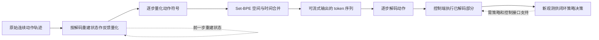
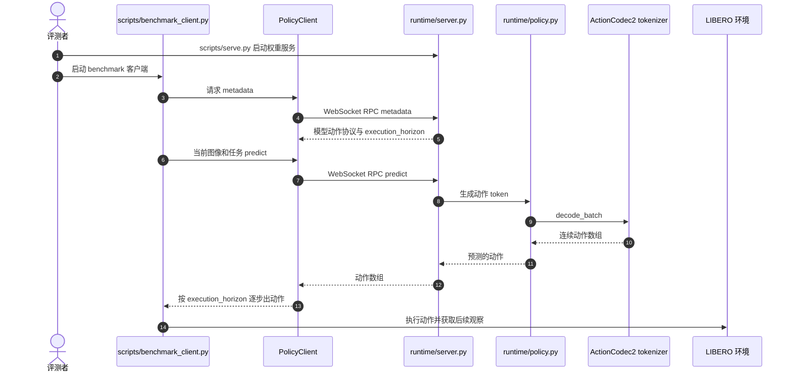

# ActionCodec2: A Streaming Action Tokenizer｜ActionCodec2：流式动作分词器

## 一句话定义

**ActionCodec2** 将动作编码为可逐步消费的 token：针对解码重建状态做误差反馈量化，再以 Set-BPE 压缩空间/时间符号，让 VLA 不必总是等完整 action chunk 输出后才开始执行。

## 英文缩写速查

| 缩写 | 英文全称 | 简要说明 |
|---|---|---|
| VLA | Vision-Language-Action | 多模态机器人动作策略 |
| BPE | Byte Pair Encoding | 本文采用可跨分量合并的 Set-BPE |
| EEF | End Effector | 末端执行器 |
| DROID | Distributed Robot Interaction Dataset | 真机策略训练所用数据 |

## 为什么重要

动作分块虽然压缩长序列，却可能带来周期性等待与过时动作。流式编码使动作生成与执行重叠，并为反馈重规划提供更细的时序粒度。**编码器可流式解码**与**机器人已实现闭环纠偏**是两件事。

## 核心信息

| 项 | 内容 |
|---|---|
| 论文 | [arXiv:2611.15490v1](https://arxiv.org/abs/2611.15490) |
| 项目 | [ActionCodec2](https://zibindong.github.io/actioncodec2-page/) |
| 代码 | [ZibinDong/actioncodec2](https://github.com/ZibinDong/actioncodec2) |
| 开源 | tokenizer 与 VLA 训练/推理代码公开；主体 Apache-2.0，G0.5 适配/派生策略另有限制性许可 |

## 核心原理

1. **误差反馈量化：** 编码当前动作时依据解码器的上一重建状态计算修正，阻止量化残差在长轨迹上不断累积。其界约束的是**编码后轨迹重建误差**，不是执行器实际跟踪误差。
2. **Set-BPE：** 跨坐标维和相邻时刻合并量化符号，以较少 tokens 表示轨迹，但仍保持每个时间步逐步解码和释放。
3. **异步/闭环配套：** 机器人执行最新已释放动作，同时模型继续生成后续动作；更新观测要真正影响未来动作，必须有合适的策略训练、控制接口与同步设计。

### 流程总览

虚线表示系统配套条件或编码内部反馈，并非把编码重建误差当作传感器反馈。

## 源码运行时序图

[源码归档](../../sources/repos/actioncodec2-official.md) 对齐公开的 LIBERO benchmark 执行路径；此图不是作者真机强化学习实验的已复现调用链。

训练脚本 `scripts/train.py` 另行进入 `actioncodec2.vla.train.main`；不要与推理环节混淆。

## 工程实践

1. 核对 action space（关节或 EEF 增量）、旋转表示、单位和动作频率；先量化 `encode → decode` 的轨迹误差。
2. 按 README 安装 Python 3.12、C++17 与相关依赖，确认 G0.5 权重的访问/许可；不要把公开 tokenizer 与商业可自由部署混为一谈。
3. 用 `scripts/serve.py` 启动模型，用 `scripts/benchmark_client.py` 测 LIBERO，并检查 `execution_horizon`、`previous_action`、推理用时与控制执行节拍。
4. 评价执行途中“改主意”时，单列观测延迟、首动作时延、扰动后决策周期、安全停止与物理动作偏差。

## 实验与评测

- DROID 训练、四组未见真机任务，作者每策略合计测 50 次，报告 **ACodec2+ 73.9% 平均任务进度**，FAST **50.8%**、X-Tokenizer **52.8%**。进度指里程碑完成比例，**不等于成功率**。
- 论文还提供不同仿真任务下的流式/分块对照；这些协议的成功率不可与上述真机进度直接合表。
- 应将 **token 数/秒、轨迹重建误差、首动作延迟、任务进度、最终成功与真机控制误差** 分别统计。

## 结论

**流式动作分词可缓解动作 chunk 的等待瓶颈，但实时观测接入和安全纠偏仍取决于策略、反馈与控制系统。**

1. 先验收重建误差，再另测跟踪误差和任务恢复。
2. 同时报告码率与动作输出延迟，避免“压缩率好”被误读为“闭环快”。
3. 不把 73.9% 的里程碑进度写成机器人成功率。
4. 检查官方评测 `execution_horizon`，确保流式执行配置真实生效。
5. 另行完成限位、碰撞、网络中断和伺服安全测试。

## 与其他工作对比

| 工作 | 关键差别 | 阅读提醒 |
|---|---|---|
| ActionCodec2 | 保留逐步解码、反馈量化与 Set-BPE | 编码误差界不保证真机轨迹误差 |
| [FAST](./paper-rcl-2501-09747-fast-efficient-action-tokenization-for-vision-la.md) | 面向整段动作的高效离散化 | 块生成的执行等待需单独评估 |
| [OAT](./paper-oat-ordered-action-tokenization.md) | 关注动作 token 的顺序结构 | 相同延迟和训练条件下才能直接比较 |

## 局限与风险

动态环境是否及时改动作，依赖模型如何接收观测并重新出动作，不会仅因换分词器自动完成。量化界不覆盖接触物理、执行器跟踪及安全约束。公开代码仅静态核对，未下载权重或做真机复现；G0.5 衍生策略另有非商用许可。

## 关联页面

- [2026-11-16 具身前沿 29 篇论文阅读地图](../overview/embodied-frontier-29-papers-2026-11-16.md)

- [动作分词综述](./paper-vla-action-tokenization-survey.md)
- [OAT](./paper-oat-ordered-action-tokenization.md)
- [FAST](./paper-rcl-2501-09747-fast-efficient-action-tokenization-for-vision-la.md)
- [VLA 纵深路线 Stage 4](../../roadmap/depth-vla.md)
- [ManiLadder 分类分难度评测](./paper-maniladder-manipulation-benchmark.md) — 作为未来验证流式动作策略跨任务难度鲁棒性的评测协议参考；**非本文已做的直接对照**

## 参考来源

- [论文原文核读归档](../../sources/papers/actioncodec2-arxiv-2611-15490.md)
- [官方项目](../../sources/sites/actioncodec2-project.md)
- [源码与实际运行入口](../../sources/repos/actioncodec2-official.md)

## 推荐继续阅读

- [论文 HTML](https://arxiv.org/html/2611.15490)
- [代码仓](https://github.com/ZibinDong/actioncodec2)
