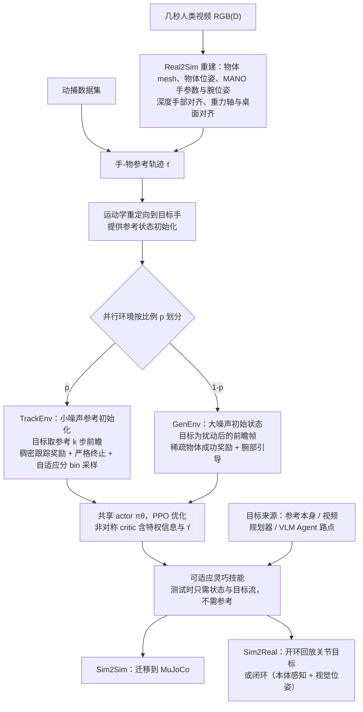

# AdaDex（混合灵巧模仿学习可适应灵巧技能）

## 一句话定义

**AdaDex 从单条数秒的手-物轨迹出发，用「运动跟踪」与「加噪泛化」两类环境共同训练一个策略，让灵巧手技能能够泛化到相似但未见的动作和目标。**

## 英文缩写速查

| 缩写 | 英文全称 | 简要说明 |
|------|----------|----------|
| RL | Reinforcement Learning | 目标条件强化学习框架 |
| HDM | Hybrid Dexterous Mimicking | 本文的混合灵巧模仿训练方式（缩写为本页约定） |
| GRAB | GRAB dataset | 论文使用的手-物抓取动作数据集之一 |
| sim-to-sim | Isaac Gym → MuJoCo | 仿真间零样本迁移的验证方式 |

## 为什么重要

- 灵巧手示范稀缺，而单条轨迹通常只能复现该动作；如何从少量示范得到可调整技能是关键问题。
- 与基线 ManipTrans、SimToolReal 的对比显示，混合训练在动作进度指标上有明显差距（据项目页）。

## 流程总览

图依据：论文 §3.1–§3.3 / Fig.2

## 方法与机制

- **输入：** 单条手-物轨迹（动捕或视频重建）。
- **目标条件 RL：** 一个共享策略在两类环境中训练。
- **运动跟踪环境：** 注入人类运动先验。
- **泛化环境：** 起点与目标加噪，使用稀疏成功奖励。

## 实验与评测

- Seen 动作（GRAB，12 个）：进度 96.74%，ManipTrans 35.20%，SimToolReal 9.72%。
- 相似未见动作（24 个）：AdaDex 跟踪进度 80.02%，去除泛化环境的消融版本为 31.75%；ManipTrans 7.28%，SimToolReal 13.68%。实验针对 GRAB 的 12 个物体，每个物体用一条动作训练、两条相似动作测试，每条动作评估 128 次。跟踪进度是首次失败时步占轨迹总长的比例；物体位置误差超过 5 cm 或姿态误差超过 20° 即判失败，并非成功率。
- 随机目标到达：进度 51.80%（SimToolReal 44.60%），成功率 27.08%（SimToolReal 31.71%）。
- 真实到仿真跟踪（9 段野外动作）：进度 80.53%，ManipTrans 31.70%。
- 迁移：Isaac Gym → MuJoCo 零样本闭环；真机 arm-hand 30 Hz。

## 与其他工作对比

- 与 ManipTrans：多数指标上明显更高（据项目页）。
- 与 SimToolReal：进度指标在多数设置更高，但随机目标到达的成功率低于 SimToolReal（27.08% 对 31.71%）。论文强调进度与成功率需分别看。

## 结论

本文的核心是用混合训练把「跟踪人类动作」与「泛化到新起点和目标」放进同一个策略。

- 单条轨迹可以作为技能种子，但泛化依赖加噪起点与目标的训练环境。
- 进度指标提升明显，但随机目标的成功率并未全面领先，应分开读。
- 代码未公开，结果当前只能依据论文与项目页核对。

## 工程实践

- 代码：项目页标注 coming soon，未发布仓库；源码运行时序图不适用。
- 复现前需要：手-物轨迹（动捕或视频重建）、物体网格和仿真环境配置；论文使用 Isaac Gym 训练。

## 局限与风险

- 代码未公开，无法独立复现。
- 随机目标到达成功率低于 SimToolReal，泛化场景的稳定性仍需更多证据。
- 推测：依赖单条人类轨迹的重建质量，视频重建误差会直接进入训练目标。

## 关联页面

- [Manipulation（操作任务）](../tasks/manipulation.md) — 灵巧手操作的任务背景
- [SPIDER：物理引导的灵巧重定向](../methods/spider-physics-informed-dexterous-retargeting.md) — 同样面向灵巧手与人类手-物轨迹的对照方法
- [Motion Retargeting](../concepts/motion-retargeting.md) — 人手到灵巧手的运动适配背景

## 参考来源

- [AdaDex 论文来源归档](../../sources/papers/adadex_arxiv_2610_28628.md)
- [arXiv PDF](https://arxiv.org/pdf/2610.28628)：已通读方法部分（实验与附录以略读为准）：§1、§3.1–§3.3、§4 开头（附录 B 重建细节未读）

## 推荐继续阅读

- [arXiv 2610.28628](https://arxiv.org/abs/2610.28628)
- [项目页](https://yuxuank.com/AdaDex/)
